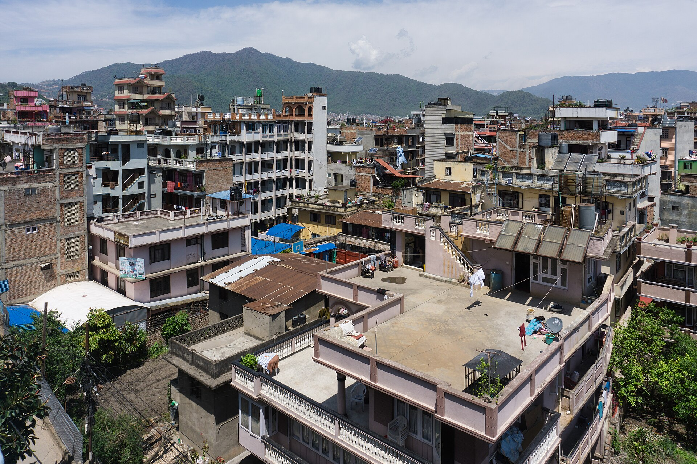
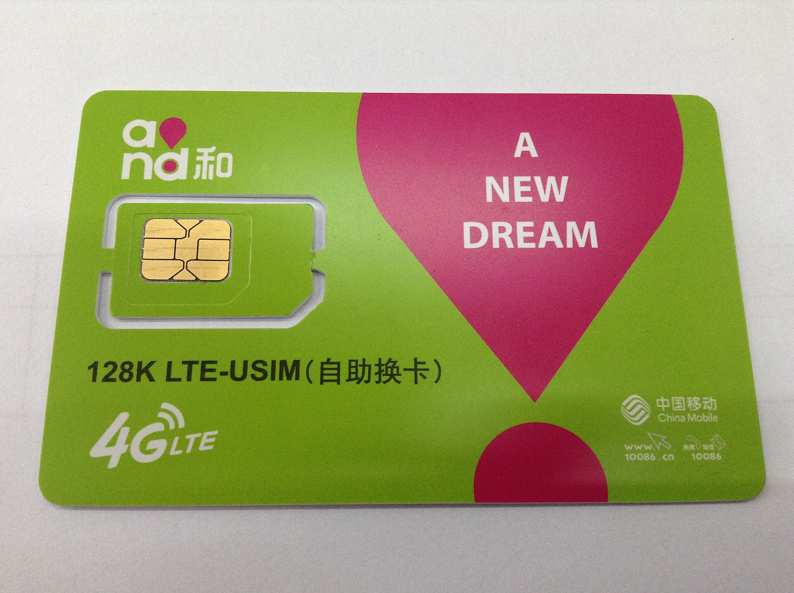

Some sites have no internet line: a farm, a building site, a hillside shop or a store far from the main road. A 4G SIM camera suits these. It has a SIM slot and a built-in 4G module, joins the mobile network like a phone and sends video to an app. This guide covers what the cameras cost in Nepal, how much data they use, what NTC and Ncell charge for data, and what to check before you buy.

For sites with no power as well, read [solar CCTV cameras in Nepal](/blog/solar-cctv-camera-nepal). Where broadband exists, a wired or WiFi camera uses no mobile data. See [WiFi vs wired cameras](/blog/wifi-vs-wired-cctv-camera).

## How a 4G camera works

1. You put a data SIM in the camera.
2. The camera connects to the mobile network.
3. It reaches the maker's service, and your phone app connects to the same service.
4. Video travels from the camera to the service to your phone, over mobile data.

Most 4G cameras also take a memory card, so they keep recording if the signal drops. Eufy's guide on camera data use says a locally recording camera may use data only for alerts, live view and downloads, while continuous cloud recording uses a much larger allowance ([Eufy](https://www.eufy.com/uk/blogs/security-camera/how-much-data-does-a-security-camera-use-a-month)).

## Prices in Nepal

Daraz Nepal listings I opened on 19 October 2026.

| Item | Key spec | Seller | Price (Rs) | Source | Checked |
|---|---|---|---|---|---|
| 8 MP (4+4) MP Dual Lens 4G IP Night Vision Camera Surveillance 1080P Full HD Automatic... | 8 MP (4+4) dual lens, 4G | Lagankhel Gadgets | 3,799 | [Daraz](https://www.daraz.com.np/products/8-mp-44-mp-dual-lens-4g-ip-night-vision-camera-surveillance-1080p-full-hd-automatic-outdoor-smarthome-cctv-camera-v380-pro-two-way-audio-i172022686.html) | 19 Oct 2026 |
| V380 Dual Lens Camera Monitor Home Outdoor HD Phone Remote PTZ WiFi 4G Camera Night Vision... | V380 dual lens, WiFi and 4G | Mr.Deals Nepal | 3,895 | [Daraz](https://www.daraz.com.np/products/v380-dual-lens-camera-monitor-home-outdoor-hd-phone-remote-ptz-wifi-4g-camera-night-vision-gun-and-ball-camera-for-home-360-view-i397007610.html) | 19 Oct 2026 |
| V380 Dual Lens Camera Monitor Home Outdoor HD Phone Remote PTZ WiFi 4G Camera Night Vision... | V380 dual lens, WiFi and 4G | Sujata Store | 5,000 | [Daraz](https://www.daraz.com.np/products/v380-dual-lens-camera-monitor-home-outdoor-hd-phone-remote-ptz-wifi-4g-camera-night-vision-gun-and-ball-camera-for-home-360-view-i172775747.html) | 19 Oct 2026 |
| 4G Sim Card Support Dual Lens WIFI IP Camera Outdoor IP66 Waterproof | 4G SIM dual lens, IP66 | T&T Traders | 4,399 | [Daraz](https://www.daraz.com.np/products/4g-sim-card-support-dual-lens-wifi-ip-camera-outdoor-ip66-waterproof-i295977844.html) | 19 Oct 2026 |
| V380 Pro New 3 Lens and 3 Screens 4G PTZ Camera 6MP Wireless IP Triple-Lens Network PTZ... | V380 Pro 3 lens, 4G PTZ, 6 MP | YACHU PASAL | 4,500 | [Daraz](https://www.daraz.com.np/products/v380-pro-new-3-lens-and-3-screens-4g-ptz-camera-6mp-wireless-ip-triple-lens-network-ptz-triple-screens-camera-i452604712.html) | 19 Oct 2026 |
| Wifi 4MP Dual Lens 4G IP Night Vision Camera Surveillance 1080P Full HD Automatic Outdoor... | 4 MP dual lens, 4G | DIGITAL ZONE | 4,949 | [Daraz](https://www.daraz.com.np/products/wifi-4mp-dual-lens-4g-ip-night-vision-camera-surveillance-1080p-full-hd-automatic-outdoor-smarthome-ptz-cctv-camera-v380-pro-i364956540.html) | 19 Oct 2026 |
| EZVIZ H8C 4G 3MP Smart Home Camera | 3 MP, 4G | NEPAL CCTV SALES | 11,500 | [Daraz](https://www.daraz.com.np/products/ezviz-h8c-4g-3mp-smart-home-camera-i130039364.html) | 19 Oct 2026 |
| EZVIZ H9C 3K(5MP+5MP) Dual-Lens Pan & Tilt 4G,Wi-Fi/Wired CCTV Camera(SD Card Not Included) | 5+5 MP dual lens, 4G and WiFi, SD card not included | Laliguras Digital Art and Multi Services | 11,663 | [Daraz](https://www.daraz.com.np/products/ezviz-h9c-3k5mp5mp-dual-lens-pan-tilt-4gwi-fiwired-cctv-camerasd-card-not-included-i168669916.html) | 19 Oct 2026 |
| DS-2DE2C400MWG-4G | 4 MP pan and tilt, 4G, IP66 | नेपाल वाङ चेङ ट्रेड | 18,000 | [Daraz](https://www.daraz.com.np/products/hikvision-fixed-outdoor-smart-pt-pan-tilt-ds-2de2c400mwg-4g-i1546504817.html) | 19 Oct 2026 |
| 4G Network Camera 4MP IR Fixed-focal Bullet WizSense DHI-IPC-HFW3441DG-AS-4G-EAU-B | 4 MP bullet, 4G, H.265, 8 GB onboard memory | Enroz Store | 24,500 | [Daraz](https://www.daraz.com.np/products/4g-network-camera-4mp-ir-fixed-focal-bullet-wizsense-dhi-ipc-hfw3441dg-as-4g-eau-b-i142572779.html) | 19 Oct 2026 |
| 4MP IR Fixed-focal Bullet 4G Solar Power Network Camera | 4 MP bullet, 4G solar | FonePortal | 34,200 | [Daraz](https://www.daraz.com.np/products/4mp-ir-fixed-focal-bullet-4g-solar-power-network-camera-i509254924.html) | 19 Oct 2026 |

Points from the table:

- The same V380 dual lens listing is Rs 3,895 from Mr.Deals Nepal and Rs 5,000 from Sujata Store, a gap of Rs 1,105 or 28 percent.
- Branded cameras sit higher. The Ezviz H8C 4G lists at Rs 11,500 and the Ezviz H9C 4G at Rs 11,663 (SD card not included).
- The Hikvision 4 MP pan and tilt 4G (DS-2DE2C400MWG-4G) lists at Rs 18,000. Its Nepali listing says IP66 and up to 512 GB on a memory card.
- The Dahua 4 MP 4G bullet lists at Rs 24,500 with a built-in 4G module, 8 GB of internal memory, up to 256 GB on a card, H.265 and IP67.
- A 4G camera with built-in solar power is the most expensive row, at Rs 34,200.
- Cheap listings are often the same hardware sold under different titles. Read the specification and warranty, not the headline.

## How much data a camera uses

Eufy's guide gives the formula: monthly data in GB = bitrate in Mbps x 3,600 x active hours a day x days a month / 8 / 1,000. Add a margin of about 10 to 20 percent for thumbnails, connection overhead, live viewing and downloads. Its worked example is a 1080p camera averaging 1.5 Mbps that uploads two hours of motion clips a day: 40.5 GB a month, about 44.6 GB with a 10 percent allowance, and 486 GB a month if it uploaded continuously ([Eufy](https://www.eufy.com/uk/blogs/security-camera/how-much-data-does-a-security-camera-use-a-month)).

Using the same formula for other cases:

| Use | Calculation | Data |
|---|---|---|
| Live view, 1 Mbps, 1 hour | 1 x 3,600 x 1 / 8 / 1,000 | 0.45 GB |
| Live view, 0.5 Mbps, 1 hour | 0.5 x 3,600 / 8 / 1,000 | 0.225 GB |
| One 10 second clip at 2 Mbps | 2 x 10 / 8 | 2.5 MB |
| 50 such clips a day for 30 days | 125 MB x 30 | 3.75 GB a month |
| Those clips plus 30 minutes of live view a day at 1 Mbps | 3.75 + 6.75 | 10.5 GB a month |
| Eufy's example: 2 hours a day at 1.5 Mbps | 1.5 x 3,600 x 2 x 30 / 8 / 1,000 | 40.5 GB a month |
| Continuous upload at 1.5 Mbps | Eufy's example | 486 GB a month |
| Continuous upload at 1 Mbps | 1 x 3,600 x 24 x 30 / 8 / 1,000 | 324 GB a month |

Eufy also gives a planning range per camera: roughly 1 to 20 GB a month for light motion-triggered use, 20 to 100 GB for frequent events and live viewing, and 300 GB to more than 2 TB for continuous transmission. The clip and live view rows above are my own arithmetic on stated assumptions, so check the real bitrate in your camera's settings. The [bitrate](/glossary/bitrate) entry and [storage guide](/blog/cctv-hard-disk-recording-days) explain more.

The conclusions: continuous upload over 4G is out of reach for any pack listed below, since 324 GB is more than the 100 GB pack. Motion clips, snapshots and short live checks are affordable, with local recording to a card for the rest.

## What NTC and Ncell charge for data

NTC and Ncell publish current packs in their apps and on USSD menus, and I could not open those pages. The figures below are from NepaliTelecom's 2026 pack pages, a third-party site that lists them. Prices change with offers, so confirm in the operator's app before you plan.

| Operator | Pack | Price (Rs) | Validity | Rs per GB |
|---|---|---|---|---|
| NTC | 1 GB | 30 | 1 day | 30 |
| NTC | 5 GB | 109 | 7 days | 21.8 |
| NTC | 20 GB | 399 | 30 days | 19.95 |
| NTC | 100 GB | 999 | 30 days | 9.99 |
| NTC | pay-as-you-go | 1 per MB | none | 1,000 |
| Ncell | 6 GB | 129 | 7 days | 21.5 |
| Ncell | 7 GB | 150 | 7 days | 21.4 |
| Ncell | Sadhai ON recurring, 8 GB to 100 GB | 399 to 1,499 | recurring | 49.9 to 15.0 |
| Ncell | pay-as-you-go | 1 per MB (1.3 with tax) | none | 1,000 |

Sources: [NepaliTelecom NTC data packs](https://nepalitelecom.com/2019/11/ntc-data-pack.html) and [NepaliTelecom Ncell data packs](https://www.nepalitelecom.com/ncell-double-majja-pack). The NTC page also lists the 1 GB pack as Rs 29 in its summary and Rs 30 in its table, so it is not consistent with itself. The Rs per GB column is price divided by volume.

NTC's page also lists recurring and unlimited packs that matter for a camera that sends a lot of video ([NepaliTelecom](https://nepalitelecom.com/2019/11/ntc-data-pack.html)).

| NTC pack | Price (Rs) | What the page says |
|---|---|---|
| Recurring, 1 GB a day | 349 | 30 GB over 30 days |
| Recurring, 2 GB a day | 599 | 60 GB over 30 days |
| Unlimited, 5 Mbps | 999 | 30 days |
| Unlimited, 1 Mbps | 49 | 1 day |
| Unlimited, 5 Mbps | 89 | 1 day |

The page says the night unlimited pack has a fair usage policy that throttles to 256 kbps after 1 GB at full speed, and the 2 hour unlimited pack throttles to 512 kbps after 2 GB. A camera is a continuous load, so ask NTC whether the 30 day 5 Mbps unlimited pack has a fair usage limit before you rely on it. If it has none, 324 GB a month for a 1 Mbps stream would fit; the page does not say.

Fit to a camera: the 10.5 GB a month case (clips plus 30 minutes of live view a day) fits inside NTC's 20 GB pack at Rs 399 for 30 days, with room for overhead. The 40.5 GB case needs the 100 GB pack at Rs 999. Pay-as-you-go at Rs 1 per MB is Rs 1,000 a GB, so a camera must never run on it.

## Does 4G cover your site?

I found no Nepal coverage map by location. NepaliTelecom's frequency page says NTC launched 4G on 1 January 2017 on 1800 MHz and uses 1800 MHz and 800 MHz for its 4G network, that Ncell launched 4G on 1 June 2017, and that Ncell also runs 4G on 900 MHz to improve coverage, and that NTC 4G has reached more than 92 percent of local levels in all 77 districts ([NepaliTelecom](https://nepalitelecom.com/2016/07/frequency-bands-in-nepal-for-mobile.html)). That is a third-party summary, so treat it as background. Coverage in a given valley or on a given hillside is what counts.

1. Take a phone with each operator's SIM to the exact spot where the camera will go.
2. Run a speed test and read the upload speed, because video needs upload.
3. Test at the height the camera will be mounted.
4. Test at different times of day.

## What to check before you buy

| Check | Why |
|---|---|
| Supported bands | Ask the seller which LTE bands the camera supports and match them against 1800 MHz (NTC and Ncell), 900 MHz (Ncell) and 800 MHz (NTC) |
| SIM slot | Some listings sell WiFi-only and 4G-only versions of the same camera. A Daraz solar camera listing says the WiFi version has no SIM slot and the 4G version does not support WiFi |
| Power | Mains, battery or solar. See the [solar guide](/blog/solar-cctv-camera-nepal) |
| Memory card | Local recording. Dahua's 4G listing gives up to 256 GB, Hikvision's 4G pan and tilt up to 512 GB, Ezviz H9C up to 512 GB |
| App and cloud | Where video goes, and whether the app needs a paid plan |
| Standard stream | ONVIF or RTSP lets a camera join other systems |
| Warranty | Who repairs it |
| Password | Change the default at first use |

## Security

A camera that reaches the internet over a SIM is on the internet whatever you do. Change the default password at once (see [default passwords](/blog/default-passwords-cctv-cameras)), update the firmware, and use the maker's app with a strong account password. Hikvision says it recommends keeping devices on the latest firmware because updates fix bugs and patch security issues ([source](https://supportusa.hikvision.com/support/solutions/articles/17000128914-my-hikvision-devices-are-behind-on-firmware-what-is-hikvision-s-stance-on-firmware-upgrades-)).

## Seeing 4G cameras next to your others

Many 4G cameras sold in Nepal have their own app, so a site with a 4G camera, a wired recorder and a WiFi camera can end up with three apps. If the camera offers ONVIF or RTSP, it can join other cameras in one app. The [LunaCam Box](/products/lunacam-box) connects recorders and ONVIF or RTSP cameras to the LunaCam app. A camera with only its own app cannot be added that way, so check before you buy. See [watch your DVR from your phone](/blog/watch-dvr-from-phone-nepal) and the [ONVIF and RTSP guide](/blog/onvif-rtsp-one-app-many-brands).

## When 4G is the wrong choice

- Where broadband exists. A wired or WiFi camera uses no mobile data.
- For many cameras on one site. Four cameras each sending clips multiply the data, so use a recorder and one connection.
- Where footage must be kept for months. A memory card holds days at normal bitrates. See [how long to keep footage](/blog/how-long-to-keep-cctv-footage).

## Sources

- [Eufy: how much data does a security camera use a month](https://www.eufy.com/uk/blogs/security-camera/how-much-data-does-a-security-camera-use-a-month)
- [NepaliTelecom: NTC data packs 2026](https://nepalitelecom.com/2019/11/ntc-data-pack.html)
- [NepaliTelecom: Ncell data packs 2026](https://www.nepalitelecom.com/ncell-double-majja-pack)
- [NepaliTelecom: Frequency bands in Nepal for mobile](https://nepalitelecom.com/2016/07/frequency-bands-in-nepal-for-mobile.html)
- [Hikvision support: firmware stance](https://supportusa.hikvision.com/support/solutions/articles/17000128914-my-hikvision-devices-are-behind-on-firmware-what-is-hikvision-s-stance-on-firmware-upgrades-)
- Daraz Nepal listings, linked in the table above.
