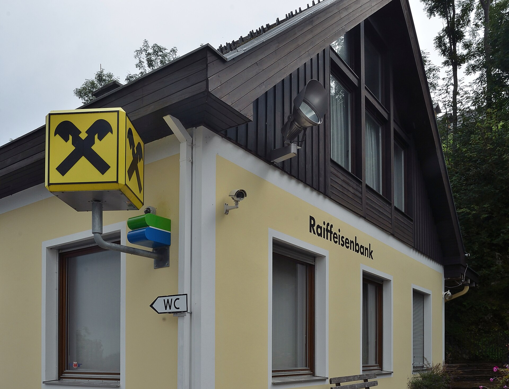

A bank with three branches can manage cameras by memory. A bank with forty cannot.

## What goes wrong

- **Mixed recorders.** Branches bought what was available when they opened, so there are several brands and ages.
- **Silent failures.** A disk fills or a camera dies, and nobody knows until footage is needed.
- **No record of access.** People ask a branch for footage over the phone and receive it on a USB stick.
- **No single place to answer police.** Each request becomes a scramble.

## What a console should give head office

1. **An organisation tree.** Head office, provinces, branches, zones and cameras.
2. **Roles and permissions per action.** Live, playback, export, PTZ and delete, each controlled on its own.
3. **Scope by site and shift.** A guard sees one branch, during his shift.
4. **A command dashboard.** Sites, open alarms and offline devices.
5. **An audit log.** Sign-ins, live views, playback, exports and configuration changes.
6. **Evidence handling.** Bookmarks, cases, hashed exports and legal hold. See [exporting evidence that stands up](/blog/cctv-evidence-export-nepal).

## Connecting what you have

You do not need to replace branch recorders. A LunaCam Box or agent at each branch connects them out to the console. See [LunaCam for banks](/solutions/banks).

## Integration

Alarms and events can feed your own systems through signed webhooks and the event stream. See the [developer platform](/products/developer-platform).
