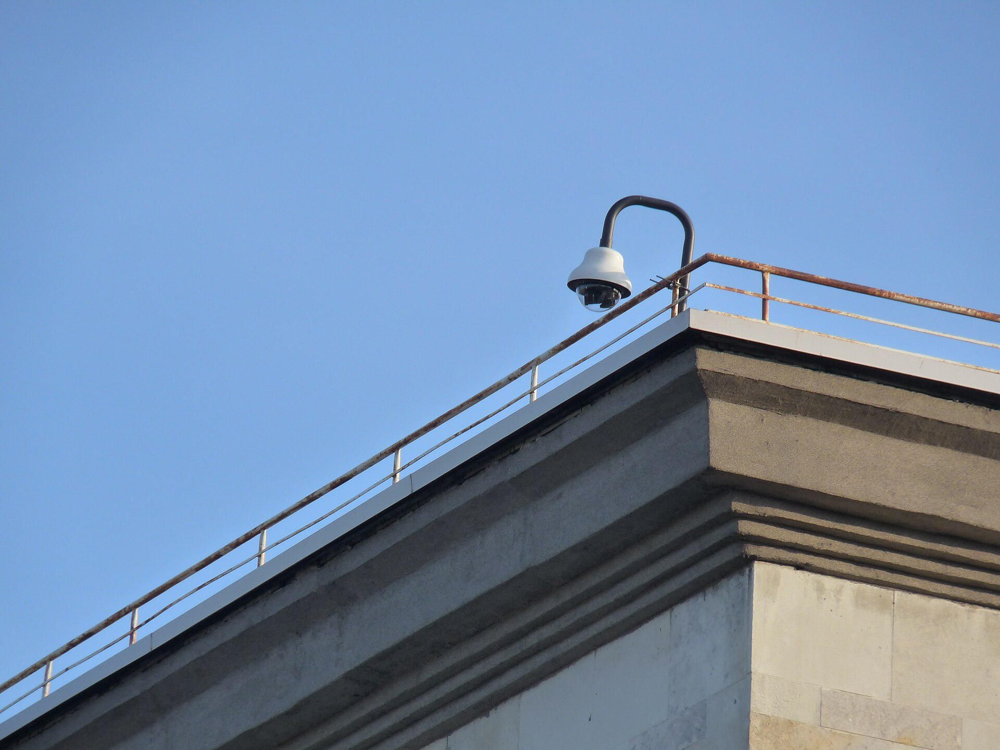
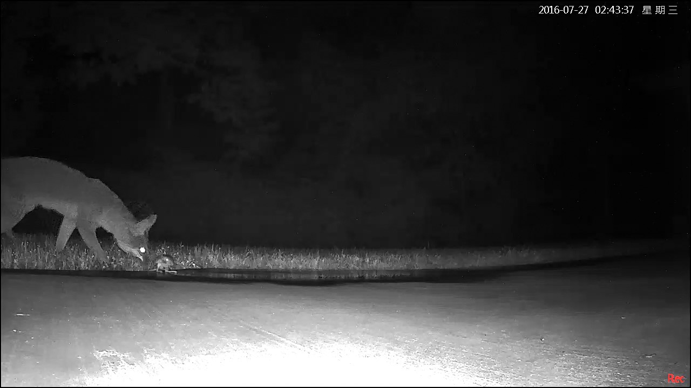

People mute their camera app within a week. Too many alerts about nothing teach you to ignore the one that matters.

## The three worth always keeping

1. **Camera offline.** If a camera is down, nothing is recording from it. You want to know the same day.
2. **Disk warning.** A DVR that cannot write stops recording, usually without telling anyone.
3. **Tamper or cover.** A camera pointed at a wall is a camera that has been dealt with.

## The ones to tune

- **Motion.** Fine in an empty shop at night. Useless in a busy street. Use zones and arm only when nobody should be there.
- **Person and vehicle.** Better than raw motion where available. LunaCam's person and vehicle detection is rolling out next.

## Arming: Home, Away, Disarm

Set what each mode alerts on. Away at night for the shop. Home for the house in the evening, with the garden cameras only. Disarm in the morning. Schedules switch it for you, and quiet hours stop non-urgent alerts.

## A picture with every alert

An alert that says "Motion at Back gate" makes you open the app. One that arrives with a snapshot lets you decide in a second.

## For operators

An alarm queue adds priority, assignment and a checklist beside each alarm, and escalates when nobody acknowledges within five minutes. See [Alerts and Alarms](/products/alerts), and for public cameras read [running public cameras in a municipality](/blog/municipal-cctv-operations).
