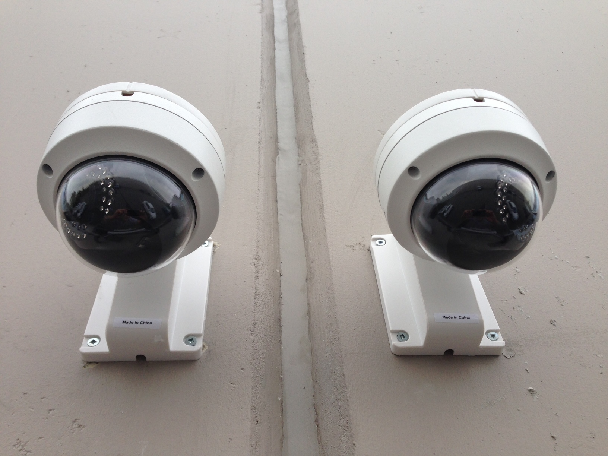
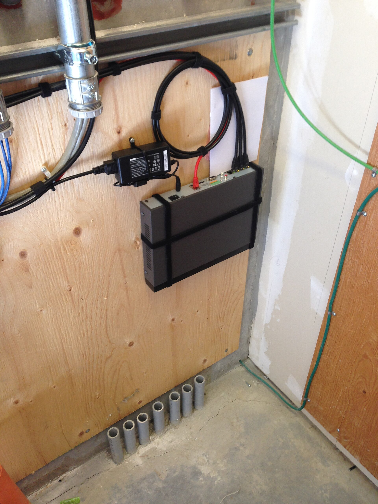
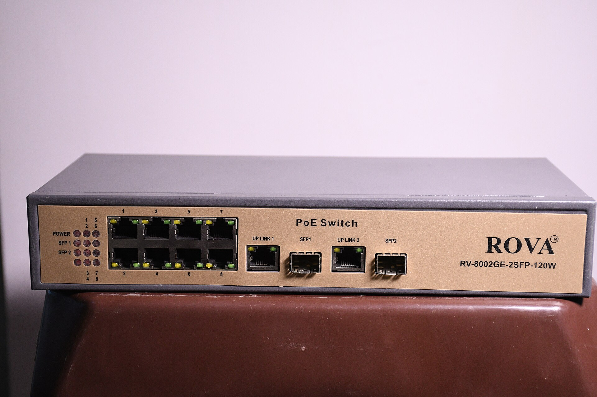
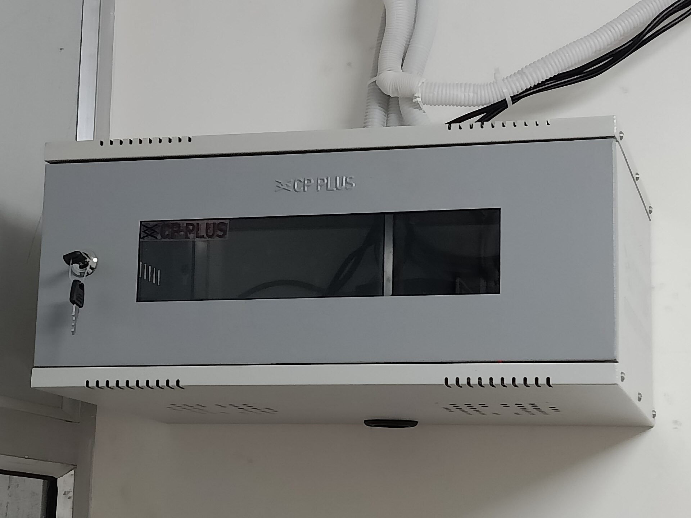

People search for the price of one camera and then find the bill is several times higher. This guide prices the whole system from real listings, so you can see which parts cost what and how far the same part varies between sellers.

For how to choose a camera, read [choosing CCTV cameras](/blog/choosing-cctv-cameras-nepal). This page is about cost only.

## How these prices were collected

Every price below is a live listing on [Daraz Nepal](https://www.daraz.com.np) that I opened on 19 October 2026. Each row gives the exact listing title, the seller, the price in rupees and a link to that listing. Daraz is a marketplace, so the same product has several sellers, each with its own price and warranty. Where a model appears under more than one seller, the table shows all of them.

Three limits apply.

- Listing prices change often, and a listing can sell out. Treat a price as a guide for what the market looked like on the date shown.
- A Daraz listing is a retail price. A dealer quote for a whole job can differ.
- I found no published Nepal price for installation labour. Searches turned up government project budgets and Indian forum quotes, none of which gives a per camera rate. This page does not guess one.

## What a full system is made of

A Daraz kit listing shows what a seller counts as a complete system. The Hikvision 4 channel package at Rs 22,470 lists these parts: 2 indoor dome cameras (DS-2CE76D0T-EXLPF), 2 outdoor bullet cameras (DS-2CE16D0T-EXLPF), a 4 channel DVR (DS-7104HGHI-M1/T), 45 meters of CCTV cable, a 500 GB hard disk, BNC and DC connectors and a Hikvision 5 A power supply.

That gives the parts list you should price in any quote.

1. Cameras.
2. A recorder: a DVR for analog HD cameras or an NVR for network (IP) cameras.
3. A hard disk.
4. Cable: coaxial for analog HD, network cable for IP.
5. Power: a power supply, or a PoE switch for IP cameras.
6. Connectors and junction boxes.
7. Labour.

## Analog HD cameras

Analog HD cameras (HD-TVI, HDCVI, AHD) send video over coaxial cable to a DVR. The [analog HD camera](/glossary/analog-hd-camera) entry explains the formats. These are 2 MP models from Hikvision and Dahua.

| Item | Key spec | Seller | Price (Rs) | Source | Checked |
|---|---|---|---|---|---|
| Hikvision 2 MP Smart Hybrid Light Indoor Fixed Turret Camera (DS-2CE76DOT-EXLPF) Need DVR... | 2 MP turret, indoor | Laliguras Digital Art and Multi Services | 2,300 | [Daraz](https://www.daraz.com.np/products/hikvision-2-mp-smart-hybrid-light-indoor-fixed-turret-camera-ds-2ce76dot-exlpf-need-dvr-for-setup-i104800539.html) | 19 Oct 2026 |
| Hikvision 2 MP Indoor Fixed Turret Camera DS-2CE76D0T-EXIPF | 2 MP turret, indoor | Modern Digitech Nepal Pvt Ltd | 2,499 | [Daraz](https://www.daraz.com.np/products/hikvision-2-mp-indoor-fixed-turret-camera-ds-2ce76d0t-exipf-i129490563.html) | 19 Oct 2026 |
| HIKVISION ECO DS-2CE56DOT-IP HD 2MP IR Dome Turbo HD CCTV Camera | 2 MP IR dome | Galaxy Techno Vision | 2,899 | [Daraz](https://www.daraz.com.np/products/hikvision-eco-ds-2ce56dot-ip-hd-2mp-ir-dome-turbo-hd-cctv-camera-i119424546.html) | 19 Oct 2026 |
| HIKVISION HD TVI CAMERA 2MP IR Dome Turbo HD Camera ECO DS-2CE56DOT-IP\ECO | 2 MP IR dome | Click ON | 2,999 | [Daraz](https://www.daraz.com.np/products/hikvision-hd-tvi-camera-2mp-ir-dome-turbo-hd-camera-eco-ds-2ce56dot-ipeco-i128373059.html) | 19 Oct 2026 |
| HIKVISION HD TVI CAMERA 2MP IR Dome Turbo HD Camera ECO DS-2CE56DOT-IP\ECO | 2 MP IR dome | A.R.S | 2,999 | [Daraz](https://www.daraz.com.np/products/hikvision-hd-tvi-camera-2mp-ir-dome-turbo-hd-camera-eco-ds-2ce56dot-ipeco-i128391823.html) | 19 Oct 2026 |
| Hikvision 2 MP Smart Hybrid Light Fixed Mini Bullet Camera (DS-2CE16DOT-EXLPF ) Need DVR... | 2 MP mini bullet | Laliguras Digital Art and Multi Services | 2,750 | [Daraz](https://www.daraz.com.np/products/hikvision-2-mp-smart-hybrid-light-fixed-mini-bullet-camera-ds-2ce16dot-exlpf-need-dvr-for-setup-i104768019.html) | 19 Oct 2026 |
| Hikvision 2 MP Fixed Mini Bullet Camera DS-2CE16D0T-EXIPF | 2 MP mini bullet | Next Trade Link | 3,500 | [Daraz](https://www.daraz.com.np/products/hikvision-2-mp-fixed-mini-bullet-camera-ds-2ce16d0t-exipf-i169890997.html) | 19 Oct 2026 |
| Dahua Wired 2MP 20 Mtrs HD Dome Camera DH-HAC-T1A21P | 2 MP dome, 20 m IR | Lighting & Security | 2,500 | [Daraz](https://www.daraz.com.np/products/dahua-wired-2mp-20-mtrs-hd-dome-camera-dh-hac-t1a21p-i296077393.html) | 19 Oct 2026 |
| 2MP HDCVI IR Bullet Camera DH-HAC-B1A21P | 2 MP bullet | Enroz Store | 2,749 | [Daraz](https://www.daraz.com.np/products/2mp-hdcvi-ir-bullet-camera-dh-hac-b1a21p-i503042880.html) | 19 Oct 2026 |
| DH-HAC-HFW1200CP-A 2MP HDCVI IR Bullet Camera | 2 MP bullet, audio | Enroz Store | 3,691 | [Daraz](https://www.daraz.com.np/products/dh-hac-hfw1200cp-a-2mp-hdcvi-ir-bullet-camera-i141810762.html) | 19 Oct 2026 |

What the rows show:

- The same Hikvision ECO dome (DS-2CE56D0T-IPF ECO) lists at Rs 2,899 from Galaxy Techno Vision and Rs 2,999 from Click ON and A.R.S. That is a Rs 100 spread, or 3.4 percent.
- The Hikvision mini bullet is Rs 2,750 from Laliguras and Rs 3,500 from Next Trade Link, but the model codes differ (EXLPF against EXIPF), so they are not the same camera.
- Dahua's DH-HAC-T1A21P dome at Rs 2,500 and the DH-HAC-B1A21P bullet at Rs 2,749 are the lowest priced Dahua rows found. The Hikvision turret at Rs 2,300 is the lowest overall.

### Colour at night

Colour at night cameras (Hikvision ColorVu, Dahua Full-color) cost more than standard infrared models.

| Item | Key spec | Seller | Price (Rs) | Source | Checked |
|---|---|---|---|---|---|
| HIKVISION 2MP ColorVu Bullet Camera DS-2CE10DF0T-PF 3.6MM IP67 + USEWELL BNC DC, White | 2 MP ColorVu bullet | Click ON | 3,399 | [Daraz](https://www.daraz.com.np/products/hikvision-2mp-colorvu-bullet-camera-ds-2ce10df0t-pf-36mm-ip67-usewell-bnc-dc-white-i129351614.html) | 19 Oct 2026 |
| 2MP ColorVU Bullet Camera DS-2CE10DF0T-PF | 2 MP ColorVu bullet | Next Trade Link | 3,499 | [Daraz](https://www.daraz.com.np/products/2mp-colorvu-bullet-camera-ds-2ce10df0t-pf-i165783239.html) | 19 Oct 2026 |
| Hikvision 2 MP ColorVu Audio Indoor Dome Camera ( DS-2CE70DFOT-PFS Need DVR To Set Up) | 2 MP ColorVu dome with audio | Laliguras Digital Art and Multi Services | 4,045 | [Daraz](https://www.daraz.com.np/products/hikvision-2-mp-colorvu-audio-indoor-dome-camera-ds-2ce70dfot-pfs-need-dvr-to-set-up-i104776058.html) | 19 Oct 2026 |
| DAHUA 2MP Full-color Starlight HDCVI Camera DH-HAC-HDW1209TLQP-LED DAHUA 2MP Full-color... | 2 MP Full-color Starlight | Enroz Store | 4,120 | [Daraz](https://www.daraz.com.np/products/dahua-2mp-full-color-starlight-hdcvi-camera-dh-hac-hdw1209tlqp-led-dahua-2mp-full-color-starlight-hdcvi-i141839261.html) | 19 Oct 2026 |

The ColorVu dome with audio at Rs 4,045 (it also has a microphone) costs Rs 1,046 more than the standard Hikvision IR dome at Rs 2,999, a 35 percent premium. The Dahua Full-color camera at Rs 4,120 costs Rs 1,371 more than the Dahua bullet at Rs 2,749. The same ColorVu bullet (DS-2CE10DF0T-PF) lists at Rs 3,399 from Click ON and Rs 3,499 from Next Trade Link.

## Network (IP) cameras

IP cameras connect by network cable, and most take power from the cable (PoE). See the [IP camera](/glossary/ip-camera) and [PoE](/glossary/poe) entries.

| Item | Key spec | Seller | Price (Rs) | Source | Checked |
|---|---|---|---|---|---|
| IPC-B121H-C 2 MP Fixed Bullet Network Camera-Hikvision (HI-LOOK) | 2 MP bullet | Enroz Store | 3,375 | [Daraz](https://www.daraz.com.np/products/ipc-b121h-c-2-mp-fixed-bullet-network-camera-hikvision-hi-look-i512048956.html) | 19 Oct 2026 |
| Uniarch 2MP Entry series fixed IR Bullet Network Camera Outdoor IP CCTV Camera | 2 MP bullet | Mangaldeep Multi Business Pvt ltd | 3,860 | [Daraz](https://www.daraz.com.np/products/uniarch-2mp-entry-series-fixed-ir-bullet-network-camera-outdoor-ip-cctv-camera-i1519821051.html) | 19 Oct 2026 |
| UNV IPC3612LB-ADF28K-G 2MP HD IR Fixed Eyeball Network Camera | 2 MP eyeball | Mangaldeep Multi Business Pvt ltd | 5,200 | [Daraz](https://www.daraz.com.np/products/unv-ipc3612lb-adf28k-g-2mp-hd-ir-fixed-eyeball-network-camera-i509041841.html) | 19 Oct 2026 |
| 2MP Full HD IR Network Bullet Camera - 30Mtr. (CP-UNC-TA21PL3-Y) | 2 MP bullet, 30 m IR | CP PLUS NEPAL | 5,300 | [Daraz](https://www.daraz.com.np/products/2mp-full-hd-ir-network-bullet-camera-30mtr-cp-unc-ta21pl3-y-i146220333.html) | 19 Oct 2026 |
| 2MP Entry IR Fixed-focal Bullet Network Camera Dahua DH-IPC-HFW1230TC1 | 2 MP bullet | Enroz Store | 5,870 | [Daraz](https://www.daraz.com.np/products/2mp-entry-ir-fixed-focal-bullet-network-camera-dahua-dh-ipc-hfw1230tc1-i502848071.html) | 19 Oct 2026 |
| Hikvision 2MP CCTV Camera POE IP Bullet H265+ DS-2CD1023G0E-I Outdoor Network Camera WDR... | 2 MP bullet, PoE, H.265+ | Laliguras Digital Art and Multi Services | 5,581 | [Daraz](https://www.daraz.com.np/products/hikvision-2mp-cctv-camera-poe-ip-bullet-h265-ds-2cd1023g0e-i-outdoor-network-camera-wdr-exir-need-nvr-to-operate-i104792466.html) | 19 Oct 2026 |
| Hikvision 2Mp Dome Cctv Camera DS-2CD1123GOE-I | 2 MP dome | Deep Brothers | 6,499 | [Daraz](https://www.daraz.com.np/products/hikvision-2mp-dome-cctv-camera-ds-2cd1123goe-i-i124844982.html) | 19 Oct 2026 |
| 2 MP Fixed Bullet Network Camera DS-2CD1T23G0-I Hikvision | 2 MP bullet | Enroz Store | 6,700 | [Daraz](https://www.daraz.com.np/products/2-mp-fixed-bullet-network-camera-ds-2cd1t23g0-i-hikvision-i503527436.html) | 19 Oct 2026 |
| Uniview IPC2124SR3-DPF36 4MP IR H.265 Outdoor Mini Bullet IP Security Camera | 4 MP bullet, H.265 | Mangaldeep Multi Business Pvt ltd | 4,937 | [Daraz](https://www.daraz.com.np/products/uniview-ipc2124sr3-dpf36-4mp-ir-h265-outdoor-mini-bullet-ip-security-camera-i509053387.html) | 19 Oct 2026 |
| 4 MP Fixed Bullet Network Camera DS-2CD1043G2-LIU Hikvision | 4 MP bullet | Enroz Store | 9,549 | [Daraz](https://www.daraz.com.np/products/4-mp-fixed-bullet-network-camera-ds-2cd1043g2-liu-hikvision-i503512815.html) | 19 Oct 2026 |
| Hikvision 4MP IP Bullet Camera Outdoor CCTV Security Camera / ColorVu Night Vision / PoE /... | 4 MP bullet, ColorVu | CCTV Camera  Service Nepal | 12,890 | [Daraz](https://www.daraz.com.np/products/hikvision-4mp-ip-bullet-camera-outdoor-cctv-security-camera-colorvu-night-vision-poe-waterproof-ip67-i1519285244.html) | 19 Oct 2026 |
| Hikvision 4MP IP Dome Camera DS-2CD1143G0-I / Indoor CCTV Security Camera / Night Vision /... | 4 MP dome | CCTV Camera  Service Nepal | 12,980 | [Daraz](https://www.daraz.com.np/products/hikvision-4mp-ip-dome-camera-ds-2cd1143g0-i-indoor-cctv-security-camera-night-vision-poe-i1519297468.html) | 19 Oct 2026 |

Three points stand out.

- IP cameras cost about twice as much as analog HD. The Hikvision 2 MP IP bullet DS-2CD1023G0E-I at Rs 5,581 compares with the Hikvision analog mini bullet at Rs 2,750, and the Dahua IP bullet at Rs 5,870 with the Dahua analog bullet at Rs 2,749. Both ratios come to about 2 to 1.
- IP prices have a wide range at the same resolution. 2 MP IP bullets list from Rs 3,375 to Rs 6,700 in this table.
- Moving from 2 MP to 4 MP on a Hikvision IP bullet cost about Rs 3,970 more (Rs 9,549 for the DS-2CD1043G2-LIU against Rs 5,581 for the DS-2CD1023G0E-I). Uniview's 4 MP IPC2124SR3 at Rs 4,937 was the lowest 4 MP price found.

CP Plus lists through its own Daraz store, CP PLUS NEPAL, which is useful if you want a seller tied to the brand.

## DVRs and NVRs

A DVR takes analog HD cameras and an NVR takes network cameras. The [DVR](/glossary/dvr) and [NVR](/glossary/nvr) entries explain the difference.

| Item | Key spec | Seller | Price (Rs) | Source | Checked |
|---|---|---|---|---|---|
| 4CH Turbo HD DVR DS-7104HGHI-K1(S) | 4 channel DVR | Next Trade Link | 5,999 | [Daraz](https://www.daraz.com.np/products/4ch-turbo-hd-dvr-ds-7104hghi-k1s-i168964769.html) | 19 Oct 2026 |
| Hikvision 4-ch 1080p Mini 1U Lite H.264 Turbo HD DVR | 4 channel DVR | Laliguras Digital Art and Multi Services | 6,274 | [Daraz](https://www.daraz.com.np/products/hikvision-4-ch-1080p-mini-1u-lite-h264-turbo-hd-dvr-i104986372.html) | 19 Oct 2026 |
| Cp-Plus Vra-1E0404 4Ch Digital Video Recorder/Dvr | 4 channel DVR | MP Accessories | 6,350 | [Daraz](https://www.daraz.com.np/products/cp-plus-vra-1e0404-4ch-digital-video-recorderdvr-i100020131.html) | 19 Oct 2026 |
| HIKVISION 4 CHANNEL DVR DS-7104HGHI-F1 | 4 channel DVR | Deep Brothers | 7,000 | [Daraz](https://www.daraz.com.np/products/hikvision-4-channel-dvr-ds-7104hghi-f1-i124653183.html) | 19 Oct 2026 |
| HIKVISION 4 Channel DVR Turbo HD | 4 channel DVR | i-Tech Solutions & Suppliers | 7,000 | [Daraz](https://www.daraz.com.np/products/hikvision-4-channel-dvr-turbo-hd-i124174250.html) | 19 Oct 2026 |
| 4 Channel Hikvision DVR, For CCTV Recorder, Bliss Info Systems DS-7104hqhi-k1 | 4 channel DVR | Golden Vision Traders Pvt Ltd | 8,500 | [Daraz](https://www.daraz.com.np/products/4-channel-hikvision-dvr-for-cctv-recorder-bliss-info-systems-ds-7104hqhi-k1-i129552336.html) | 19 Oct 2026 |
| Hikvision DVR 8-ch 1080p Mini 1U Lite H.264 Turbo HD | 8 channel DVR | A.R.S | 7,699 | [Daraz](https://www.daraz.com.np/products/hikvision-dvr-8-ch-1080p-mini-1u-lite-h264-turbo-hd-i129580252.html) | 19 Oct 2026 |
| Hikvision 8-ch 1080p Mini 1U Lite H.264 Turbo Hd DVR (DS-7108HGHI-M1) | 8 channel DVR | Laliguras Digital Art and Multi Services | 7,990 | [Daraz](https://www.daraz.com.np/products/hikvision-8-ch-1080p-mini-1u-lite-h264-turbo-hd-dvr-ds-7108hghi-m1-i104982385.html) | 19 Oct 2026 |
| Dvr Cpplus Dvr 8Ch (Cp-Uvr-0801F1-Ic 8Ch. 5M-N H.265+ Digital Video Recorder ) | 8 channel DVR, H.265+ | DreamOnlineShop | 8,200 | [Daraz](https://www.daraz.com.np/products/dvr-cpplus-dvr-8ch-cp-uvr-0801f1-ic-8ch-5m-n-h265-digital-video-recorder-i121195426.html) | 19 Oct 2026 |
| HIKVISION 8 Channel Turbo HD Lite DVR | 8 channel DVR | i-Tech Solutions & Suppliers | 8,500 | [Daraz](https://www.daraz.com.np/products/hikvision-8-channel-turbo-hd-lite-dvr-i123940512.html) | 19 Oct 2026 |
| Hikvision 8 Port/ ChannelChannel DVR DS-7108HGHI-K1 | 8 channel DVR | Deep Brothers | 10,500 | [Daraz](https://www.daraz.com.np/products/hikvision-8-port-channelchannel-dvr-ds-7108hghi-k1-i124643740.html) | 19 Oct 2026 |
| Hikvision 8 Channel DVR DS-7108HGHI-M1/T Turbo HD Digital Video Recorder / 1080P CCTV DVR... | 8 channel DVR, H.265 | CCTV Camera  Service Nepal | 12,700 | [Daraz](https://www.daraz.com.np/products/hikvision-8-channel-dvr-ds-7108hghi-m1t-turbo-hd-digital-video-recorder-1080p-cctv-dvr-with-h265-compression-i1518924370.html) | 19 Oct 2026 |
| Hikvision 16 Channel 1080p Mini 1U Lite H.264 DVR | 16 channel DVR | Laliguras Digital Art and Multi Services | 14,745 | [Daraz](https://www.daraz.com.np/products/hikvision-16-channel-1080p-mini-1u-lite-h264-dvr-i105030074.html) | 19 Oct 2026 |
| Hikvision NVR 4-ch Mini 1U 7104NI-Q1 | 4 channel NVR | A.R.S | 7,499 | [Daraz](https://www.daraz.com.np/products/hikvision-nvr-4-ch-mini-1u-7104ni-q1-i129579258.html) | 19 Oct 2026 |
| Hikvision 4-ch Mini 1U NVR (DS-7104NI-Q1/M) | 4 channel NVR | Laliguras Digital Art and Multi Services | 8,200 | [Daraz](https://www.daraz.com.np/products/hikvision-4-ch-mini-1u-nvr-ds-7104ni-q1m-i105520203.html) | 19 Oct 2026 |
| Hikvision NVR 7104NI-Q1/M | 4 channel NVR | Next Trade Link | 8,999 | [Daraz](https://www.daraz.com.np/products/hikvision-nvr-7104ni-q1m-i170687606.html) | 19 Oct 2026 |
| Network Video Recorder NVR 8 Channel | 8 channel NVR | Click ON | 8,885 | [Daraz](https://www.daraz.com.np/products/network-video-recorder-nvr-8-channel-i128353152.html) | 19 Oct 2026 |
| Network Video Recorder NVR 8 Channel | 8 channel NVR | A.R.S | 8,888 | [Daraz](https://www.daraz.com.np/products/network-video-recorder-nvr-8-channel-i127522821.html) | 19 Oct 2026 |
| Network Video Recorder NVR 8 Channel | 8 channel NVR | Click ON | 8,899 | [Daraz](https://www.daraz.com.np/products/network-video-recorder-nvr-8-channel-i128411118.html) | 19 Oct 2026 |
| Network Video Recorder NVR 8 Channel | 8 channel NVR | DreamOnlineShop | 8,900 | [Daraz](https://www.daraz.com.np/products/network-video-recorder-nvr-8-channel-i121193690.html) | 19 Oct 2026 |
| Hikvision NVR 8-ch Mini 1U 7108NI-Q1 | 8 channel NVR | A.R.S | 9,999 | [Daraz](https://www.daraz.com.np/products/hikvision-nvr-8-ch-mini-1u-7108ni-q1-i129581183.html) | 19 Oct 2026 |
| HIKVISION 8 Channel NVR DS-7108NI-Q1/M | 8 channel NVR | Next Trade Link | 11,000 | [Daraz](https://www.daraz.com.np/products/hikvision-8-channel-nvr-ds-7108ni-q1m-i170686634.html) | 19 Oct 2026 |

Price per channel, worked out from these rows:

| Recorder | Price range (Rs) | Per channel (Rs) |
|---|---|---|
| 4 channel DVR | 5,999 to 8,500 | 1,500 to 2,125 |
| 8 channel DVR | 7,699 to 12,700 | 962 to 1,588 |
| 16 channel DVR | 14,745 | 922 |
| 4 channel NVR | 7,499 to 8,999 | 1,875 to 2,250 |
| 8 channel NVR | 8,885 to 11,000 | 1,111 to 1,375 |

Four things follow from the table.

1. A bigger recorder costs less per channel. The 16 channel DVR works out at about 922 rupees a channel against 1,500 to 2,125 for the 4 channel.
2. Three sellers list an 8 channel NVR with no brand at Rs 8,885 to Rs 8,900 (four listings), and Hikvision's 8 channel NVR lists at Rs 9,999 and Rs 11,000.
3. Spare channels are cheap. Going from the cheapest 4 channel DVR (Rs 5,999) to the cheapest 8 channel DVR (Rs 7,699) adds Rs 1,700.
4. The 8 channel DVR range is wide, from Rs 7,699 to Rs 12,700. Read the listing for H.265 support and the disk limit before you pay the higher price.

## Hard disks

The disk is where footage lives. WD's Purple datasheet describes the range as built for 24x7 video surveillance recording, with a workload rating of up to 180 TB a year (three times a desktop drive, in its words), a 3 year limited warranty, and support for up to 64 single-stream HD cameras. The [surveillance hard drive](/glossary/surveillance-hard-drive) entry explains the difference from a desktop disk. Source: [WD Purple data sheet](https://documents.westerndigital.com/content/dam/doc-library/en_us/assets/public/western-digital/product/internal-drives/wd-purple-hdd/data-sheet-wd-purple-hdd.pdf).

| Item | Key spec | Seller | Price (Rs) | Source | Checked |
|---|---|---|---|---|---|
| 500GB HDD Survillance For CCTV Cameras | 500 GB surveillance, 9,398 per TB | A.R.S | 4,699 | [Daraz](https://www.daraz.com.np/products/500gb-hdd-survillance-for-cctv-cameras-i416598883.html) | 19 Oct 2026 |
| Western Digital WD 1TB Purple Surveillance Internal Hard Drive (WD10PURX) | 1 TB surveillance, 9,999 per TB | Click ON | 9,999 | [Daraz](https://www.daraz.com.np/products/western-digital-wd-1tb-purple-surveillance-internal-hard-drive-wd10purx-i185629993.html) | 19 Oct 2026 |
| Western Digital WD Purple 1TB Surveillance Hard Drive | 1 TB surveillance, 12,500 per TB | BHILASH IT Traders | 12,500 | [Daraz](https://www.daraz.com.np/products/western-digital-wd-purple-1tb-surveillance-hard-drive-i127821512.html) | 19 Oct 2026 |
| Seagate Skyhawk 1 TB Surveillance Internal Hard Drive HDD 3.5 Inch With 1 Year Warranty | 1 TB surveillance, 9,999 per TB | Click ON | 9,999 | [Daraz](https://www.daraz.com.np/products/seagate-skyhawk-1-tb-surveillance-internal-hard-drive-hdd-35-inch-with-1-year-warranty-i185637565.html) | 19 Oct 2026 |
| Desktop Hard Drive 1 TB WD Blue WD10EZEX | 1 TB desktop, 9,999 per TB | A.R.S | 9,999 | [Daraz](https://www.daraz.com.np/products/desktop-hard-drive-1-tb-wd-blue-wd10ezex-i127548203.html) | 19 Oct 2026 |
| Western Digital WD Blue 1TB Hard Drive (WD10EZEX) - 7200 RPM 64MB Cache 3.5" SATA Internal... | 1 TB desktop, 13,756 per TB | CCTV Camera  Service Nepal | 13,756 | [Daraz](https://www.daraz.com.np/products/western-digital-wd-blue-1tb-hard-drive-wd10ezex-7200-rpm-64mb-cache-35-sata-internal-hdd-for-desktop-pc-dvr-cctv-surveillance-systems-i1548207072.html) | 19 Oct 2026 |
| WD Purple Surveillance Hard Drive 2 TB For Desktop NVR DVR With 1 Year Warranty | 2 TB surveillance, 7,500 per TB | ROYAL COMPUTER INSTITUTE | 15,000 | [Daraz](https://www.daraz.com.np/products/wd-purple-surveillance-hard-drive-2-tb-for-desktop-nvr-dvr-with-1-year-warranty-i172902026.html) | 19 Oct 2026 |
| WD Purple Surveillance Hard Drive 2TB with 1 Year Warranty | 2 TB surveillance, 9,999 per TB | Click ON | 19,999 | [Daraz](https://www.daraz.com.np/products/wd-purple-surveillance-hard-drive-2tb-with-1-year-warranty-i185647125.html) | 19 Oct 2026 |
| WD Purple Surveillance Hard Drive 2TB with 1 Year Warranty | 2 TB surveillance, 13,250 per TB | MAGIC COMPUTER SOLUTION | 26,500 | [Daraz](https://www.daraz.com.np/products/wd-purple-surveillance-hard-drive-2tb-with-1-year-warranty-i128149246.html) | 19 Oct 2026 |
| TOSHIBA Surveillance HDD S300 Surveillance Hard Drives 2TB / 4TB support up to 32 high... | 2 TB surveillance, 12,500 per TB | BHILASH IT Traders | 24,999 | [Daraz](https://www.daraz.com.np/products/toshiba-surveillance-hdd-surveillance-hard-drives-2tb-4tb-support-up-to-32-high-resolution-cameras-compatible-with-dvr-nvr-video-servers-and-video-management-systems-i128627945.html) | 19 Oct 2026 |
| Wd Purple 4 tb hard drives | 4 TB surveillance, 3,875 per TB | Germanium International | 15,500 | [Daraz](https://www.daraz.com.np/products/wd-purple-4-tb-hard-drives-i137829555.html) | 19 Oct 2026 |
| TOSHIBA Surveillance HDD S300 Surveillance Hard Drives 4TB support up to 32 high Resolution... | 4 TB surveillance, 8,750 per TB | BHILASH IT Traders | 34,999 | [Daraz](https://www.daraz.com.np/products/toshiba-surveillance-hdd-surveillance-hard-drives-4tb-support-up-to-32-high-resolution-cameras-compatible-with-dvr-nvr-video-servers-and-video-management-systems-i506485880.html) | 19 Oct 2026 |
| Seagate SkyHawk 4TB SATA Surveillance SATA III 3.5" Internal Hard Drive, 256 MB Cache, 5400 RPM | 4 TB surveillance, 8,875 per TB | MAGIC COMPUTER SOLUTION | 35,500 | [Daraz](https://www.daraz.com.np/products/seagate-skyhawk-4tb-sata-surveillance-sata-iii-35-internal-hard-drive-256-mb-cache-5400-rpm-i436691707.html) | 19 Oct 2026 |

The key spec cell ends with the price per TB, worked out as price divided by capacity.

What the table shows:

- The same WD Purple 1 TB lists at Rs 9,999 from Click ON and Rs 12,500 from BHILASH IT Traders, a gap of 25 percent.
- The WD Purple 2 TB lists at Rs 15,000, Rs 19,999 and Rs 26,500, a gap of 77 percent between the lowest and highest.
- All three 2 TB WD Purple listings state 1 year of warranty in their titles, while WD's datasheet gives a 3 year limited warranty. Ask the seller who honours the warranty and for how long.
- The WD Purple 4 TB at Rs 15,500 from Germanium International is far below the Toshiba S300 4 TB at Rs 34,999 and Seagate SkyHawk 4 TB at Rs 35,500. A price that low is worth asking the seller about before you order.
- The WD Blue 1 TB is a desktop disk. It lists at Rs 9,999 and Rs 13,756, no cheaper than a surveillance disk, so there is no saving in choosing it.

### How big a disk should you pick?

WD's datasheet uses a stream of 3.2 Mbps (1080p, H.265, 25 fps) in its camera support figure. At that rate one camera writes 34.6 gigabytes a day, since one megabit per second is 10.8 GB a day.

| Cameras | GB a day at 3.2 Mbps each | Days on a 500 GB disk | Days on 1 TB | Days on 2 TB |
|---|---|---|---|---|
| 4 | 138 | 3.6 | 7.2 | 14.5 |
| 8 | 276 | 1.8 | 3.6 | 7.2 |
| 16 | 553 | 0.9 | 1.8 | 3.6 |

These days use the disk's full nominal size and ignore the space the recorder keeps free, so real figures are lower. Your cameras may run at a lower bitrate, and recorders can record only on motion. The Rs 22,470 kit's 500 GB disk would hold under four days of four cameras at WD's stream rate. Read the hard disk days guide for the full tables, and check the actual bitrate in your recorder menu.

A second consequence: at 34.6 GB a day, a camera writes about 12.6 TB a year. Fourteen such cameras on one disk would reach WD's 180 TB a year workload rating, so a large system needs more than one disk.

## Cable

| Item | Key spec | Seller | Price (Rs) | Source | Checked |
|---|---|---|---|---|---|
| CCTV Camera 3+1 Pure Copper 90m Cable | 3+1 pure copper, 90 m | A.R.S | 2,330 | [Daraz](https://www.daraz.com.np/products/cctv-camera-31-pure-copper-90m-cable-i128383990.html) | 19 Oct 2026 |
| CCTV Camera 3+1 Pure Copper 90m Cable | 3+1 pure copper, 90 m | Galaxy Techno Vision | 2,499 | [Daraz](https://www.daraz.com.np/products/cctv-camera-31-pure-copper-90m-cable-i117984764.html) | 19 Oct 2026 |
| CCTV Camera 3+1 Pure Copper 90m Cable | 3+1 pure copper, 90 m | Click ON | 2,999 | [Daraz](https://www.daraz.com.np/products/cctv-camera-31-pure-copper-90m-cable-i128370062.html) | 19 Oct 2026 |
| Hikvision CCTV Cable 90 Meter 2+1 Coaxial Cable Pure Copper Wire for CCTV Camera DVR... | 2+1 coax, 90 m, Hikvision | CCTV Camera  Service Nepal | 7,860 | [Daraz](https://www.daraz.com.np/products/hikvision-cctv-cable-90-meter-21-coaxial-cable-pure-copper-wire-for-cctv-camera-dvr-security-system-i1519057293.html) | 19 Oct 2026 |
| Cat 6 Cable Drum 305M Copper Coated Hitech Brand | CAT6, 305 m, copper coated | Click ON | 6,264 | [Daraz](https://www.daraz.com.np/products/cat-6-cable-drum-305m-copper-coated-hitech-brand-i129576461.html) | 19 Oct 2026 |
| 305 Meter Roll CAT6 FTP CCA Ethernet Cable | CAT6 FTP, 305 m, CCA | MP Accessories | 7,000 | [Daraz](https://www.daraz.com.np/products/305-meter-roll-cat6-ftp-cca-ethernet-cable-i111267495.html) | 19 Oct 2026 |

The same style of 90 m 3+1 pure copper cable lists at Rs 2,330, Rs 2,499 and Rs 2,999. The Hikvision branded 90 m 2+1 coaxial cable lists at Rs 7,860, more than three times the cheapest. A 3+1 cable carries video and power in one jacket, which saves running a separate power wire.

### Pure copper or copper clad aluminium

Two of the CAT6 rolls in the table are sold as copper coated or CCA. IP Security Depot says copper clad aluminium has roughly 58 percent higher resistance than copper, runs hotter in bundles, breaks at terminations and is not TIA compliant, so it cannot form part of a certified channel. For PoE cameras the extra resistance matters because PoE runs on a voltage budget with very little slack ([IP Security Depot](https://www.ipsecuritydepot.com/blog/why-cca-ethernet-cable-fails-poe-installs/)). Ask for pure copper network cable for IP cameras. The seller of the CAT6 CCA roll at Rs 7,000 states CCA in the title, which is better than a seller who does not say.

### How far can a cable run

CCTV Camera Pros gives these distances for HD over coax: RG59 coaxial cable up to 300 meters for AHD cameras, 800 meters with an HD video amplifier, and CAT5 with HD video baluns up to 300 meters ([CCTV Camera Pros guide](https://videos.cctvcamerapros.com/surveillance-system-installations/cctv-camera-video-max-cable-distance-guide.html)). Check the maximum distance in your own camera and recorder datasheets. A 90 m roll covers most small shops, but a school or a large compound needs more.

## Power, switches and boxes

| Item | Key spec | Seller | Price (Rs) | Source | Checked |
|---|---|---|---|---|---|
| Hikvision CCTV Power Supply SMPS 5A | 5 A, 12 V supply | Laliguras Digital Art and Multi Services | 1,500 | [Daraz](https://www.daraz.com.np/products/hikvision-cctv-power-supply-smps-5a-i104866485.html) | 19 Oct 2026 |
| 12V 10A SMPS Power Supply For CCTV Cameras | 10 A, 12 V supply | abc electronics | 999 | [Daraz](https://www.daraz.com.np/products/12v-10a-smps-power-supply-for-cctv-cameras-i130416837.html) | 19 Oct 2026 |
| Hikvision 8ch 10A SMPS DS-2FA120A-DW-IN for CCTV Cameras | 8 channel 10 A supply | Click ON | 1,999 | [Daraz](https://www.daraz.com.np/products/hikvision-8ch-10a-smps-ds-2fa120a-dw-in-for-cctv-cameras-i129526216.html) | 19 Oct 2026 |
| Hikvision 8ch 10A SMPS DS-2FA120A-DW-IN for CCTV Cameras | 8 channel 10 A supply | Laliguras Digital Art and Multi Services | 2,200 | [Daraz](https://www.daraz.com.np/products/hikvision-8ch-10a-smps-ds-2fa120a-dw-in-for-cctv-cameras-i105018887.html) | 19 Oct 2026 |
| Hikvision 4 Port Fast Ethernet Smart POE Switch DS-3E1105P | 4 port PoE switch | A.R.S | 3,899 | [Daraz](https://www.daraz.com.np/products/hikvision-4-port-fast-ethernet-smart-poe-switch-ds-3e1105p-i416640274.html) | 19 Oct 2026 |
| Hikvision 4 Port Fast Ethernet POE Switch | 4 port PoE switch | Click ON | 3,980 | [Daraz](https://www.daraz.com.np/products/hikvision-4-port-fast-ethernet-poe-switch-i128359015.html) | 19 Oct 2026 |
| 8 Port Poe Switch HR903-AF-82Y-80 | 8 port PoE switch | Next Trade Link | 3,500 | [Daraz](https://www.daraz.com.np/products/8-port-poe-switch-hr903-af-82y-80-i1513829825.html) | 19 Oct 2026 |
| Smart Poe Switch 8+2 Uplink 2 Years Warranty Best Quality In Nepal | 8+2 uplink smart PoE switch | Click ON | 3,240 | [Daraz](https://www.daraz.com.np/products/smart-poe-switch-82-uplink-2-years-warranty-best-quality-in-nepal-i362479102.html) | 19 Oct 2026 |
| POE switch 8 port Hik Vision | 8 port PoE switch | Prime Computer Infosys | 6,500 | [Daraz](https://www.daraz.com.np/products/poe-switch-hik-vision-i139294387.html) | 19 Oct 2026 |
| Hikvision Dual Uplink 8 Port Fast Ethernet Unmanaged POE Switch | 8 port PoE switch, dual uplink | Click ON | 8,240 | [Daraz](https://www.daraz.com.np/products/hikvision-dual-uplink-8-port-fast-ethernet-unmanaged-poe-switch-i128352195.html) | 19 Oct 2026 |
| Hikvision Dual Uplink 8 Port Fast Ethernet Unmanaged POE Switch | 8 port PoE switch, dual uplink | A.R.S | 8,280 | [Daraz](https://www.daraz.com.np/products/hikvision-dual-uplink-8-port-fast-ethernet-unmanaged-poe-switch-i128389984.html) | 19 Oct 2026 |
| 8 Port Fast Ethernet Unmanaged POE Switch | 8 port PoE switch | Golden Vision Traders Pvt Ltd | 8,900 | [Daraz](https://www.daraz.com.np/products/8-port-fast-ethernet-unmanaged-poe-switch-i131858544.html) | 19 Oct 2026 |
| Smart Poe Switch 2 Years Warranty (16+2) Best Quality | 16+2 smart PoE switch | Click ON | 8,640 | [Daraz](https://www.daraz.com.np/products/smart-poe-switch-2-years-warranty-162-best-quality-i362482107.html) | 19 Oct 2026 |
| Outdoor/Indoor box for CCTV Setup (DVR,SMPS,POE,NVR or Other Accessories) with Key Lock | lockable box for DVR, power supply and switch | Laliguras Digital Art and Multi Services | 2,830 | [Daraz](https://www.daraz.com.np/products/outdoorindoor-box-for-cctv-setup-dvrsmpspoenvr-or-other-accessories-with-key-lock-i105497826.html) | 19 Oct 2026 |
| Waterproof Junction Box For CCTV Camera Video Wire Box Power Supply Cable Box Outdoor... | waterproof junction box | Buy More Save More Store | 696 | [Daraz](https://www.daraz.com.np/products/waterproof-junction-box-for-cctv-camera-video-wire-box-power-supply-cable-box-outdoor-electronic-camera-protection-box-white-i510410884.html) | 19 Oct 2026 |
| Dahua DH-PFM350-360-A 600VA 360W UPS / Uninterruptible Power Supply with AVR / Backup Power... | 600 VA, 360 W UPS | CCTV Camera  Service Nepal | 17,890 | [Daraz](https://www.daraz.com.np/products/dahua-dh-pfm350-360-a-600va-360w-ups-uninterruptible-power-supply-with-avr-backup-power-for-cctv-cameras-nvr-dvr-router-networking-devices-i1544445089.html) | 19 Oct 2026 |

Notes on the table:

- The same Hikvision 8 channel 10 A power supply lists at Rs 1,999 from Click ON and Rs 2,200 from Laliguras.
- The Hikvision 8 port PoE switch with dual uplink lists at Rs 8,240 from Click ON and Rs 8,280 from A.R.S. Unbranded 8 port PoE switches list from Rs 3,240 to Rs 3,500, so the brand adds about Rs 4,700 to Rs 5,000 on this row. I could not confirm the PoE power budget for the unbranded listings, so ask the seller for the budget in watts before you buy.
- A 16+2 port smart PoE switch at Rs 8,640 is the cheapest way to power sixteen IP cameras from one box in this check.
- The Dahua UPS at Rs 17,890 is 600 VA, 360 W. A UPS keeps a recorder running through short power cuts. This is optional, but cuts are a common cause of corrupted recordings.

## Ready kits

A kit gives a single price. These are the kits where the listing states what is in the box.

| Item | Key spec | Seller | Price (Rs) | Source | Checked |
|---|---|---|---|---|---|
| Hikvision 4 Channel AHD Hybrid Llight CCTV Package with 500 GB HDD | 4 channel DVR, 4 cameras (2 dome, 2 bullet), 45 m cable, 500 GB | Laliguras Digital Art and Multi Services | 22,470 | [Daraz](https://www.daraz.com.np/products/hikvision-4-channel-ahd-hybrid-llight-cctv-package-with-500-gb-hdd-i104894010.html) | 19 Oct 2026 |
| Dahua 4 Camera CCTV Security System Kit / 1 Bullet + 3 Dome Cameras / DVR + 500GB Hard... | 4 cameras (1 bullet, 3 dome), DVR, 500 GB, 90 m cable | CCTV Camera  Service Nepal | 38,980 | [Daraz](https://www.daraz.com.np/products/dahua-4-camera-cctv-security-system-kit-1-bullet-3-dome-cameras-dvr-500gb-hard-drive-90m-bnc-cable-pvc-box-complete-surveillance-packag-i1542681742.html) | 19 Oct 2026 |
| Hikvision 4 Channel IP CCTV Package with NVR,500GB Hard Disk | 4 channel NVR, 4 IP cameras, PoE switch, 60 m CAT6, 500 GB | A.R.S | 35,500 | [Daraz](https://www.daraz.com.np/products/hikvision-4-channel-ip-cctv-package-with-nvr500gb-hard-disk-i129582118.html) | 19 Oct 2026 |
| Hikvision 4 Channel IP CCTV Package with NVR & 500 GB Hard Disk | 4 channel NVR, 4 IP cameras, 4 port PoE switch, 50 m CAT6, 500 GB | Laliguras Digital Art and Multi Services | 39,769 | [Daraz](https://www.daraz.com.np/products/hikvision-4-channel-ip-cctv-package-with-nvr-500-gb-hard-disk-i105518180.html) | 19 Oct 2026 |
| CCTV Camera Set With 24 Hours Night Vision (2 IP Dome, 2 Bullet,8 Port NVR, 1024GB Hdd,17"... | 4 IP cameras, 8 channel NVR, 1 TB, 17 inch monitor, 75 m CAT6 | Galaxy Techno Vision | 40,900 | [Daraz](https://www.daraz.com.np/products/cctv-camera-set-with-24-hours-night-vision-2-ip-dome-2-bullet8-port-nvr-1024gb-hdd17-monitor-100-m-cat6-cable-i117461137.html) | 19 Oct 2026 |
| Hikvision 8 Channel HD CCTV Package with DVR,1 TB Hard Disk | 8 channel DVR, 4 dome + 4 bullet, 90 m cable, 1 TB | Click ON | 41,040 | [Daraz](https://www.daraz.com.np/products/hikvision-8-channel-hd-cctv-package-with-dvr1-tb-hard-disk-i415741605.html) | 19 Oct 2026 |
| Hikvision 8 Channel Normal AHD Hybrid Light CCTV Package With 1 TB Hard DisK | 8 channel DVR, 90 m cable, 1 TB WD, 10 A power supply | Laliguras Digital Art and Multi Services | 42,140 | [Daraz](https://www.daraz.com.np/products/hikvision-8-channel-normal-ahd-hybrid-light-cctv-package-with-1-tb-hard-disk-i131368552.html) | 19 Oct 2026 |
| Hikvision 8 Channel Audio AHD Hybrid Light CCTV Package With 1 TB Hard Disk | 8 channel DVR with audio cameras, 90 m cable, 1 TB WD | Laliguras Digital Art and Multi Services | 46,140 | [Daraz](https://www.daraz.com.np/products/hikvision-8-channel-audio-ahd-hybrid-light-cctv-package-with-1-tb-hard-disk-i105006479.html) | 19 Oct 2026 |
| Cp Plus 8 Hd Cctv Cameras And 8Ch Hd Dvr Kit With 1Tb Hard Disk + All Accessories | 8 CP Plus 1.3 MP cameras, 8 channel DVR, 1 TB, 90 m wire | Sasto Gadgets And Accessories | 48,000 | [Daraz](https://www.daraz.com.np/products/cp-plus-8-hd-cctv-cameras-and-8ch-hd-dvr-kit-with-1tb-hard-disk-all-accessories-i101020097.html) | 19 Oct 2026 |
| Cp Plus 8 Hd Cctv Cameras And 8Ch Hd Dvr Kit With 1Tb Hard Disk + All Accessories | 8 CP Plus 1.3 MP cameras, 8 channel DVR, 1 TB, 90 m wire | Aafno Pasal | 48,000 | [Daraz](https://www.daraz.com.np/products/cp-plus-8-hd-cctv-cameras-and-8ch-hd-dvr-kit-with-1tb-hard-disk-all-accessories-i19571.html) | 19 Oct 2026 |
| Cp Plus 8 Hd Cctv Cameras And 8Ch Hd Dvr Kit With 1Tb Hard Disk + All Accessories | 8 CP Plus 1.3 MP cameras, 8 channel DVR, 1 TB, 90 m wire | A.P. Zone | 47,999 | [Daraz](https://www.daraz.com.np/products/cp-plus-8-hd-cctv-cameras-and-8ch-hd-dvr-kit-with-1tb-hard-disk-all-accessories-i123812176.html) | 19 Oct 2026 |
| Hikvision 16 Channel AHD Hybrid Light CCTV Package With 2 TB Hard Disk | 16 channel DVR, 180 m cable, 2 TB Toshiba, junction boxes, power supply; camera count not stated | Laliguras Digital Art and Multi Services | 83,860 | [Daraz](https://www.daraz.com.np/products/hikvision-16-channel-ahd-hybrid-light-cctv-package-with-2-tb-hard-disk-i105006484.html) | 19 Oct 2026 |
| Hikvision 16 Channel IP CCTV Package with 2 TB Hard Disk | 16 IP cameras (8 dome, 8 bullet), 16 channel NVR, 2 TB, PoE switches, 160 m CAT6 | Laliguras Digital Art and Multi Services | 137,726 | [Daraz](https://www.daraz.com.np/products/hikvision-16-channel-ip-cctv-package-with-2-tb-hard-disk-i104760479.html) | 19 Oct 2026 |

What to take from the kits:

- Per camera cost where the listing states the camera count: the Hikvision 4 camera analog kit works out at Rs 5,618 a camera (Rs 22,470 divided by 4). The Dahua 4 camera kit is Rs 9,745 a camera. The Hikvision IP kits are Rs 8,875 and Rs 9,942 a camera, and the 16 camera IP kit is Rs 8,608 a camera.
- The CP Plus 8 camera kit lists the same contents from three sellers at Rs 48,000, Rs 48,000 and Rs 47,999. Its cameras are 1.3 MP, not 2 MP, so it is not like for like with the Hikvision 2 MP kits. That is Rs 6,000 a camera for 1.3 MP.
- Two Hikvision 8 channel listings (Rs 42,140 and Rs 46,140) and the 16 channel kit do not state how many cameras come in the box, so a per camera figure cannot be calculated. Message the seller before you buy.
- Disks in the 4 camera kits are 500 GB. See the storage section above for how few days that holds.

### Kit against buying the parts

For the Hikvision 4 channel analog kit at Rs 22,470, the same kind of parts listed separately add up like this.

| Part | Listing used | Seller | Price (Rs) |
|---|---|---|---|
| 2 indoor turret cameras | DS-2CE76D0T-EXLPF at 2,300 each | Laliguras | 4,600 |
| 2 mini bullet cameras | DS-2CE16D0T-EXLPF at 2,750 each | Laliguras | 5,500 |
| 4 channel DVR | Hikvision 4 ch 1080p Mini 1U Lite | Laliguras | 6,274 |
| 500 GB surveillance disk | 500GB HDD for CCTV | A.R.S | 4,699 |
| 90 m coax cable (kit has 45 m) | 3+1 pure copper | A.R.S | 2,330 |
| 5 A power supply | Hikvision SMPS 5A | Laliguras | 1,500 |
| Total | | | 24,903 |

The kit costs Rs 2,433 less than the parts, or about 10 percent, even with half the cable. The DVR model in the kit (DS-7104HGHI-M1/T) is not the one in the parts list, so the comparison is close, not exact. Bundling is cheaper here, and the kit also gives you a single seller to ask about a fault.

## Worked totals

These totals use real listings from the tables above and are examples, not quotes. Labour is left out.

### 4 cameras, analog HD, 1 TB disk

| Part | Listing | Price (Rs) |
|---|---|---|
| 4 cameras | Hikvision IR dome, DS-2CE56D0T-IPF ECO, 2,899 each | 11,596 |
| 4 channel DVR | Hikvision DS-7104HGHI-K1(S) | 5,999 |
| 1 TB surveillance disk | WD Purple, Click ON | 9,999 |
| 90 m coax cable | 3+1 pure copper, A.R.S | 2,330 |
| Power | Hikvision SMPS 5A | 1,500 |
| Total | | 31,424 |

This is Rs 8,954 more than the Rs 22,470 kit, which comes with a 500 GB disk instead of 1 TB. The disk accounts for over half of the gap (Rs 5,300 of it).

### 4 cameras, IP, with PoE switch

| Part | Listing | Price (Rs) |
|---|---|---|
| 4 cameras | Hikvision 2 MP IP bullet, DS-2CD1023G0E-I, 5,581 each | 22,324 |
| 4 channel NVR | Hikvision NVR 7104NI-Q1, A.R.S | 7,499 |
| 4 port PoE switch | Hikvision DS-3E1105P, A.R.S | 3,899 |
| 1 TB surveillance disk | WD Purple, Click ON | 9,999 |
| Total, before cable | | 43,721 |

The network cable comes on top. Compare with the Hikvision IP kit at Rs 35,500, which includes 60 m of CAT6 and a 500 GB disk.

### 8 cameras, analog HD, 2 TB disk

| Part | Listing | Price (Rs) |
|---|---|---|
| 8 cameras | Hikvision IR dome, 2,899 each | 23,192 |
| 8 channel DVR | Hikvision 8-ch Lite, A.R.S | 7,699 |
| 2 TB surveillance disk | WD Purple, Royal Computer Institute | 15,000 |
| 2 rolls 90 m coax cable | 3+1 pure copper, A.R.S | 4,660 |
| Power | Hikvision 8 channel 10 A, Click ON | 1,999 |
| Total | | 52,550 |

Compare with the 8 channel kits at Rs 41,040 to Rs 46,140, which carry a 1 TB disk and 90 m of cable.

### 16 cameras, IP, 4 TB of disk

| Part | Listing | Price (Rs) |
|---|---|---|
| 16 cameras | Hikvision 2 MP IP bullet, DS-2CD1023G0E-I, 5,581 each | 89,296 |
| 16 channel NVR | No 16 channel NVR listing was collected in this check | not priced |
| 16+2 PoE switch | Click ON smart switch | 8,640 |
| 4 TB surveillance disk | Seagate SkyHawk, Magic Computer Solution | 35,500 |
| Total of the parts priced | | 133,436 |

The 16 channel IP kit at Rs 137,726 includes the NVR, a 2 TB disk, two 8 port PoE switches and 160 m of CAT6. A fair comparison needs a 16 channel NVR price and cable, which this check did not collect. The kit works out at Rs 8,608 a camera including the recorder, disk, switches and cable.

## After you buy

### Internet

To watch from your phone you need a connection that stays on. WorldLink's residential page lists a 200 Mbps plan at [Rs 14,894 for 12 months](https://worldlink.com.np/internet-plans/residential-broadband/) and a 600 Mbps plan at Rs 20,000 for 12 months. The page says TSC is included in the internet service charge and VAT is extra (checked 19 October 2026). Divided by twelve, that is Rs 1,241 and Rs 1,667 a month before VAT. See the [upload bandwidth guide](/blog/cctv-internet-bandwidth-upload-nepal) for how much upload a camera needs.

### Replacing the disk

WD gives a 3 year limited warranty on Purple drives and a workload rating of 180 TB a year. A disk that writes all day wears faster than a desktop disk, so plan to replace it. Check the date of purchase and who honours the warranty.

### Remote viewing

Vendor apps are free but send video through the maker's servers. The [LunaCam Box](/products/lunacam-box) connects your existing recorder to the LunaCam app over an outbound encrypted tunnel, with no port forwarding. See [pricing](/pricing) for what LunaCam costs.

## What to ask an installer

There is no price list for labour, so ask each installer for a written quote that shows:

1. The make and model of every part, so you can check it against the listings above.
2. Cable length and type: pure copper or CCA, and coax or CAT6.
3. The number of cameras in any kit, and the resolution of each.
4. The disk size, make and warranty, and how many days of recording it holds at your cameras' bitrate.
5. Price per camera for fitting and cabling, plus drilling and conduit.
6. Recorder setup, phone app setup and password handover. See the [installer handover guide](/blog/installer-site-handover-guide).
7. Warranty on the work, and who to call.

Get at least two quotes. If one is far lower, find out which of the lines above is missing.

## Mistakes that cost money

- Buying on the camera price alone. The camera is about a third of a four camera kit.
- Taking the disk that comes with the kit. A 500 GB disk holds under four days of four cameras at WD's 3.2 Mbps stream rate.
- Buying CCA cable for PoE cameras.
- Mixing up 1.3 MP and 2 MP. One of the 8 camera kits above has 1.3 MP cameras.
- Paying for a Hikvision labelled switch or cable when an unbranded one meets the same need, or the reverse. Ask for the specification.
- Leaving the default password on the recorder. See [default passwords](/blog/default-passwords-cctv-cameras).

## How to cut cost without cutting corners

1. Compare at least three sellers for every part. The same listing varied by up to 77 percent for a 2 TB disk.
2. Buy a recorder with spare channels. The step from 4 to 8 channels is cheap.
3. Spend on the disk and cable first.
4. Use 2 MP in most rooms and 4 MP where detail matters, such as gates and counters.
5. Use an efficient codec such as [H.265](/glossary/h265) so the disk lasts longer.

## Sources

- Daraz Nepal listings, each linked in the tables above, opened 19 October 2026.
- [WD Purple data sheet](https://documents.westerndigital.com/content/dam/doc-library/en_us/assets/public/western-digital/product/internal-drives/wd-purple-hdd/data-sheet-wd-purple-hdd.pdf).
- [IP Security Depot on CCA cable](https://www.ipsecuritydepot.com/blog/why-cca-ethernet-cable-fails-poe-installs/).
- [CCTV Camera Pros, maximum cable distance guide](https://videos.cctvcamerapros.com/surveillance-system-installations/cctv-camera-video-max-cable-distance-guide.html).
- [WorldLink residential broadband plans](https://worldlink.com.np/internet-plans/residential-broadband/).
