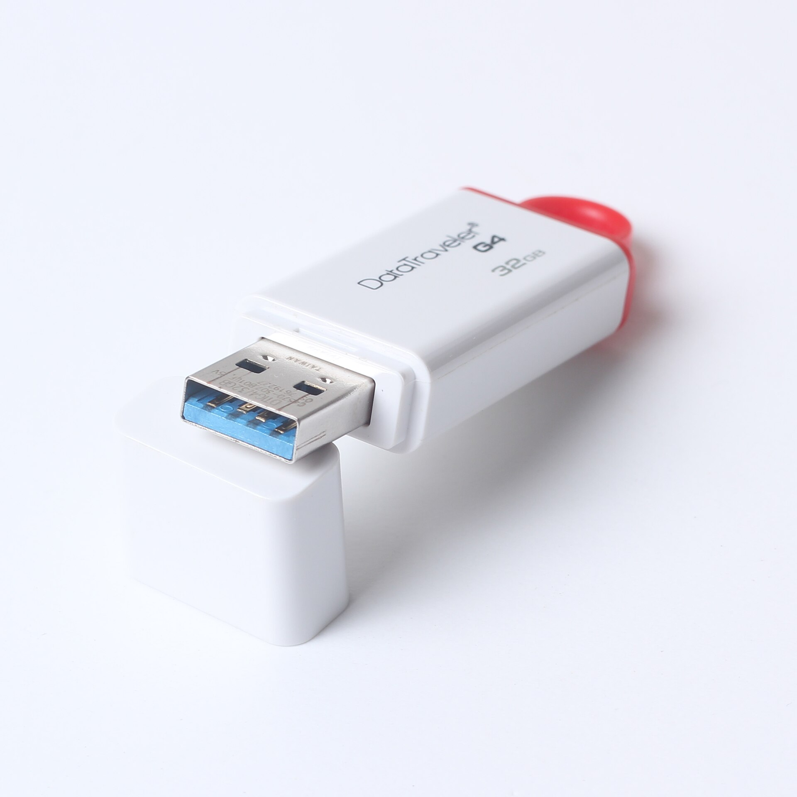
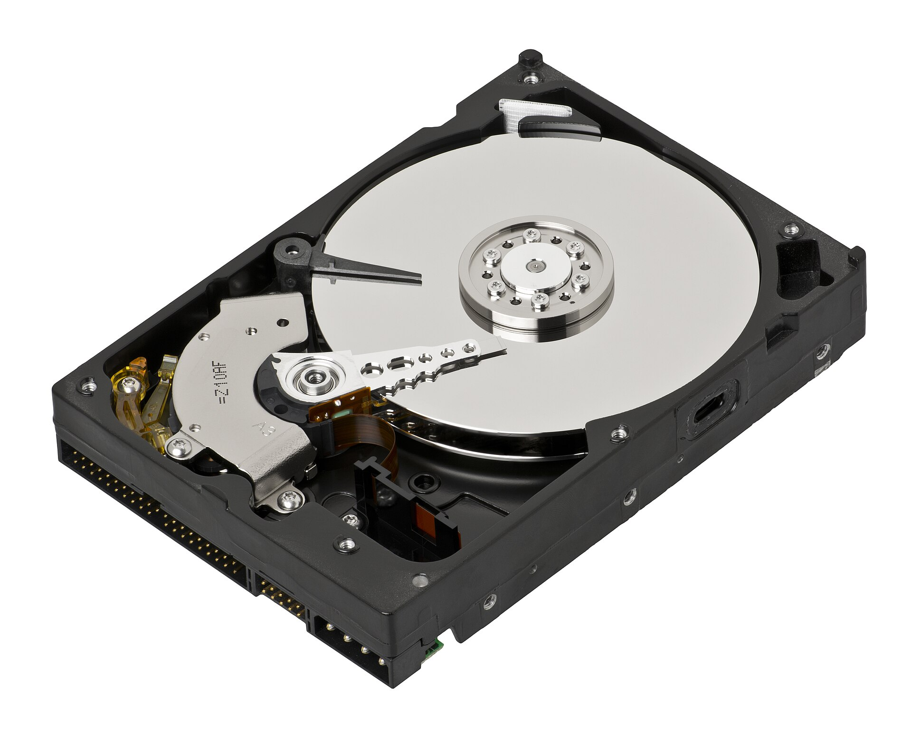

When something goes wrong at a shop, a branch or a junction, someone asks for the footage. Too often it arrives on a pen drive with a file name like VID_0042, and no way to show where it has been.

## What makes footage evidence

Footage is only as good as your ability to show three things: that it is the right footage, that it is complete, and that nobody changed it.

### A fingerprint of every file

An export gets a SHA-256 hash. Change one frame and the hash changes. Whoever receives the file can recompute the hash and compare.

### A signed manifest

The manifest lists every file in the export with its hash, signed by the system that made it. A verifier tool checks the signature, so changing the list is as visible as changing a file.

### A watermark

A visible watermark names the user, the time and the site. It discourages passing footage around, and it tells you whose export leaked if one does.

### A record of who handled it

Every view, export and share of a case should be logged. That log is the chain of custody. See [chain of custody](/glossary/chain-of-custody).

## The steps

1. **Bookmark** the moment with a note and tags.
2. **Build a case** from clips, snapshots, notes and the people involved.
3. **Export** with a hash, a manifest and a watermark.
4. **Hand over** with an expiring, password-protected link.
5. **Keep a legal hold** on the footage so it cannot be deleted while the case is open.

[Evidence and Compliance](/products/evidence) does all five. The legal background is in [what the Privacy Act, 2075 asks of CCTV operators](/blog/privacy-act-2075-cctv-nepal).
