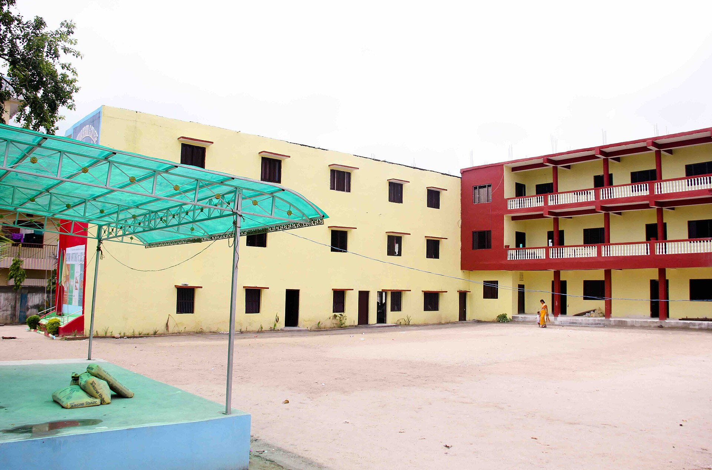
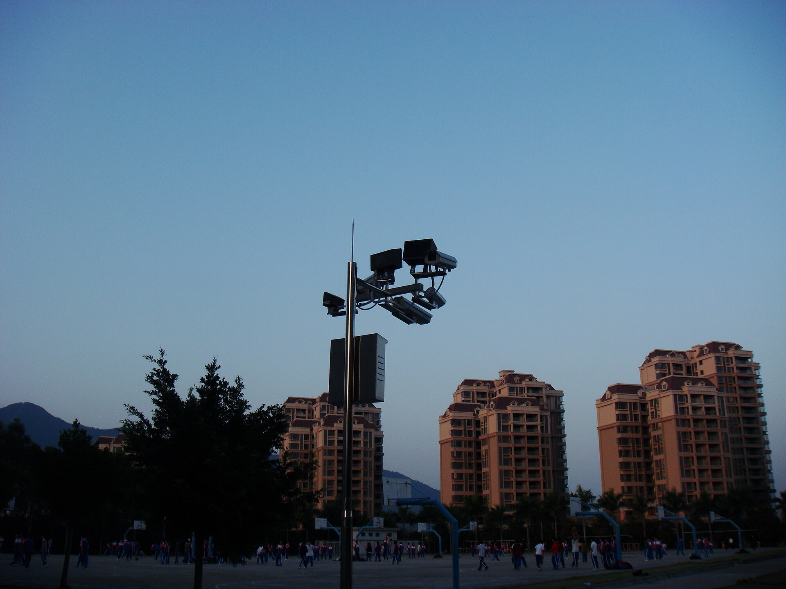
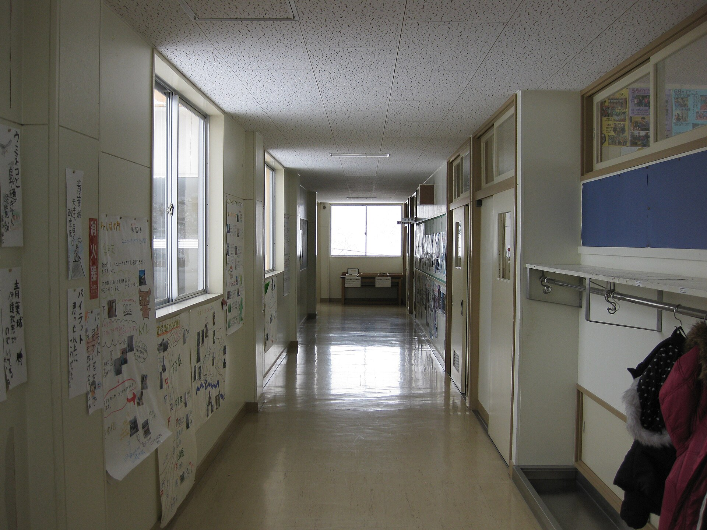
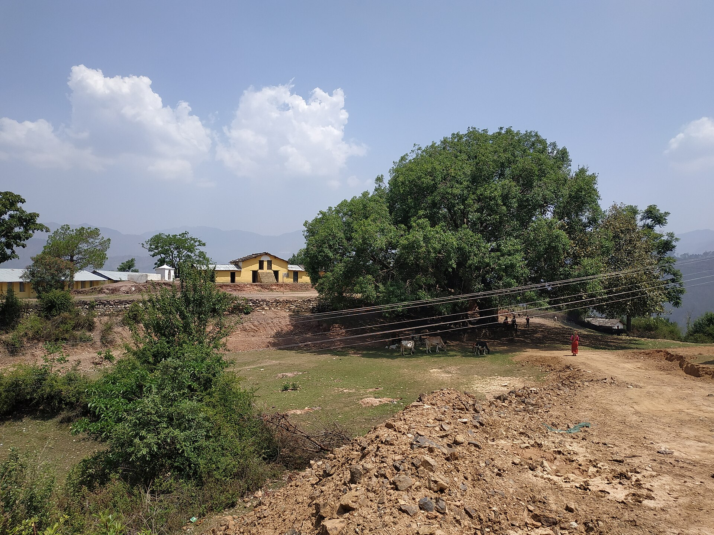

A school has open doors, children and valuable equipment. CCTV can help in three ways: it deters trouble at the gate, it helps you see what happened when something goes wrong, and it supports staff when a complaint is made. It also records children, so the law and common sense set limits. This guide sets out what Nepal's Privacy Act says, what Nepali research found about classroom cameras, what another country's school rules require as a reference, and what a 16 camera system costs in Nepal.

I am not a lawyer, and this page is not legal advice. Confirm the details for your school with one. For the Act in general, see [what Nepal's Privacy Act, 2075 asks of CCTV operators](/blog/privacy-act-2075-cctv-nepal).

## What the Privacy Act says

I read the English text of the Privacy Act, 2075 (2018) as published by the Law Commission and hosted by the Asian Development Bank ([PDF](https://lpr.adb.org/sites/default/files/resource/%5Bnid%5D/nepal-the-privacy-act-2075-2018-english.pdf)). Three sections apply to cameras.

| Section | What it says |
|---|---|
| Section 9: Not to install CCTV camera in the residence | No person shall install, or cause to be installed, a CCTV camera at the residence of any person without his or her consent, or for collecting personal information related to the user of that residence |
| Section 20: Relating to installing CCTV camera at public place | If it is necessary to install a CCTV camera at a public place, it may be installed at a place other than a toilet, bathroom or changing room. Provision shall be made to give a notice of the camera where it is installed so that all can see and be informed. Provisions relating to installation at any place shall be as prescribed |
| Section 21: Not to make surveillance or espionage | No electronic means, photography or method may be used to make surveillance or espionage of the residence of any person or any office, or to obtain anything confidential under the Act |

Section 29 lists acts contrary to Sections 9 and 21 among the offences under the Act. The punishment in 29(2) is imprisonment for up to three years, or a fine of up to Rs 30,000, or both. For offences such as a breach of Section 9, Section 30 says the person concerned complains to the District Court within three months of the act. Section 29(3) makes the Government of Nepal the plaintiff for the Section 21 offences.

What the Act does not say, as far as the text I opened shows:

- It sets no retention period for footage.
- It has no rule specific to schools.
- Section 20(3) leaves the provisions on installing CCTV "as prescribed", which means regulations. I did not find them.

Two practical points follow for a school. First, a hostel is a residence, so cameras that look into rooms where students live need consent under Section 9. Second, the rule against toilets, bathrooms and changing rooms and the notice requirement are written in plain terms, so follow them whatever else you decide.

## What Nepali research found about classroom cameras

A 2026 paper in The Journal of Aadikavi, "Secondary Level Students' Perceptions of CCTV in Nepali Classrooms", reports that CCTV in Nepali classrooms "has been adopted at a very high rate" to control student behaviour, improve teacher accountability and enhance security. It interviewed fifteen students in Grades 9 to 12, ran focus groups with 20 Grade 9 students and collected field notes from 42 Grade 8 students ([NepJOL](https://www.nepjol.info/index.php/joaa/article/view/99506)).

Findings:

- Students had mixed opinions, with the positive aspects outnumbering the negative.
- Many said CCTV helps keep students in check, curbs inappropriate conduct and holds teachers accountable.
- Some felt surveillance instilled fear and undermined their privacy and liberty.
- The paper advises education authorities and institutions to set clear policies on CCTV and to consult students before installing it, and says schools should emphasise effective teaching over surveillance.

Use that as a starting point for the policy you write before the first camera goes up.

## A reference from India

India's CBSE issued a notice in July 2025 making CCTV compulsory for its affiliated schools. This does not apply in Nepal, but it is a concrete example of what a regulator asked for. The notice requires high resolution cameras with audio-visual recording at entry and exit points, lobbies, corridors, staircases, classrooms, labs, library, canteen, store room, playground and other common areas, except toilets and washrooms. Storage must hold at least 15 days of footage, preserved for review by authorities ([Khaleej Times](https://www.khaleejtimes.com/world/asia/cbse-mandatory-cctv-cameras-schools), [Careers360](https://news.careers360.com/cbse-mandates-cctv-in-all-affiliated-schools-directs-installation-at-key-points-15-day-footage-backup)).

I found no Nepal equivalent. Note that CBSE includes classrooms, while the Nepali study shows students divided on them.

## Where to put cameras

This table combines the CBSE list (a regulator's example), the Privacy Act's limits and the layout of a typical school. The choices are yours to make.

| Place | Why | Note |
|---|---|---|
| Main gate and car entrance | Records who enters and leaves, and vehicles | Wide view plus a close view for faces |
| Side and back gates | Often the way in that avoids the main gate | Cover them |
| Lobbies and reception | Visitors, records, cash | Face the door and counter |
| Corridors | Movement between classes | Mount high at one end to see the whole length |
| Staircases | Falls and crowding | A common place for injuries |
| Library, labs, store room | Equipment and records | One camera at the door at least |
| Canteen | Crowding | Cover the entrance |
| Playground | Injuries, strangers near the boundary | Needs a camera that copes with sun and distance |
| Classrooms | CBSE requires them. The Nepali study found mixed student views | A policy decision, with consultation |

Places the law keeps out of reach: toilets, bathrooms and changing rooms (Section 20), and residences without consent (Section 9). A hostel needs its own decision.

## What cameras cost in Nepal

Daraz Nepal listings I opened on 19 October 2026. See [CCTV camera price in Nepal](/blog/cctv-camera-price-nepal) for the full tables.

| Item | Key spec | Seller | Price (Rs) | Source | Checked |
|---|---|---|---|---|---|
| Dahua Wired 2MP 20 Mtrs HD Dome Camera DH-HAC-T1A21P | 2 MP analog dome, 20 m IR | Lighting & Security | 2,500 | [Daraz](https://www.daraz.com.np/products/dahua-wired-2mp-20-mtrs-hd-dome-camera-dh-hac-t1a21p-i296077393.html) | 19 Oct 2026 |
| HIKVISION ECO DS-2CE56DOT-IP HD 2MP IR Dome Turbo HD CCTV Camera | 2 MP analog IR dome | Galaxy Techno Vision | 2,899 | [Daraz](https://www.daraz.com.np/products/hikvision-eco-ds-2ce56dot-ip-hd-2mp-ir-dome-turbo-hd-cctv-camera-i119424546.html) | 19 Oct 2026 |
| DH-IPC-HDBW1230E-S5 2MP IP Vandal-Proof Dome | 2 MP IP vandal-proof dome | Enroz Store | 7,375 | [Daraz](https://www.daraz.com.np/products/dh-ipc-hdbw1230e-2mp-ip-vandal-proof-dome-i143506069.html) | 19 Oct 2026 |
| 2MP Entry IR Fixed-focal Bullet Network Camera Dahua DH-IPC-HFW1230TC1 | 2 MP IP bullet | Enroz Store | 5,870 | [Daraz](https://www.daraz.com.np/products/2mp-entry-ir-fixed-focal-bullet-network-camera-dahua-dh-ipc-hfw1230tc1-i502848071.html) | 19 Oct 2026 |
| Hikvision 2MP CCTV Camera POE IP Bullet H265+ DS-2CD1023G0E-I Outdoor Network Camera WDR... | 2 MP IP bullet, PoE | Laliguras Digital Art and Multi Services | 5,581 | [Daraz](https://www.daraz.com.np/products/hikvision-2mp-cctv-camera-poe-ip-bullet-h265-ds-2cd1023g0e-i-outdoor-network-camera-wdr-exir-need-nvr-to-operate-i104792466.html) | 19 Oct 2026 |
| Uniview IPC2124SR3-DPF36 4MP IR H.265 Outdoor Mini Bullet IP Security Camera | 4 MP IP bullet | Mangaldeep Multi Business Pvt ltd | 4,937 | [Daraz](https://www.daraz.com.np/products/uniview-ipc2124sr3-dpf36-4mp-ir-h265-outdoor-mini-bullet-ip-security-camera-i509053387.html) | 19 Oct 2026 |
| 4 MP Fixed Bullet Network Camera DS-2CD1043G2-LIU Hikvision | 4 MP IP bullet | Enroz Store | 9,549 | [Daraz](https://www.daraz.com.np/products/4-mp-fixed-bullet-network-camera-ds-2cd1043g2-liu-hikvision-i503512815.html) | 19 Oct 2026 |
| Hikvision 16 Channel AHD Hybrid Light CCTV Package With 2 TB Hard Disk | 16 channel DVR, 180 m cable, 2 TB Toshiba, junction boxes; camera count not stated | Laliguras Digital Art and Multi Services | 83,860 | [Daraz](https://www.daraz.com.np/products/hikvision-16-channel-ahd-hybrid-light-cctv-package-with-2-tb-hard-disk-i105006484.html) | 19 Oct 2026 |
| Hikvision 16 Channel IP CCTV Package with 2 TB Hard Disk | 16 IP cameras (8 dome, 8 bullet), 16 channel NVR, 2 TB, PoE switches, 160 m CAT6 | Laliguras Digital Art and Multi Services | 137,726 | [Daraz](https://www.daraz.com.np/products/hikvision-16-channel-ip-cctv-package-with-2-tb-hard-disk-i104760479.html) | 19 Oct 2026 |

For a 16 camera school, the IP kit works out at Rs 8,608 a camera including the recorder, a 2 TB disk, two 8 port PoE switches and 160 m of CAT6. The kit listing names the cameras as 2 MP domes and bullets.

## How much disk for 16 cameras

The disk is the biggest decision. These figures come from the bitrates in the [storage guide](/blog/cctv-hard-disk-recording-days): 1 to 2 Mbps for 1080p H.265 from a bitrate guide, and 3.2 Mbps from WD's data sheet, using GB a day = Mbps x 10.8.

| Retention | 1 to 2 Mbps per camera | 3.2 Mbps per camera |
|---|---|---|
| 15 days (the CBSE figure) | 2.6 to 5.2 TB | 8.3 TB |
| 30 days | 5.2 to 10.4 TB | 16.6 TB |

At the lowest price per TB found on Daraz, Rs 7,500 per TB for a 2 TB WD Purple from Royal Computer Institute, 5.2 TB costs about Rs 39,000 and 10.4 TB about Rs 78,000 in disk alone. Those figures come from a single listing, and WD's data sheet rates its drives for up to 180 TB a year, so a large system needs several disks.

| Item | Key spec | Seller | Price (Rs) | Source | Checked |
|---|---|---|---|---|---|
| WD Purple Surveillance Hard Drive 2 TB For Desktop NVR DVR With 1 Year Warranty | 2 TB surveillance, 7,500 per TB | ROYAL COMPUTER INSTITUTE | 15,000 | [Daraz](https://www.daraz.com.np/products/wd-purple-surveillance-hard-drive-2-tb-for-desktop-nvr-dvr-with-1-year-warranty-i172902026.html) | 19 Oct 2026 |
| TOSHIBA Surveillance HDD S300 Surveillance Hard Drives 4TB support up to 32 high Resolution... | 4 TB surveillance, 8,750 per TB | BHILASH IT Traders | 34,999 | [Daraz](https://www.daraz.com.np/products/toshiba-surveillance-hdd-surveillance-hard-drives-4tb-support-up-to-32-high-resolution-cameras-compatible-with-dvr-nvr-video-servers-and-video-management-systems-i506485880.html) | 19 Oct 2026 |
| Seagate SkyHawk 4TB SATA Surveillance SATA III 3.5" Internal Hard Drive, 256 MB Cache, 5400 RPM | 4 TB surveillance, 8,875 per TB | MAGIC COMPUTER SOLUTION | 35,500 | [Daraz](https://www.daraz.com.np/products/seagate-skyhawk-4tb-sata-surveillance-sata-iii-35-internal-hard-drive-256-mb-cache-5400-rpm-i436691707.html) | 19 Oct 2026 |

## Rules to write down before the first camera

The Act, the Nepali study and the CBSE notice give three sources. Use them to write a short policy, and display it with the signs.

1. Signs. Section 20(2) requires a notice where a camera is installed so that all can see and be informed.
2. Purpose. State what the cameras are for, such as gate security, and what they are not for. The Nepali study found students feared surveillance, so say plainly what it is used for.
3. Who can watch. Name the roles that may watch live view or play back footage, and give nobody the admin password. Use named accounts.
4. Retention. Pick a period and size the disk for it. The Act sets none, and CBSE's 15 days is an example, not a Nepali rule.
5. Requests for footage. Decide how a parent, a teacher or the police may ask, who approves it and what is exported.
6. Excluded places. Toilets, bathrooms and changing rooms, as the Act says, and any other space you decide to exclude.
7. Consultation. The Nepali study advises consulting students before installing.
8. Security. Lock the recorder in a cabinet, change default passwords and update firmware. See [default passwords](/blog/default-passwords-cctv-cameras).

LunaCam supports several of these: privacy signage in Nepali and English, a retention report with a statement for a chosen period, a record of police footage requests and their decisions, role-based access, and an append-only audit log. See the [LunaCam Box](/products/lunacam-box) and [pricing](/pricing). For exporting clips, see [exporting CCTV evidence](/blog/cctv-evidence-export-nepal).

## Small and remote schools

Not every school has a gate, a power room and broadband. A hill school with one building may need two cameras: one on the entrance and one on the office or store room. Where there is no mains power or internet, a solar camera with a SIM can cover the gate. See [solar CCTV cameras in Nepal](/blog/solar-cctv-camera-nepal) and [4G SIM CCTV cameras](/blog/4g-sim-cctv-camera-nepal).

## Checklist

1. Write the purpose and the policy first.
2. Mark gates, lobbies, corridors, staircases, library, labs, store room, canteen and playground on a plan.
3. Keep cameras out of toilets, bathrooms and changing rooms, and out of residences without consent.
4. Put up notices.
5. Choose cameras for light and distance at each spot, and price the whole system.
6. Size the disk for the retention period you chose.
7. Set roles, a request process and an audit trail.
8. Lock the recorder and change every default password.
9. Review the setup each year.

## Sources

- [Privacy Act, 2075 (2018), English text (ADB-hosted PDF of the Law Commission text)](https://lpr.adb.org/sites/default/files/resource/%5Bnid%5D/nepal-the-privacy-act-2075-2018-english.pdf)
- [NepJOL: Secondary Level Students' Perceptions of CCTV in Nepali Classrooms](https://www.nepjol.info/index.php/joaa/article/view/99506)
- [Khaleej Times: CBSE mandates CCTV cameras in schools](https://www.khaleejtimes.com/world/asia/cbse-mandatory-cctv-cameras-schools)
- [Careers360: CBSE mandates CCTV, 15-day footage backup](https://news.careers360.com/cbse-mandates-cctv-in-all-affiliated-schools-directs-installation-at-key-points-15-day-footage-backup)
- [WD Purple data sheet](https://documents.westerndigital.com/content/dam/doc-library/en_us/assets/public/western-digital/product/internal-drives/wd-purple-hdd/data-sheet-wd-purple-hdd.pdf)
- [Video Experts Group bitrate guide](https://help.videoexpertsgroup.com/kb/recommended-bitrate-settings)
- Daraz Nepal listings, linked in the tables above.
