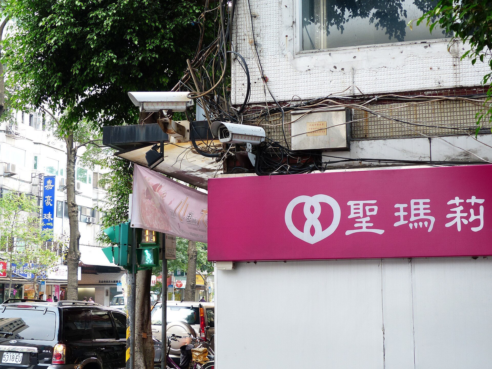
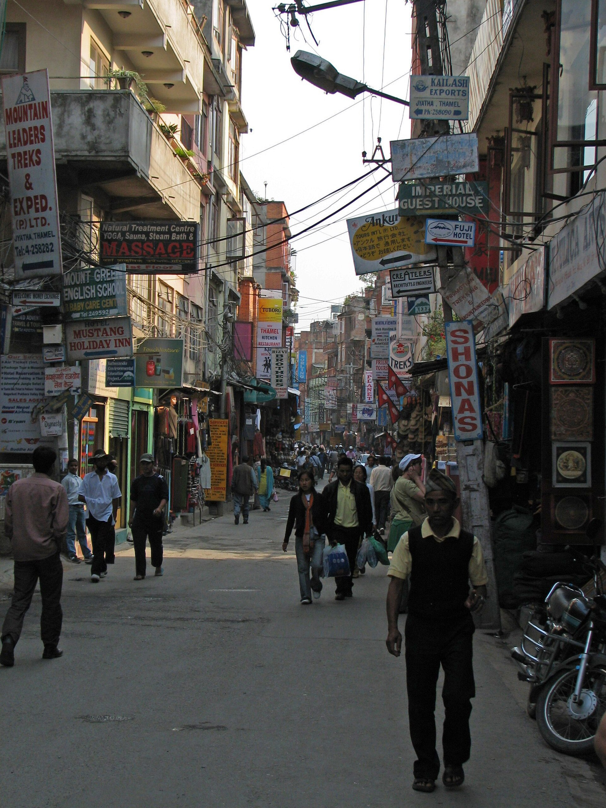

Most shop owners put cameras up to stop theft. The cameras do more once you start using them.

## Where to point them

- **The entrance**, at face height, so you see who comes in.
- **The counter**, to cover cash and handovers.
- **The stockroom door**, not the whole stockroom.
- **The back door and the shutter**, for after hours.

## What to set alerts for

- **Motion after closing time.** Use an Away schedule so you are alerted only when the shop is shut.
- **A camera going offline.** A camera that stopped yesterday cannot show what happened today.
- **A disk getting full.** A DVR that stops recording does so quietly.

Quiet hours stop alerts waking you for things you do not need. See [Alerts and Alarms](/products/alerts).

## How long to keep footage

Keep it for as long as it takes you to notice a problem, then add a margin. Thirty days is a common start. The Ministry of Home Affairs' CCTV Installation and Operation Procedure asks for at least three months of footage, so plan for that. See [what the Act asks](/blog/privacy-act-2075-cctv-nepal).

## Finding the moment

When a customer says they paid and you think they did not, you need that minute, not the whole day. Open [playback](/products/playback-clips), jump to the motion and person markers around the time and cut a clip.

## Several shops, one app

Group cameras by site, open them together in a grid and give each manager access to their own shop. You see everything. They see what they need, and every view is logged.

