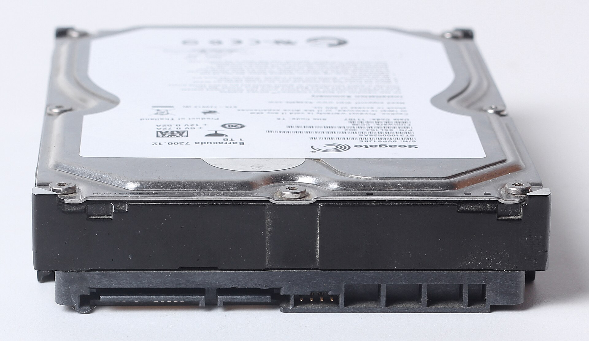

A hard disk's label tells you little until you know how fast your cameras fill it. This page gives lookup tables you can use straight away, and shows where each number comes from. For why retention matters and what Nepal's rules say, see [how long should you keep CCTV footage](/blog/how-long-to-keep-cctv-footage). This page is the calculator.

## The one rule that does the work

Disk use is bitrate multiplied by time. One megabit per second is 0.125 megabytes a second, which is 10.8 gigabytes over 24 hours. So:

GB a day per camera = Mbps x 10.8

Everything below uses that rule. The only things you need are the bitrate of each camera and the number of cameras.

## Where the bitrates come from

Bitrates vary a lot, so these tables use three sourced reference points rather than one invented figure.

| Reference | Figure | What it describes | Source |
|---|---|---|---|
| WD Purple data sheet | 3.2 Mbps | A single stream, 1080p, H.265, 25 fps, used in WD's claim of support for up to 64 HD cameras | [WD](https://documents.westerndigital.com/content/dam/doc-library/en_us/assets/public/western-digital/product/internal-drives/wd-purple-hdd/data-sheet-wd-purple-hdd.pdf) |
| Seagate SkyHawk data sheet | about 3.3 Mbps | Worked out from Seagate's claim of over 9,345 hours of HD video on 14 TB, calculated on H.264, 1 megapixel, medium quality, 15 fps, 1 camera, 24 hours a day | [Seagate](https://cdn.shopify.com/s/files/1/0011/8675/8756/files/ST12000VX0008-data-sheet.pdf) |
| Video Experts Group bitrate guide | ranges by resolution | Typical H.264 and H.265 bitrates at 15 to 30 fps for moderate motion scenes | [VEG](https://help.videoexpertsgroup.com/kb/recommended-bitrate-settings) |

The Seagate figure is my own arithmetic: 14,000 GB divided by 9,345 hours is 1.5 GB an hour, which is about 3.3 Mbps. The two data sheet figures agree with each other more than with the guide's ranges, which suggests the vendors assume a busier or higher quality stream.

The guide's table:

| Resolution | H.264 | H.265 |
|---|---|---|
| 1080p | 1.5 to 2.5 Mbps | 1 to 2 Mbps |
| 4 MP | 3 to 4 Mbps | 2 to 3 Mbps |
| 4K (8 MP) | 4 to 6 Mbps | 3 to 5 Mbps |

The guide says these assume moderate motion and standard compression, and that busy streets or industrial sites may need more. It also says H.265 may need roughly 30 to 50 percent less bitrate than H.264 for similar quality, and the table shows about that at 1080p. Read the [H.265](/glossary/h265) and [bitrate](/glossary/bitrate) entries for the basics.

## GB a day for one camera

From the guide's ranges, using GB a day = Mbps x 10.8:

| Setup | Low | High |
|---|---|---|
| 1080p H.264 | 16.2 GB | 27.0 GB |
| 1080p H.265 | 10.8 GB | 21.6 GB |
| 4 MP H.264 | 32.4 GB | 43.2 GB |
| 4 MP H.265 | 21.6 GB | 32.4 GB |
| 4K H.264 | 43.2 GB | 64.8 GB |
| 4K H.265 | 32.4 GB | 54.0 GB |
| WD reference, 1080p H.265 at 25 fps | 34.6 GB | 34.6 GB |

## Days on a 1 TB disk, recording all day

This table treats 1 TB as 1,000 GB. WD's data sheet says 1 TB is one trillion bytes and that actual user capacity may be less, so real figures are a little lower. Each cell shows days from the high bitrate to the low bitrate.

| Setup | 1 camera | 4 cameras | 8 cameras | 16 cameras |
|---|---|---|---|---|
| 1080p H.265 | 46 to 93 days | 12 to 23 days | 6 to 12 days | 3 to 6 days |
| 1080p H.264 | 37 to 62 days | 9 to 15 days | 5 to 8 days | 2 to 4 days |
| 4 MP H.265 | 31 to 46 days | 8 to 12 days | 4 to 6 days | 2 to 3 days |
| 4 MP H.264 | 23 to 31 days | 6 to 8 days | 3 to 4 days | 1 to 2 days |
| 4K H.265 | 19 to 31 days | 5 to 8 days | 2 to 4 days | 1 to 2 days |
| 4K H.264 | 15 to 23 days | 4 to 6 days | 2 to 3 days | 1 day |
| WD reference (3.2 Mbps) | 29 days | 7 days | 3.6 days | 1.8 days |

Read it like this: four 1080p H.265 cameras fill a 1 TB disk in 12 to 23 days at the guide's rates, and in 7 days at WD's 3.2 Mbps.

## Disk size for 30 days

Total space for 30 days of all day recording. Each cell is low to high, in terabytes.

| Setup | 1 camera | 4 cameras | 8 cameras | 16 cameras |
|---|---|---|---|---|
| 1080p H.265 | 0.3 to 0.6 | 1.3 to 2.6 | 2.6 to 5.2 | 5.2 to 10.4 |
| 1080p H.264 | 0.5 to 0.8 | 1.9 to 3.2 | 3.9 to 6.5 | 7.8 to 13.0 |
| 4 MP H.265 | 0.6 to 1.0 | 2.6 to 3.9 | 5.2 to 7.8 | 10.4 to 15.6 |
| 4 MP H.264 | 1.0 to 1.3 | 3.9 to 5.2 | 7.8 to 10.4 | 15.6 to 20.7 |
| 4K H.265 | 1.0 to 1.6 | 3.9 to 6.5 | 7.8 to 13.0 | 15.6 to 25.9 |
| 4K H.264 | 1.3 to 1.9 | 5.2 to 7.8 | 10.4 to 15.6 | 20.7 to 31.1 |
| WD reference (3.2 Mbps) | 1.0 | 4.1 | 8.3 | 16.6 |

Most recorders also need spare space, so add some margin. Check how many disk bays your recorder has and the largest disk each bay accepts. That limit is in the recorder's datasheet or manual.

## What the recorder settings change

### Recording hours

The tables assume 24 hours. If a camera records only while something moves, multiply the days by 24 and divide by the hours of movement. For a 1080p H.265 camera at 2 Mbps (21.6 GB a day), the days on 1 TB become:

| Recording | Hours | Days on 1 TB |
|---|---|---|
| All day | 24 | 46 |
| 12 hours | 12 | 93 |
| 8 hours | 8 | 139 |
| 3 hours | 3 | 370 |

The hours of movement are your own estimate. A shop floor with customers all day will not get the 3 hour row. Test for a week and read what the recorder reports.

### CBR or VBR

DahuaWiki's page on camera video settings says there are two bit rate types, VBR and CBR. In CBR the bit rate is the maximum value, and the camera lowers frame rate or video quality in busy scenes to stay under it. In VBR you set a video quality instead ([DahuaWiki](https://dahuawiki.com/IPCCameraConfigVideo)). The bitrate guide recommends VBR for most surveillance, because CBR holds a fixed rate regardless of the scene, which can waste bandwidth in quiet scenes or lose quality in busy ones ([VEG](https://help.videoexpertsgroup.com/kb/recommended-bitrate-settings)).

DahuaWiki also says the recommended bit rate differs for each resolution, that the frame rate options vary with the resolution, and that the H.265 option is the main profile codec.

### Frame rate

The guide notes that a 1080p camera at 30 fps produces significantly more data than the same camera at 15 fps. Dropping the frame rate on cameras that watch a store room or a back wall cuts disk use. Keep a higher frame rate at counters and gates.

### Scene and night

The guide says busy streets and industrial sites need higher bitrates than moderate motion scenes. Treat the low end of any range as the best case.

## Disk wear and warranty

A recorder writes all day, so disk ratings matter.

| | WD Purple | Seagate SkyHawk |
|---|---|---|
| Workload rating | up to 180 TB a year | designed for always-on workloads of 180 TB a year |
| Cameras | supports up to 64 single-stream HD cameras | up to 64 HD cameras |
| Warranty | 3 year limited | 3 year limited |
| Note | WD says this is up to three times a desktop drive | Seagate says it is designed for ambient temperatures of 0 to 60 C, and higher temperatures reduce useful life |

Sources: [WD data sheet](https://documents.westerndigital.com/content/dam/doc-library/en_us/assets/public/western-digital/product/internal-drives/wd-purple-hdd/data-sheet-wd-purple-hdd.pdf), [Seagate data sheet](https://cdn.shopify.com/s/files/1/0011/8675/8756/files/ST12000VX0008-data-sheet.pdf). The Seagate sheet quoted is for a 12 TB to 14 TB model, so check the sheet for the size you buy.

At WD's 3.2 Mbps, one camera writes 34.6 GB a day, which is 12.6 TB a year. About 14 cameras reach the 180 TB a year rating on one disk. Large systems need more than one disk, which most multi-bay recorders support. The [surveillance hard drive](/glossary/surveillance-hard-drive) entry explains why a desktop disk is a poor fit.

## What disks cost in Nepal

Prices are Daraz Nepal listings I opened on 19 October 2026. The key spec column ends with price per TB.

| Item | Key spec | Seller | Price (Rs) | Source | Checked |
|---|---|---|---|---|---|
| 500GB HDD Survillance For CCTV Cameras | 500 GB surveillance, 9,398 per TB | A.R.S | 4,699 | [Daraz](https://www.daraz.com.np/products/500gb-hdd-survillance-for-cctv-cameras-i416598883.html) | 19 Oct 2026 |
| Western Digital WD 1TB Purple Surveillance Internal Hard Drive (WD10PURX) | 1 TB surveillance, 9,999 per TB | Click ON | 9,999 | [Daraz](https://www.daraz.com.np/products/western-digital-wd-1tb-purple-surveillance-internal-hard-drive-wd10purx-i185629993.html) | 19 Oct 2026 |
| Western Digital WD Purple 1TB Surveillance Hard Drive | 1 TB surveillance, 12,500 per TB | BHILASH IT Traders | 12,500 | [Daraz](https://www.daraz.com.np/products/western-digital-wd-purple-1tb-surveillance-hard-drive-i127821512.html) | 19 Oct 2026 |
| Seagate Skyhawk 1 TB Surveillance Internal Hard Drive HDD 3.5 Inch With 1 Year Warranty | 1 TB surveillance, 9,999 per TB | Click ON | 9,999 | [Daraz](https://www.daraz.com.np/products/seagate-skyhawk-1-tb-surveillance-internal-hard-drive-hdd-35-inch-with-1-year-warranty-i185637565.html) | 19 Oct 2026 |
| WD Purple Surveillance Hard Drive 2 TB For Desktop NVR DVR With 1 Year Warranty | 2 TB surveillance, 7,500 per TB | ROYAL COMPUTER INSTITUTE | 15,000 | [Daraz](https://www.daraz.com.np/products/wd-purple-surveillance-hard-drive-2-tb-for-desktop-nvr-dvr-with-1-year-warranty-i172902026.html) | 19 Oct 2026 |
| WD Purple Surveillance Hard Drive 2TB with 1 Year Warranty | 2 TB surveillance, 9,999 per TB | Click ON | 19,999 | [Daraz](https://www.daraz.com.np/products/wd-purple-surveillance-hard-drive-2tb-with-1-year-warranty-i185647125.html) | 19 Oct 2026 |
| WD Purple Surveillance Hard Drive 2TB with 1 Year Warranty | 2 TB surveillance, 13,250 per TB | MAGIC COMPUTER SOLUTION | 26,500 | [Daraz](https://www.daraz.com.np/products/wd-purple-surveillance-hard-drive-2tb-with-1-year-warranty-i128149246.html) | 19 Oct 2026 |
| TOSHIBA Surveillance HDD S300 Surveillance Hard Drives 4TB support up to 32 high Resolution... | 4 TB surveillance, 8,750 per TB | BHILASH IT Traders | 34,999 | [Daraz](https://www.daraz.com.np/products/toshiba-surveillance-hdd-surveillance-hard-drives-4tb-support-up-to-32-high-resolution-cameras-compatible-with-dvr-nvr-video-servers-and-video-management-systems-i506485880.html) | 19 Oct 2026 |
| Seagate SkyHawk 4TB SATA Surveillance SATA III 3.5" Internal Hard Drive, 256 MB Cache, 5400 RPM | 4 TB surveillance, 8,875 per TB | MAGIC COMPUTER SOLUTION | 35,500 | [Daraz](https://www.daraz.com.np/products/seagate-skyhawk-4tb-sata-surveillance-sata-iii-35-internal-hard-drive-256-mb-cache-5400-rpm-i436691707.html) | 19 Oct 2026 |

The same WD Purple 1 TB lists at Rs 9,999 and Rs 12,500 from different sellers. Three 2 TB WD Purple listings (Rs 15,000, Rs 19,999 and Rs 26,500) all say 1 year of warranty in the title, against the 3 years in WD's data sheet, so ask the seller who covers the warranty. See the full price tables in [CCTV camera price in Nepal](/blog/cctv-camera-price-nepal).

## Worked examples

### A 4 camera shop on a 500 GB kit disk

The Hikvision 4 camera kit at Rs 22,470 on Daraz comes with a 500 GB disk. Four cameras at 3.2 Mbps write 138 GB a day, so the disk lasts 3.6 days. At 1 Mbps each (a low rate for 1080p H.265) it lasts 11.6 days. Either way it is far short of 30 days, so budget for a larger disk.

### An 8 camera shop for 30 days

Eight 1080p H.265 cameras need 2.6 to 5.2 TB at the guide's rates, and 8.3 TB at 3.2 Mbps. At the lowest price per TB found (Rs 7,500 per TB for a 2 TB WD Purple), 5.2 TB costs about Rs 39,000 and 8.3 TB about Rs 62,000 in disk alone. Those are worked from one listing, so confirm the price.

### A school with 16 cameras

Sixteen 1080p H.265 cameras need 5.2 to 10.4 TB for 30 days. For 15 days, the retention India's CBSE sets for its schools, they need 2.6 to 5.2 TB. Nepal's Privacy Act text I read sets no retention period, so choose your own and size for it. See [CCTV for schools](/blog/cctv-for-schools-nepal).

## Ways to make the disk last

1. Use H.265 if your cameras and recorder support it.
2. Use VBR with a sensible quality, not a high fixed CBR rate.
3. Lower the frame rate on cameras that watch quiet areas.
4. Record on motion for areas with little movement.
5. Add a second disk if the recorder has a spare bay.
6. Shorten retention, and export the clips that matter. See [exporting evidence](/blog/cctv-evidence-export-nepal).

## Check the real number on your recorder

The tables give a plan. The recorder gives the truth.

1. Let the recorder run for a week.
2. Open its storage or HDD menu and note the recording days it reports.
3. Read the actual bitrate of each camera in the camera video settings and use the 10.8 rule on it.
4. If it shows fewer days than you need, change one of the settings above or add a disk.

LunaCam has a bandwidth and storage usage report that shows how much each camera uses, so you can see which one is filling the disk. See the [LunaCam Box](/products/lunacam-box).

## Sources

- [WD Purple data sheet](https://documents.westerndigital.com/content/dam/doc-library/en_us/assets/public/western-digital/product/internal-drives/wd-purple-hdd/data-sheet-wd-purple-hdd.pdf)
- [Seagate SkyHawk data sheet (12 TB to 14 TB models)](https://cdn.shopify.com/s/files/1/0011/8675/8756/files/ST12000VX0008-data-sheet.pdf)
- [Video Experts Group: recommended bitrate settings](https://help.videoexpertsgroup.com/kb/recommended-bitrate-settings)
- [DahuaWiki: IP camera video configuration](https://dahuawiki.com/IPCCameraConfigVideo)
- Daraz Nepal listings, linked in the table above.
