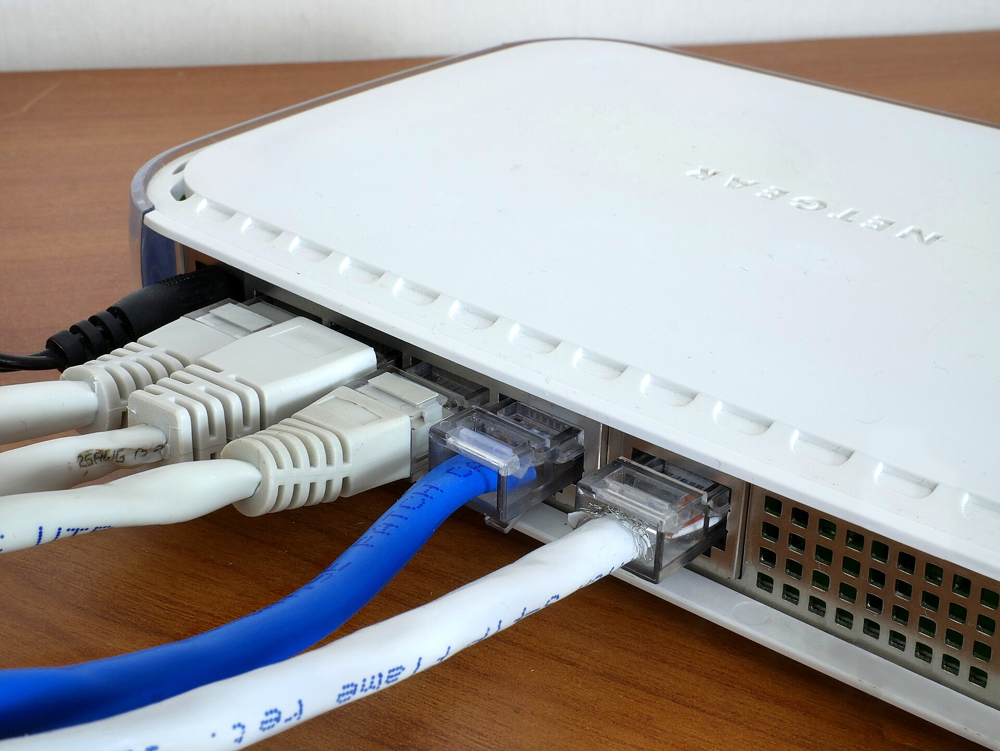
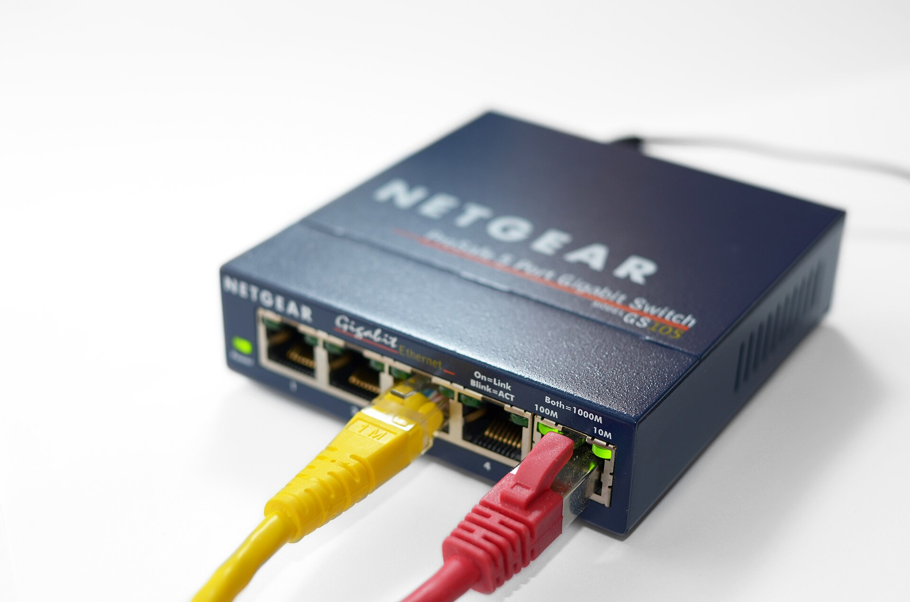

You forwarded the port, typed the right address, and the DVR will not open from outside. The DVR is fine. The problem is usually your connection.

## What CGNAT is

Internet addresses are in short supply. Many providers put several customers behind one public address. That is carrier-grade NAT, or CGNAT. From the internet, your router has no address of its own, so nobody can reach it, however you set the router.

Apartments, shared buildings and some mobile and wireless providers are the usual cases.

## How to check

Open your router's status page and read the WAN or internet address. Then search the web for "what is my IP". If the two differ, you are behind a shared address. A router address that starts with 100.64 up to 100.127 is also a sign of CGNAT.

## Options that work

- **Ask for a public address.** Some providers give one for a fee. It fixes forwarding but puts the DVR on the open internet, so change every default password first.
- **Use a vendor cloud.** It works, but your video goes abroad. See [Hik-Connect alternatives](/blog/hik-connect-alternative-nepal).
- **Use a connect-out box.** The [LunaCam Box](/products/lunacam-box) opens a connection from inside your network to LunaCam, so it needs no inbound access.

## The last-seen test

Whatever you use, confirm that it tells you when a camera goes quiet. On the box, every camera shows the last time it was seen, and LunaCam alerts you when one goes offline. A remote viewing setup you cannot trust to tell you it broke is worse than none.
