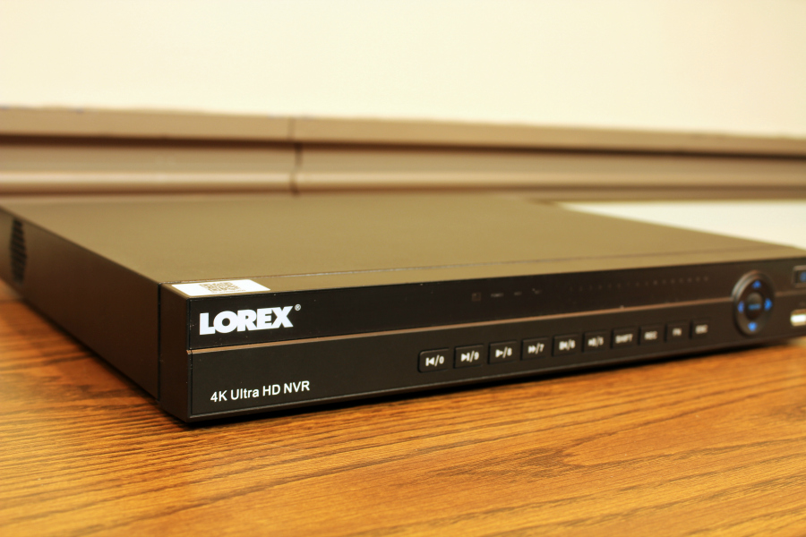
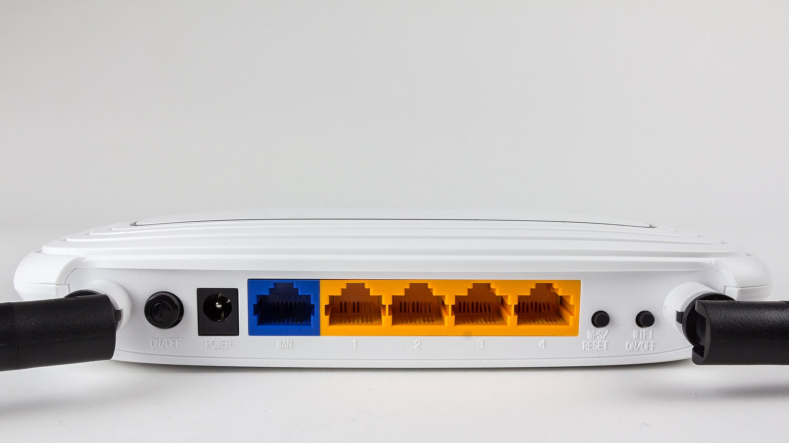

DMSS is Dahua's app for recorders and cameras. DahuaWiki describes it as a mobile surveillance app with remote monitoring, video playback, push notifications, device initialization and remote configuration. When it shows a device as offline, the recorder has lost its link to the P2P service, or the app is using the wrong details. This guide follows Dahua's own troubleshooting checklist and its DMSS instruction pages, and adds an installer's guide where Dahua's pages are silent.

Compare brands first? Read [Hikvision vs Dahua](/blog/hikvision-vs-dahua). For the Hikvision version of this page, see [Hik-Connect not working](/blog/hik-connect-not-working).

## What P2P is

P2P is the cloud link that lets DMSS reach a recorder behind a router without opening ports. DahuaWiki's "Add Dahua Device via P2P" page assumes only that the device is initialized and DMSS is installed ([source](https://dahuawiki.com/DMSS/Add_Dahua_Device_via_P2P)). A device added by IP is different: DahuaWiki says it is not eligible for account binding, and it needs the phone and device on the same network or a port forward ([source](https://dahuawiki.com/DMSS/Add_Dahua_Device_via_IP)).

## Step 1. Read the P2P status on the recorder

DahuaWiki says to check that P2P is enabled and online on the recorder, under Settings, then Network, then P2P ([source](https://dahuawiki.com/DMSS/Add_Dahua_Device_via_P2P)). The Cornick installer guide describes the same menu: Main Menu, Network, P2P, tick Enable, press Apply, and wait a minute or two for the status to change to online. On one firmware it shows "Connect Success" ([source](https://cornick.helpjuice.com/176989-operation-guides/setting-up-nvr-for-remote-access-via-p2p)).

If the status never goes online, go to the checklist.

## Step 2. Use Dahua's P2P troubleshooting checklist

DahuaWiki's "P2P Troubleshoot Checklist" lists the checks in this order ([source](https://dahuawiki.com/FAQ/P2P_Troubleshoot_Checklist)).

1. P2P enabled (on the Dahua device).
2. DHCP enabled.
3. DNS 1 set to 8.8.8.8.
4. DNS 2 set to 8.8.4.4.
5. Ping test succeeds.
6. Default TCP port is 37777 for a Dahua device (35000 for a FLIR device).
7. After confirming all of the above, reboot the recorder or camera.

### The ping test

The checklist gives these steps for the SystemUI ([source](https://dahuawiki.com/FAQ/P2P_Troubleshoot_Checklist)).

1. Go to Main Menu, then Info, then Network, then Test.
2. Enter 8.8.8.8 as the destination IP.
3. Click Test.
4. Repeat the test with google.com in place of 8.8.8.8.

If the test fails, the checklist's tip is to check the network cable. A ping to 8.8.8.8 that works while google.com fails points at a DNS problem. A failure on both points at the cable, the router or the line.

### If you still cannot fix it

The same page describes a packet capture for Dahua support. You insert a FAT32 USB drive, disable P2P, start "Sniffer Packet Backup" under Operation, then Network, re-enable P2P, pause the capture and send the .PCAP files to your support representative. Use this only when support asks for it.

## Step 3. Check the network settings

DahuaWiki's NVR manual page for network settings says that when DHCP is enabled you cannot modify IP, subnet mask or gateway, because the values come from the DHCP server. The IP address and the default gateway should be in the same section. To see the current IP you may need to disable DHCP. The page also lists the default ports: TCP 37777, UDP 37778, HTTP 80, HTTPS 443 and RTSP 554, and notes that the recorder reboots after you change any of the four port settings ([source](https://dahuawiki.com/NVRiSettingNetwork)).

The Cornick guide adds two practical points ([source](https://cornick.helpjuice.com/176989-operation-guides/setting-up-nvr-for-remote-access-via-p2p)).

- Check the LAN cable. It should show a green light and a flashing orange light on the port.
- If you set DHCP and get an error that the switch cannot be in the same range, the recorder's built-in PoE switch needs a different address range. The guide says to change the switch IP to 10.2.2.1 under Main Menu, Network, Switch.

Cornick also notes that on some networks, such as a business, the P2P protocol may be blocked, and the IT department may suggest port forwarding instead.

## Step 4. Add the device again, correctly

If the status is online on the recorder but DMSS still fails, add the device again by following DahuaWiki's steps ([source](https://dahuawiki.com/DMSS/Add_Dahua_Device_via_P2P)).

1. On the recorder, confirm P2P is enabled and online, and find the serial number QR code.
2. In DMSS, tap the + at the top right of the Home tab, or the Add Device button.
3. Choose Scan QR Code and allow camera access if asked.
4. Scan the QR code, or choose Manually Enter SN and type the serial number.
5. After the scan, do not enter a security code. Press Next.
6. Enter the device's admin password. DahuaWiki notes this is not your DMSS account password.
7. Wait for the app to authenticate, then name the device and set its time zone and DST.

The QR code is on the recorder's P2P screen and on the box it came in, according to the Cornick guide.

## Step 5. If the device is already bound to another account

If the device is already added to someone else's account, DMSS shows an error with an Appeal option. DahuaWiki's page says to tap Appeal, upload a photo of the device showing its serial number label and a proof of purchase if available, and submit. It says the unbind usually takes 1 to 2 business days, and gives a US support phone number to speed it up ([source](https://dahuawiki.com/DMSS/Unbind_Device)). This is the usual case when you buy a used recorder or an installer registered it under their own account.

## Step 6. Sharing and alerts

Sharing and alert settings are often mistaken for connection faults.

### Share instead of giving out the admin password

DahuaWiki's sharing page lists two methods. For one device, tap the three dots beside it on the Home tab and choose Share Device. You can share specific channels or the whole device, and you set permissions. Play Video is required because it gives live view. Then enter the other person's email or scan their QR ID. A device does not appear in the share list if it is not account bound, if it was shared to you, or if it does not support sharing ([source](https://dahuawiki.com/DMSS/Share_Device_with_Another_User)).

### Push notifications

DahuaWiki's push notification page gives these steps ([source](https://dahuawiki.com/DMSS/Push_Notifications_Setup)).

1. From the Device page, tap the three dots by the device, then Device Details.
2. Tap Multi-channel Alarm Subscription and switch the slider on.
3. Use Period Settings to set the hours you want alerts.
4. Tap the alarm type, such as Motion Detection or Intrusion Alarm, and tick the channels.
5. Check the channel count next to the alarm type, then tap Save.

If alerts still do not arrive, DahuaWiki says to check the notification permission on the phone.

## Local devices and account bound devices

DMSS has two kinds of entries, and mixing them up causes duplicates and sharing problems.

- A device added by IP or domain is a local device. DahuaWiki says it is not eligible for account binding and is specific to that DMSS installation ([source](https://dahuawiki.com/DMSS/Add_Dahua_Device_via_IP)).
- A device added by P2P with a QR code or serial number is account bound.

To move a local device onto your account, DahuaWiki's steps are ([source](https://dahuawiki.com/DMSS/Transfer)):

1. Open the Me tab at the bottom right, then Service, then Transfer Local Device to Account.
2. Select the local devices and choose Forwarding.
3. Enter your DMSS account password when asked, then press OK.
4. Confirm with Transfer. Transferred devices show a green check.
5. Delete the local copies when prompted, to avoid duplicates.

To remove a device ([source](https://dahuawiki.com/DMSS/Remove_Device)): tap the three dots beside it on the Home tab, choose Device Details, and for an account bound device open the Device Info screen and tap Delete at the bottom. For a local device, scroll to the bottom of Device Details and select Delete.

Live view and playback are separate pages in DahuaWiki. From the Device screen the Play button opens live view, and from live view the Playback icon starts playback from today, with a timeline you can move ([live view](https://dahuawiki.com/DMSS/Live_View), [playback](https://dahuawiki.com/DMSS/Playback)).

## If the recorder password is the problem

Offline status and a forgotten recorder password are different faults. For a lost recorder password, read [how to reset a forgotten DVR or NVR password](/blog/reset-dvr-nvr-password).

## Prices for Dahua recorders in Nepal

If the recorder is too old to support P2P or you are replacing it, see current Daraz Nepal prices in [CCTV camera price in Nepal](/blog/cctv-camera-price-nepal). For example, a Dahua 4 channel XVR package with cameras listed at Rs 30,000 and an 8 channel package at Rs 55,000 on Daraz from Bro Tech Enterprises on 19 October 2026.

## A second way to watch

If DMSS keeps dropping, or you want one app for Dahua and other brands, a connect-out box is another route. The [LunaCam Box](/products/lunacam-box) connects a Dahua recorder, and cameras from other makers over ONVIF and RTSP, to one app through an outbound encrypted tunnel, with no port forwarding. See [how to watch a DVR from your phone](/blog/watch-dvr-from-phone-nepal) for the three methods compared.

## Checklist

1. Recorder: cable in, link lights on.
2. Main Menu, Network, P2P: enabled and online.
3. DHCP enabled, DNS 8.8.8.8 and 8.8.4.4.
4. Ping test to 8.8.8.8 and google.com succeeds.
5. TCP port 37777 unchanged unless you know why.
6. Reboot after confirming the above.
7. Added in DMSS by QR code or serial number, with the device's admin password.
8. Device bound to your account, or an Appeal sent.
9. Sharing and alarm subscription set, phone notifications allowed.
10. Default password changed. See [default passwords](/blog/default-passwords-cctv-cameras).

## Sources

- [DahuaWiki: P2P Troubleshoot Checklist](https://dahuawiki.com/FAQ/P2P_Troubleshoot_Checklist)
- [DahuaWiki: Add Dahua Device via P2P](https://dahuawiki.com/DMSS/Add_Dahua_Device_via_P2P)
- [DahuaWiki: Add Dahua Device via IP](https://dahuawiki.com/DMSS/Add_Dahua_Device_via_IP)
- [DahuaWiki: Unbind Device](https://dahuawiki.com/DMSS/Unbind_Device)
- [DahuaWiki: Share Device with Another User](https://dahuawiki.com/DMSS/Share_Device_with_Another_User)
- [DahuaWiki: Push Notifications Setup](https://dahuawiki.com/DMSS/Push_Notifications_Setup)
- [DahuaWiki: NVR Interface, Setting, Network](https://dahuawiki.com/NVRiSettingNetwork)
- [DahuaWiki: DMSS overview](https://dahuawiki.com/DMSS)
- [DahuaWiki: Transfer a local device](https://dahuawiki.com/DMSS/Transfer)
- [DahuaWiki: Remove Device](https://dahuawiki.com/DMSS/Remove_Device)
- [DahuaWiki: Live View](https://dahuawiki.com/DMSS/Live_View)
- [DahuaWiki: Playback](https://dahuawiki.com/DMSS/Playback)
- [Cornick: Setting up an NVR for remote access via P2P](https://cornick.helpjuice.com/176989-operation-guides/setting-up-nvr-for-remote-access-via-p2p)
- [Daraz Nepal: Dahua 4 channel XVR package](https://www.daraz.com.np/products/dahua-4-channel-xvr-2mp-ahd-indoor-and-outdoor-cc-tv-camera-package-with-mobile-viewing-i113369720.html)
- [Daraz Nepal: Dahua 8 channel XVR package](https://www.daraz.com.np/products/dahua-8-channel-xvr-2mp-ahd-indoor-and-outdoor-cc-tv-camera-package-with-mobile-viewing-i113373547.html)
