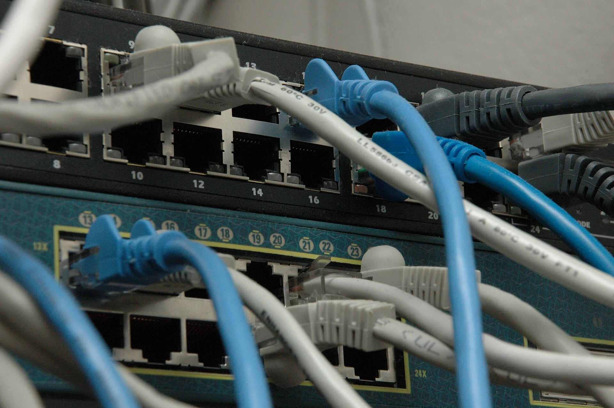

Most CCTV in Nepal came with an app. You scan a code on the DVR, install the app and see your cameras from anywhere. It is convenient, and it is why almost nobody asks where the video goes.

The answer, for most vendor apps, is: through the maker's servers, outside Nepal. Your DVR connects out to that cloud. The app connects to the same cloud. The two meet there, and your video passes through on the way.

## What this means in practice

Three things are worth knowing.

- **Your video leaves the country.** Every time you open live view, the picture travels through a foreign server first.
- **Your DVR password is shared with that service.** The app has to log in to your recorder on your behalf, so some form of the credential is held by the vendor's cloud.
- **The rules are the vendor's.** Retention, access and what happens in a dispute are set by terms you accepted in a tap.

For a home this is a privacy question. For a bank, a school or a municipality it can be a legal one, which we cover in [what the Privacy Act, 2075 asks of CCTV operators](/blog/privacy-act-2075-cctv-nepal).

## What an alternative has to do

A good replacement should do five things:

1. Work with the cameras and recorders you already own, whatever the brand.
2. Need no router settings, because most homes and shops cannot forward ports. See [why remote viewing fails behind CGNAT](/blog/cctv-remote-viewing-cgnat-nepal).
3. Keep video relays and storage in Nepal.
4. Keep your camera passwords on a device you own, not in a cloud.
5. Say plainly where the data is and who can see it.

## How LunaCam does it

[LunaCam](/products/camera-app) runs relays and storage in Nepal. A small [LunaCam Box](/products/lunacam-box) on your network, or the same agent on a PC, connects out to LunaCam, so there is nothing to open on your router. Camera passwords stay on the box.

Live view and DVR playback are free to start. You can try it on one recorder before you decide anything.

## Before you switch

Write down what you have: the recorder brand and model, how many channels, and whether the cameras are analogue or IP. That is enough for us to tell you in one call how it will connect. [Book a walkthrough](/demo) and we will go through it with you.
