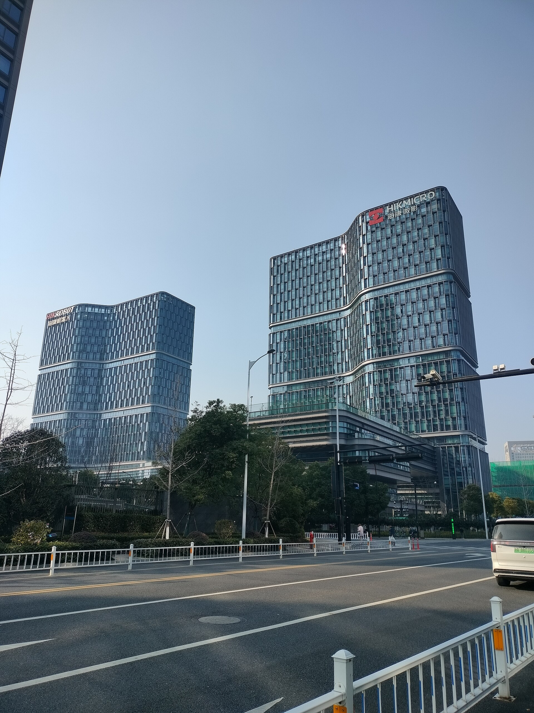
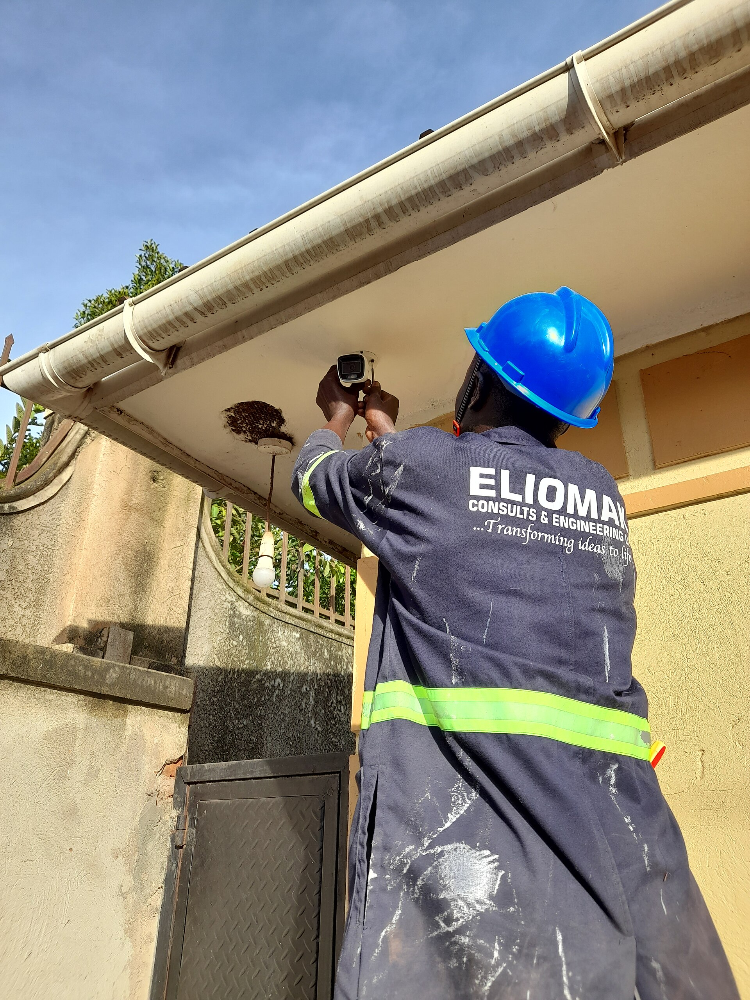

Shopkeepers, installers and homeowners in Nepal ask this question more than any other. The fair answer is that the two companies make similar products at similar prices, and the model, the seller and the installation matter more than the logo. This guide puts numbers on that from real Daraz Nepal listings, and covers the points that do differ: apps, recovery tools, published security flaws and government restrictions.

For the full cost of a system, see [CCTV camera price in Nepal](/blog/cctv-camera-price-nepal). For how to choose a camera, see [choosing CCTV cameras](/blog/choosing-cctv-cameras-nepal).

## The two companies

| | Hikvision | Dahua Technology |
|---|---|---|
| Full name | Hangzhou Hikvision Digital Technology Co., Ltd. | Zhejiang Dahua Technology Co., Ltd. |
| Headquarters | Hangzhou, Zhejiang | Binjiang District, Hangzhou |
| Founded | 2001 | 2001 |
| Ownership (Wikipedia) | Partly state-owned | A minority is state-owned (11.67 percent as of 2023) |
| Size | Largest video surveillance company | Second largest by revenue, as of 2021 |
| Consumer brand | Ezviz | Lorex, acquired in 2018 |

Source: Wikipedia's pages on [Hikvision](https://en.wikipedia.org/wiki/Hikvision) and [Dahua Technology](https://en.wikipedia.org/wiki/Dahua_Technology). Wikipedia is a secondary source, so use it for background and check anything that matters against the companies' own pages.

## Prices in Nepal

All rows are Daraz Nepal listings I opened on 19 October 2026. I paired them by type and resolution.

### 2 MP analog HD cameras

| Item | Key spec | Seller | Price (Rs) | Source | Checked |
|---|---|---|---|---|---|
| HIKVISION ECO DS-2CE56DOT-IP HD 2MP IR Dome Turbo HD CCTV Camera | Hikvision 2 MP IR dome | Galaxy Techno Vision | 2,899 | [Daraz](https://www.daraz.com.np/products/hikvision-eco-ds-2ce56dot-ip-hd-2mp-ir-dome-turbo-hd-cctv-camera-i119424546.html) | 19 Oct 2026 |
| HIKVISION HD TVI CAMERA 2MP IR Dome Turbo HD Camera ECO DS-2CE56DOT-IP\ECO | Hikvision 2 MP IR dome | Click ON | 2,999 | [Daraz](https://www.daraz.com.np/products/hikvision-hd-tvi-camera-2mp-ir-dome-turbo-hd-camera-eco-ds-2ce56dot-ipeco-i128373059.html) | 19 Oct 2026 |
| HIKVISION HD TVI CAMERA 2MP IR Dome Turbo HD Camera ECO DS-2CE56DOT-IP\ECO | Hikvision 2 MP IR dome | A.R.S | 2,999 | [Daraz](https://www.daraz.com.np/products/hikvision-hd-tvi-camera-2mp-ir-dome-turbo-hd-camera-eco-ds-2ce56dot-ipeco-i128391823.html) | 19 Oct 2026 |
| Dahua Wired 2MP 20 Mtrs HD Dome Camera DH-HAC-T1A21P | Dahua 2 MP dome, 20 m IR | Lighting & Security | 2,500 | [Daraz](https://www.daraz.com.np/products/dahua-wired-2mp-20-mtrs-hd-dome-camera-dh-hac-t1a21p-i296077393.html) | 19 Oct 2026 |
| Hikvision 2 MP Smart Hybrid Light Fixed Mini Bullet Camera (DS-2CE16DOT-EXLPF ) Need DVR... | Hikvision 2 MP mini bullet | Laliguras Digital Art and Multi Services | 2,750 | [Daraz](https://www.daraz.com.np/products/hikvision-2-mp-smart-hybrid-light-fixed-mini-bullet-camera-ds-2ce16dot-exlpf-need-dvr-for-setup-i104768019.html) | 19 Oct 2026 |
| 2MP HDCVI IR Bullet Camera DH-HAC-B1A21P | Dahua 2 MP bullet | Enroz Store | 2,749 | [Daraz](https://www.daraz.com.np/products/2mp-hdcvi-ir-bullet-camera-dh-hac-b1a21p-i503042880.html) | 19 Oct 2026 |
| DH-HAC-HFW1200CP-A 2MP HDCVI IR Bullet Camera | Dahua 2 MP bullet, audio | Enroz Store | 3,691 | [Daraz](https://www.daraz.com.np/products/dh-hac-hfw1200cp-a-2mp-hdcvi-ir-bullet-camera-i141810762.html) | 19 Oct 2026 |
| HIKVISION 2MP ColorVu Bullet Camera DS-2CE10DF0T-PF 3.6MM IP67 + USEWELL BNC DC, White | Hikvision 2 MP ColorVu bullet | Click ON | 3,399 | [Daraz](https://www.daraz.com.np/products/hikvision-2mp-colorvu-bullet-camera-ds-2ce10df0t-pf-36mm-ip67-usewell-bnc-dc-white-i129351614.html) | 19 Oct 2026 |
| 2MP ColorVU Bullet Camera DS-2CE10DF0T-PF | Hikvision 2 MP ColorVu bullet | Next Trade Link | 3,499 | [Daraz](https://www.daraz.com.np/products/2mp-colorvu-bullet-camera-ds-2ce10df0t-pf-i165783239.html) | 19 Oct 2026 |
| DAHUA 2MP Full-color Starlight HDCVI Camera DH-HAC-HDW1209TLQP-LED DAHUA 2MP Full-color... | Dahua 2 MP Full-color | Enroz Store | 4,120 | [Daraz](https://www.daraz.com.np/products/dahua-2mp-full-color-starlight-hdcvi-camera-dh-hac-hdw1209tlqp-led-dahua-2mp-full-color-starlight-hdcvi-i141839261.html) | 19 Oct 2026 |

### 2 MP and 4 MP IP cameras

| Item | Key spec | Seller | Price (Rs) | Source | Checked |
|---|---|---|---|---|---|
| Hikvision 2MP CCTV Camera POE IP Bullet H265+ DS-2CD1023G0E-I Outdoor Network Camera WDR... | Hikvision 2 MP IP bullet, PoE | Laliguras Digital Art and Multi Services | 5,581 | [Daraz](https://www.daraz.com.np/products/hikvision-2mp-cctv-camera-poe-ip-bullet-h265-ds-2cd1023g0e-i-outdoor-network-camera-wdr-exir-need-nvr-to-operate-i104792466.html) | 19 Oct 2026 |
| IPC-B121H-C 2 MP Fixed Bullet Network Camera-Hikvision (HI-LOOK) | Hikvision 2 MP IP bullet | Enroz Store | 3,375 | [Daraz](https://www.daraz.com.np/products/ipc-b121h-c-2-mp-fixed-bullet-network-camera-hikvision-hi-look-i512048956.html) | 19 Oct 2026 |
| 2MP Entry IR Fixed-focal Bullet Network Camera Dahua DH-IPC-HFW1230TC1 | Dahua 2 MP IP bullet | Enroz Store | 5,870 | [Daraz](https://www.daraz.com.np/products/2mp-entry-ir-fixed-focal-bullet-network-camera-dahua-dh-ipc-hfw1230tc1-i502848071.html) | 19 Oct 2026 |
| 2MP Dahua IP Bullet Network Camera IPC-HFW1230S1 / Built-in Mic Audio / IR Night Vision /... | Dahua 2 MP IP bullet with microphone | CCTV Camera  Service Nepal | 9,980 | [Daraz](https://www.daraz.com.np/products/2mp-dahua-ip-bullet-network-camera-ipc-hfw1230s1-built-in-mic-audio-ir-night-vision-h265-poe-ip67-waterproof-cctv-camera-i1530038442.html) | 19 Oct 2026 |
| 4 MP Fixed Bullet Network Camera DS-2CD1043G2-LIU Hikvision | Hikvision 4 MP IP bullet | Enroz Store | 9,549 | [Daraz](https://www.daraz.com.np/products/4-mp-fixed-bullet-network-camera-ds-2cd1043g2-liu-hikvision-i503512815.html) | 19 Oct 2026 |
| Dahua 4MP IP Eyeball Network Camera / H.265+ PoE CCTV Security Camera / IR Night Vision /... | Dahua 4 MP IP eyeball | CCTV Camera  Service Nepal | 14,700 | [Daraz](https://www.daraz.com.np/products/dahua-4mp-ip-eyeball-network-camera-h265-poe-cctv-security-camera-ir-night-vision-weatherproof-outdoorindoor-surveillance-camera-i1523387567.html) | 19 Oct 2026 |

### Kits from one seller

CCTV Camera Service Nepal lists both brands, so the comparison below holds the seller fixed.

| Item | Key spec | Seller | Price (Rs) | Source | Checked |
|---|---|---|---|---|---|
| Hikvision 4 Camera CCTV Set with DVR / Turbo HD Security System / 500gb Hard Drive / Power... | Hikvision: 2 dome + 2 bullet, DVR, 500 GB, 90 m wire, power supply | CCTV Camera  Service Nepal | 46,890 | [Daraz](https://www.daraz.com.np/products/hikvision-4-camera-cctv-set-with-dvr-turbo-hd-security-system-500gb-hard-drive-power-supply-wire-included-home-office-surveillance-nepal-i1516087930.html) | 19 Oct 2026 |
| Dahua 4 Camera CCTV Security System Kit / 1 Bullet + 3 Dome Cameras / DVR + 500GB Hard... | Dahua: 1 bullet + 3 dome, DVR, 500 GB, 90 m BNC cable, PVC box | CCTV Camera  Service Nepal | 38,980 | [Daraz](https://www.daraz.com.np/products/dahua-4-camera-cctv-security-system-kit-1-bullet-3-dome-cameras-dvr-500gb-hard-drive-90m-bnc-cable-pvc-box-complete-surveillance-packag-i1542681742.html) | 19 Oct 2026 |
| Dahua 5 Camera CCTV Security System Kit / 1 Bullet + 4 Dome Cameras / DVR + 500GB Hard... | Dahua: 1 bullet + 4 dome, DVR, 500 GB, 90 m BNC cable | CCTV Camera  Service Nepal | 45,000 | [Daraz](https://www.daraz.com.np/products/dahua-5-camera-cctv-security-system-kit-1-bullet-4-dome-cameras-dvr-500gb-hard-drive-90m-bnc-cable-pvc-box-complete-surveillance-package-i1542701231.html) | 19 Oct 2026 |
| Hikvision 2MP ColorVu Audio CCTV Camera Set (5 Cameras) with 8 Channels DVR & 500GB Hard... | Hikvision: 5 ColorVu cameras, 8 channel DVR, 500 GB, 90 m cable | CCTV Camera  Service Nepal | 58,980 | [Daraz](https://www.daraz.com.np/products/hikvision-2mp-colorvu-audio-cctv-camera-set-5-cameras-with-8-channels-dvr-500gb-hard-disk-2-dome-3-bullet-full-hd-night-vision-i1517034091.html) | 19 Oct 2026 |
| Dahua 4 Camera CCTV Kit (2 Dome + 2 Bullet) Full HD 1080P / 4CH NVR + 500GB HDD / 90M Cat6... | Dahua: 2 dome + 2 bullet, 4 channel NVR, 500 GB, 90 m Cat6, PoE switch | CCTV Camera  Service Nepal | 59,890 | [Daraz](https://www.daraz.com.np/products/dahua-4-camera-cctv-kit-2-dome-2-bullet-full-hd-1080p-4ch-nvr-500gb-hdd-90m-cat6-cable-poe-switch-complete-security-system-nepal-i1523721832.html) | 19 Oct 2026 |

### What the prices show

- Analog dome: Dahua's DH-HAC-T1A21P at Rs 2,500 is Rs 399 under the cheapest Hikvision ECO dome (Rs 2,899). The three Hikvision listings range from Rs 2,899 to Rs 2,999 across three sellers.
- Colour at night: Hikvision's ColorVu bullet DS-2CE10DF0T-PF at Rs 3,399 and Rs 3,499 sits under Dahua's Full-color camera at Rs 4,120, though the Dahua one is a different shape and the listings do not give identical specifications.
- IP 2 MP bullet: Hikvision's DS-2CD1023G0E-I at Rs 5,581 lists below Dahua's IPC-HFW1230TC1 at Rs 5,870, a gap of Rs 289. A Hikvision IPC-B121H-C lists lower at Rs 3,375.
- Kits from one seller: the Dahua 4 camera kit at Rs 38,980 lists Rs 7,910 under the Hikvision 4 camera kit at Rs 46,890. The kits differ (Hikvision has 2 dome and 2 bullet, Dahua 1 bullet and 3 dome), so this is not a pure brand comparison.
- The 5 camera Dahua kit at Rs 45,000 is Rs 13,980 under the 5 camera Hikvision ColorVu kit at Rs 58,980, but the Hikvision kit has an 8 channel recorder and ColorVu cameras.
- Another seller (Laliguras) lists a Hikvision 4 channel kit with 4 cameras and 500 GB at Rs 22,470. That is Rs 16,510 under Dahua's 4 camera kit and Rs 24,420 under the Hikvision one from CCTV Camera Service Nepal, so seller and contents moved the price more than brand did.

The takeaway: compare the whole listing, not the brand. A price gap of a few hundred rupees on a camera is smaller than the gap between two sellers of the same brand.

## Apps and cloud

Both brands rely on a cloud service for easy phone viewing.

| | Hikvision | Dahua |
|---|---|---|
| App | Hik-Connect | DMSS |
| What it is | Hikvision calls it an application and cloud service that connects cameras or an NVR to a phone, tablet or computer | DahuaWiki calls DMSS a mobile surveillance app with remote monitoring, playback, push notifications, device initialization and remote configuration |
| PC software | iVMS-4200 on Windows and Mac | SmartPSS Lite |
| Account rule | A device binds to one Hik-Connect account. Defaulting does not unbind it | A device already bound to an account triggers an Appeal with proof of purchase, which Dahua says takes 1 to 2 business days |
| Reset tool | SADP | DMSS, ConfigTool |

Sources: Hikvision support pages on [setting up Hik-Connect](https://supportusa.hikvision.com/support/solutions/articles/17000110900-how-to-setup-hikconnect) and [defaulting and unbinding](https://supportusa.hikvision.com/support/solutions/articles/17000128727-will-defaulting-my-device-unbind-it-from-hikconnect-); [DahuaWiki's DMSS page](https://dahuawiki.com/DMSS) and [unbind page](https://dahuawiki.com/DMSS/Unbind_Device). For fixes, see [Hik-Connect not working](/blog/hik-connect-not-working) and [DMSS app offline](/blog/dmss-app-offline-dahua).

Both rely on outbound connections for the standard cloud service, so neither needs port forwarding for it. Hikvision lists port forwarding only for Hik-Connect DDNS and direct IP access. See [Hik-Connect alternatives in Nepal](/blog/hik-connect-alternative-nepal) if you want video to stay in the country.

## Password recovery

Both brands support owner recovery, with different routes. Plan for it before you need it. See [how to reset a forgotten DVR or NVR password](/blog/reset-dvr-nvr-password).

| | Hikvision | Dahua |
|---|---|---|
| Route | SADP on a computer, then a QR code or XML file sent to Hikvision support with a device label photo | DMSS app: scan the QR code on the recorder, get a code by email |
| Key validity | 48 hours for the key or XML file | A guide says 24 hours for the emailed code |
| If no recovery email | Support route | Support route only on the older blue interface |

## Published security flaws

Both brands have had critical vulnerabilities, and both patched them. These come from the US National Vulnerability Database.

| CVE | Brand | Published | NVD description | Score |
|---|---|---|---|---|
| CVE-2021-36260 | Hikvision | 22 Sep 2021 | A command injection vulnerability in the web server of some Hikvision products, from insufficient input validation | 9.8 critical (v3.1) |
| CVE-2021-33044 | Dahua | 15 Sep 2021 | An identity authentication bypass in some Dahua products during login, using malicious data packets | 9.8 critical (v3.1) |
| CVE-2021-33045 | Dahua | 15 Sep 2021 | The same description as CVE-2021-33044 | 9.8 critical (v3.1) |
| CVE-2017-7921 | Hikvision | 6 May 2017 | An improper authentication issue in several DS-2CD camera series | 9.8 critical (v3.1) |

Sources: NVD entries for [CVE-2021-36260](https://nvd.nist.gov/vuln/detail/CVE-2021-36260), [CVE-2021-33044](https://nvd.nist.gov/vuln/detail/CVE-2021-33044), [CVE-2021-33045](https://nvd.nist.gov/vuln/detail/CVE-2021-33045) and [CVE-2017-7921](https://nvd.nist.gov/vuln/detail/CVE-2017-7921).

Hikvision's own support pages say it recommends keeping devices on the latest firmware because updates fix bugs and patch security issues ([source](https://supportusa.hikvision.com/support/solutions/articles/17000128914-my-hikvision-devices-are-behind-on-firmware-what-is-hikvision-s-stance-on-firmware-upgrades-)). The lesson applies to any brand: update firmware, change default passwords, and keep the recorder off the open internet. See [default passwords](/blog/default-passwords-cctv-cameras).

## Government restrictions

Wikipedia records these actions, and this matters only if you supply a government or foreign-funded site.

| Date | Hikvision | Dahua |
|---|---|---|
| 2018 to 2019 | US barred Hikvision from federal contracts (Aug 2019) | The 2019 NDAA barred Dahua equipment in US federal contracts |
| Oct 2019 | Placed on the US Entity List | Placed on the US Entity List |
| Mar 2021 | | FCC declared Dahua equipment an unacceptable risk |
| Nov 2022 | | FCC interim freeze order, per Wikipedia |
| Apr and Nov 2022 | UK banned purchase by a health department, then use in government buildings | |
| Dec 2023 | Quebec banned use in government | Quebec banned use in government |

Source: Wikipedia, [Hikvision](https://en.wikipedia.org/wiki/Hikvision) and [Dahua Technology](https://en.wikipedia.org/wiki/Dahua_Technology). Both companies dispute the characterisations, and Wikipedia notes responses from each. For a private shop or home in Nepal these rules do not change what a camera does, but they are a reason to follow the security basics above and to keep firmware current.

## Where they are the same

- Both sell analog HD, IP cameras, DVRs and NVRs from entry to premium models, and both appear in many Daraz kits.
- Both support ONVIF on IP cameras, so a camera from one brand can work with another's recorder in many cases. See [ONVIF and RTSP](/blog/onvif-rtsp-one-app-many-brands).
- Both offer colour at night: Hikvision's ColorVu and Dahua's Full-color appear in Nepali listings.
- Both have long product lines with confusing model numbers.

## How to decide

1. List what you need: camera count, indoors or outdoors, colour at night, audio, days of recording. The [storage tables](/blog/cctv-hard-disk-recording-days) help with disks.
2. Compare two or three models from each brand on those points, using the model code and not the brand.
3. Compare at least three sellers for each part. The tables above show seller moving the price more than brand.
4. Ask each seller about warranty and who handles repairs.
5. Know the recovery route. Keep the recorder's serial number, the account email and the label photo.
6. Choose the dealer you trust over the logo.

## Using both together

You do not have to pick one for life. A shop may have Hikvision cameras from one install and Dahua from another. A connect-out box such as the [LunaCam Box](/products/lunacam-box) works with Hikvision, Dahua, Uniview and Axis recorders and cameras, and with other makes over ONVIF and RTSP, so all cameras show in one app. See [pricing](/pricing).

## Sources

- [Wikipedia: Hikvision](https://en.wikipedia.org/wiki/Hikvision)
- [Wikipedia: Dahua Technology](https://en.wikipedia.org/wiki/Dahua_Technology)
- [NVD: CVE-2021-36260](https://nvd.nist.gov/vuln/detail/CVE-2021-36260)
- [NVD: CVE-2021-33044](https://nvd.nist.gov/vuln/detail/CVE-2021-33044)
- [NVD: CVE-2021-33045](https://nvd.nist.gov/vuln/detail/CVE-2021-33045)
- [NVD: CVE-2017-7921](https://nvd.nist.gov/vuln/detail/CVE-2017-7921)
- [Hikvision support: How to set up Hik-Connect](https://supportusa.hikvision.com/support/solutions/articles/17000110900-how-to-setup-hikconnect)
- [Hikvision support: Defaulting and unbinding](https://supportusa.hikvision.com/support/solutions/articles/17000128727-will-defaulting-my-device-unbind-it-from-hikconnect-)
- [Hikvision support: Firmware stance](https://supportusa.hikvision.com/support/solutions/articles/17000128914-my-hikvision-devices-are-behind-on-firmware-what-is-hikvision-s-stance-on-firmware-upgrades-)
- [DahuaWiki: DMSS](https://dahuawiki.com/DMSS)
- [DahuaWiki: Unbind Device](https://dahuawiki.com/DMSS/Unbind_Device)
- Daraz Nepal listings, linked in the tables above.
