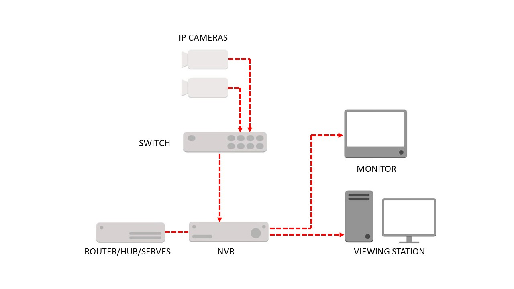

Every recorder overwrites old video once its disks are full. Retention is simply how many days pass before that happens. Most owners never choose it. The disk size chooses for them.

## The storage maths

Disk use is bitrate multiplied by time. A rough guide for one camera recording all day:

| Stream | Per day | 30 days |
|---|---|---|
| 2 Mbps (1080p, efficient codec) | about 21 GB | about 630 GB |
| 4 Mbps (4 MP) | about 43 GB | about 1.3 TB |
| 8 Mbps (4K) | about 86 GB | about 2.6 TB |

Multiply by your camera count. Eight 4 MP cameras for 30 days need about 10 TB, before any spare space.

## What the disks cost in Nepal

Surveillance disks are sold on Daraz by several sellers, and prices differ even for the same size. A WD Purple 1 TB was listed at [Rs 12,500](https://www.daraz.com.np/products/western-digital-wd-purple-1tb-surveillance-hard-drive-i127821512.html) and a WD Purple 2 TB at [Rs 19,999](https://www.daraz.com.np/products/wd-purple-surveillance-hard-drive-2tb-with-1-year-warranty-i185647125.html) (checked October 2026). A Hikvision-labelled 4 TB WD Purple was listed by another seller at [Rs 14,510](https://www.daraz.com.np/products/hikvision-western-digital-4-tb-surveillance-hard-disk-for-desktop-dvrnvr-wd-purple-i110447902.html) (checked October 2026). The larger disk can cost less than the smaller one, so compare sellers and warranty terms before you buy.

## Ways to stretch it

- **Motion recording** on quiet cameras, such as a back store room.
- **A lower substream** for cameras that only need to show presence.
- **Efficient codecs** where your cameras support them.
- **Different retention per camera.** The cash counter needs longer than the street view.

## What the law asks

Nepal's Privacy Act, 2075 sets no retention period. The three-month minimum comes from the Ministry of Home Affairs' CCTV Installation and Operation Procedure, as amended in 2019 ([Himalayan Times, 15 February 2019](https://thehimalayantimes.com/kathmandu/misuse-of-cctvs-made-punishable)). Banks and public bodies often have their own, longer rules. Read the details in [the Privacy Act and CCTV in Nepal](/blog/privacy-act-2075-cctv-nepal).

## Keep the important moments longer

A fixed period cannot know which clip matters. When an incident happens, export it before the overwrite reaches it. See [exporting evidence that stands up](/blog/cctv-evidence-export-nepal).

## Choose a number, then check it

Pick the days you need, multiply, and compare with the disk you have. If the answer does not fit, reduce cameras on continuous recording before you reduce days.
