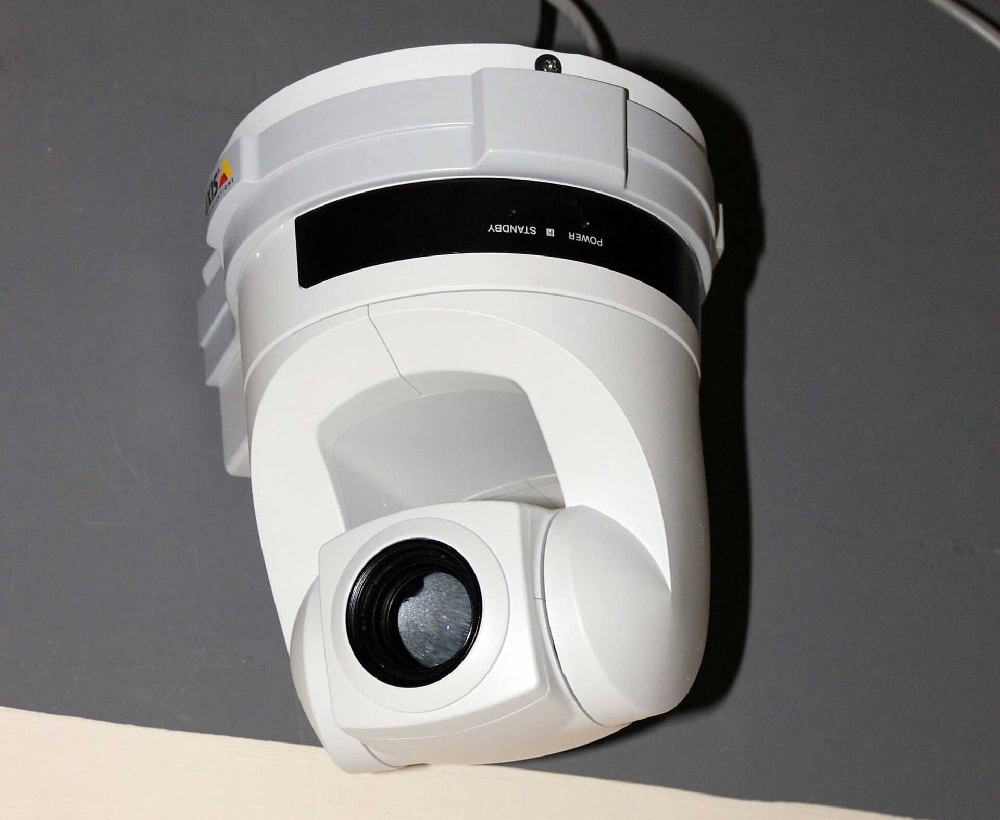

The installer's login is often the only one that works on the recorder. It stays there for years. Then the installer changes shops, the customer has no way in, and everybody is worse off.

## What a good handover includes

- **Owner accounts** created and signed in before you leave.
- **Passwords changed** from defaults on every camera and recorder. See [default passwords on CCTV cameras](/blog/default-passwords-cctv-cameras).
- **The site claimed by the owner**, so you no longer hold the only key.
- **A named list of who can see what.**
- **A note of what is installed**: recorder, cameras, retention, disk size.

## What a basic site costs

Owners often ask what they are being handed. Two small Daraz kits give a sense of scale: a CP Plus 4-channel DVR kit with 2 dome cameras at [Rs 13,200](https://www.daraz.com.np/products/cp-plus-cctv-camera-set-4-channel-dvr-with-2-dome-camera-along-with-accessories-i100680103.html), and a TVT 4-channel night vision package with DVR and a 500 GB Seagate disk at [Rs 30,000](https://www.daraz.com.np/products/tvt-4-channel-night-vision-hd-cctv-package-with-dvr500-gb-seagate-hard-disk-i129212965.html) (checked October 2026). Installation, cabling and extra disks are quoted separately by each installer. For LunaCam prices, see [pricing](/pricing).

## How it works on LunaCam

You manage many customers from one installer account. When a job ends you hand the site over, and the owner takes it. After that:

- You see the site only when the owner approves an access request.
- The owner can use privacy mode to block installers and admins from seeing cameras.
- Remote diagnostics (ping, stream test, logs, speed test) are available for the time the owner allows.

## Why it helps you

Customers who control their own system trust you more, not less. And a clean handover means the support calls you get are real ones.

See [LunaCam for installers](/solutions/installers) and [become an installer partner](/resellers).
