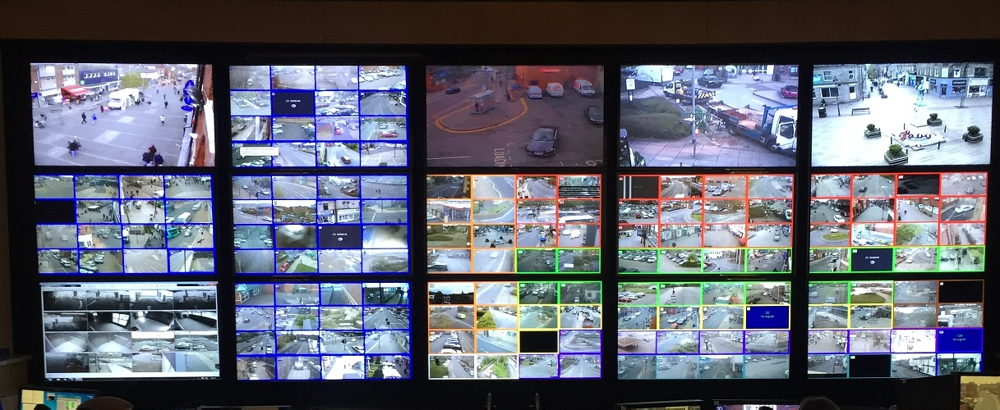

A municipality can buy a hundred cameras in a year. The harder part is deciding who looks at them and what happens next.

## What it can cost

Budgets are usually reported as one figure. The Budhanilkantha project, a joint effort of the Kathmandu Valley Police Office and the municipality, put 181 AI-based cameras on three routes for [Rs 50 million](https://www.technologykhabar.com/?p=160673), as reported in 2024. That total covers the whole project, so it is not a price per camera. Ask for a bill of quantities that lists cameras, network, storage, control room and support separately.

## Start with process

1. **Who is the operator?** Name the roles: operator, supervisor, auditor.
2. **What counts as an alarm?** Offline, tamper, motion in a closed zone.
3. **What do they do when one fires?** Write the steps. They should appear beside the alarm, with the related cameras and the video before and after.
4. **Who do they call if nobody acknowledges?** Set escalation: after five minutes, call the next person.
5. **Who answers police?** One request, approval and delivery path.

## What the platform has to hold

- A map of Nepal or a floor plan with camera icons and field-of-view cones.
- An alarm queue with priority, assignment and acknowledgement reasons such as false alarm, guard sent or police called.
- A command dashboard of sites, open alarms and offline devices.
- Feed sharing with police, with expiring access.
- An audit log of who watched what.

## What the law asks of public bodies

Public bodies that install CCTV are to notify the police or District Administration Office within 15 days, and keep footage for at least three months. See [the Privacy Act, 2075 summary](/blog/privacy-act-2075-cctv-nepal). LunaCam fills in the notice.

## Start small

Pick one corridor, run the process for a month and fix what does not work. Then add sites. See [LunaCam for municipalities](/solutions/municipalities).
