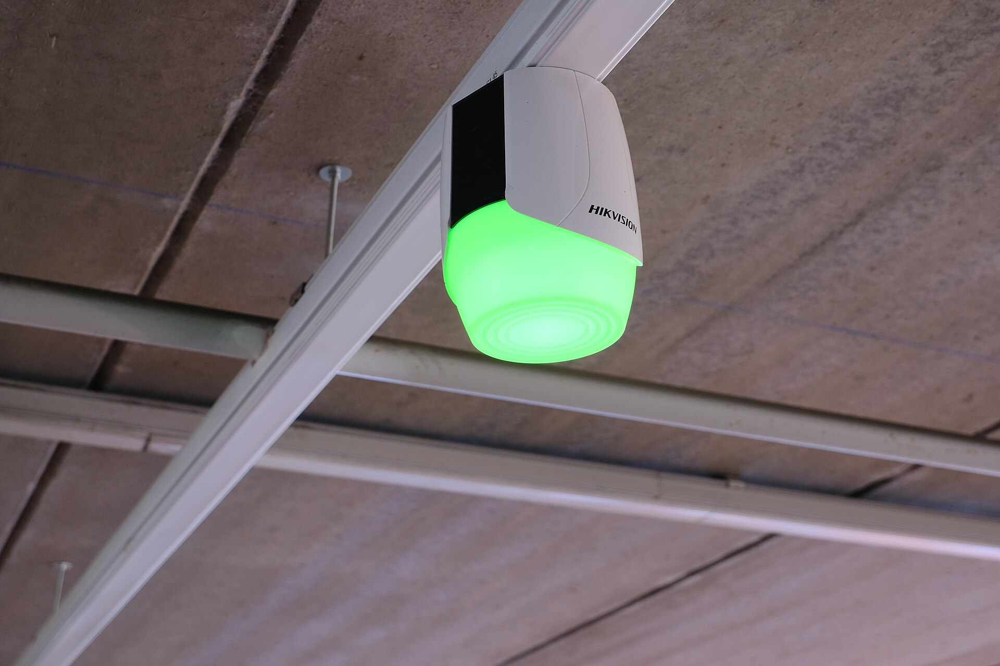

Open a good camera app and you may see a Hikvision DVR, a Dahua camera and an unlabelled one from a market stall, all in the same grid. That works because of two standards.

## RTSP: the video

RTSP gives a camera or recorder a web-style address that returns its video. Almost every IP camera and DVR offers it. If you know the address and the login, any software can ask for the picture. See [RTSP](/glossary/rtsp).

## ONVIF: the conversation

RTSP only carries video. ONVIF adds the rest: finding cameras on the network, reading their capabilities, moving PTZ and receiving events. ONVIF is organised in profiles. S covers live video and PTZ. T adds H.265 and encrypted connections. G covers searching recordings stored on a recorder or card. See [ONVIF](/glossary/onvif).

## Where brand adapters still matter

Standards cover the common ground. Some features live in the maker's own interface: some alarm inputs, health data, playback search on older firmware. For the two brands most common in Nepal, LunaCam has direct adapters for Hikvision and Dahua, so those go beyond what ONVIF alone exposes.

## What this means when you buy

- You do not have to buy one brand everywhere.
- When you choose a camera, check that it lists ONVIF, ideally profiles S and T.
- Keep the main and sub streams enabled. Software picks the sub stream for small tiles to save data.

Developers can build on the same layer through the [developer platform](/products/developer-platform).
