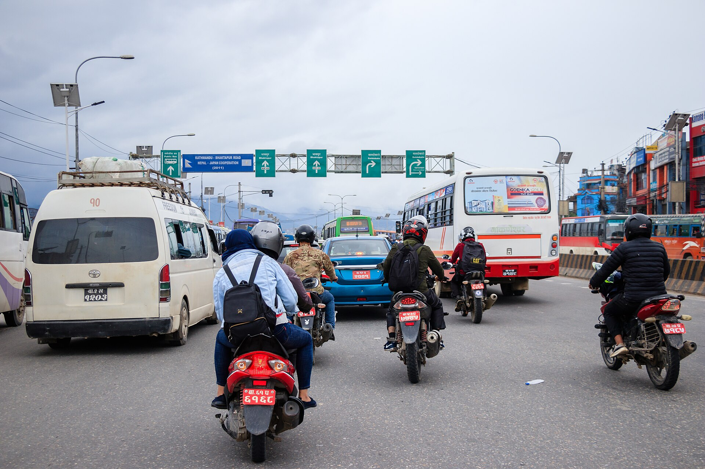
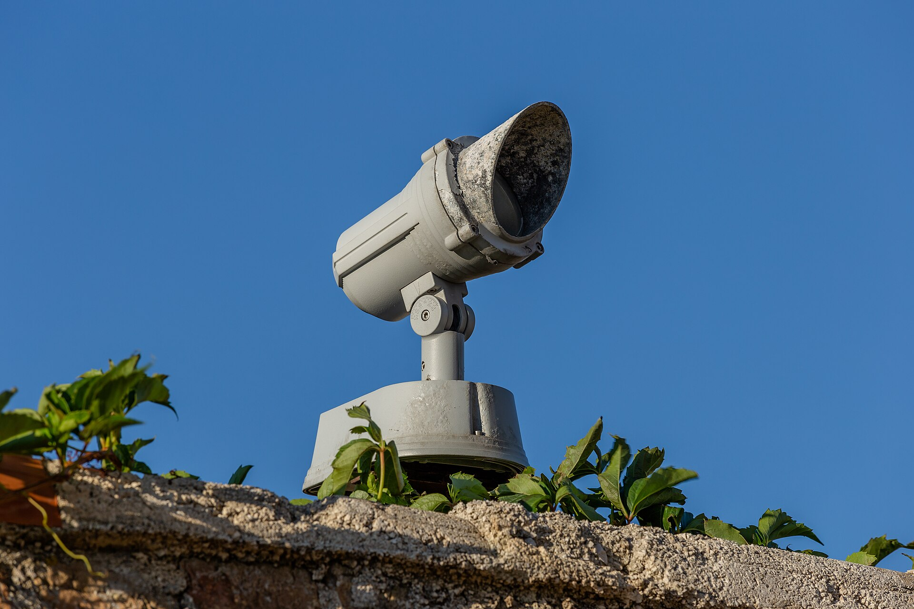

This is a plain summary, not legal advice. Read the Act, or ask a lawyer, before you rely on any of it.

Nepal's Privacy Act, 2075 (2018) is the first law in Nepal to say how CCTV footage should be handled. Four of its points matter most to people who run cameras.

## 1. Public bodies tell the authorities

Government and public bodies that install CCTV are to inform the police or the District Administration Office within 15 days. The notice names the sites and the purpose.

## 2. Footage is kept for a minimum period

Footage is to be kept for at least three months. That is a floor. If a case is open, footage involved is held for as long as the case needs.

## 3. Police can ask for it

Footage is to be given to the police on request. The operator needs a way to receive the request, decide on it, deliver the right footage and prove what was delivered.

## 4. Some places must run CCTV

Banks, financial institutions, malls, jewelers and cybercafes are among the places required to run CCTV, so they also need the first three to work.

## What this asks of your system

- **Notice to authorities:** a record of sites and cameras you can turn into a notice.
- **Three months of footage:** a retention floor nobody can shorten by mistake.
- **Delivery to police:** a request, approval and delivery trail.
- **Care of personal data:** roles, an audit log and exports that are tracked.

## How LunaCam helps

LunaCam fills in the notice, sets a retention floor, runs a request, approval and delivery workflow, and logs every view and export. See [Evidence and Compliance](/products/evidence). For how an export holds up as evidence, read [exporting CCTV evidence that stands up](/blog/cctv-evidence-export-nepal).

The legal duty stays with the operator. The software only makes it possible to meet it.
