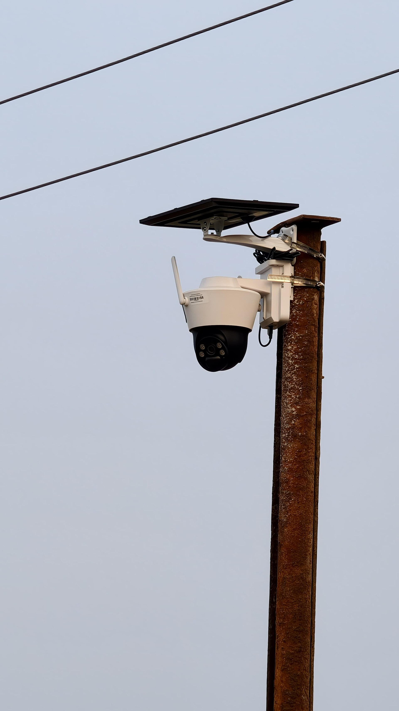
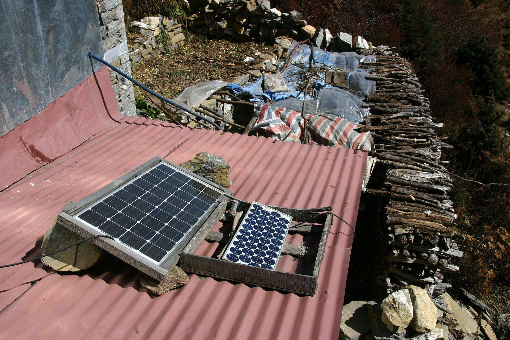
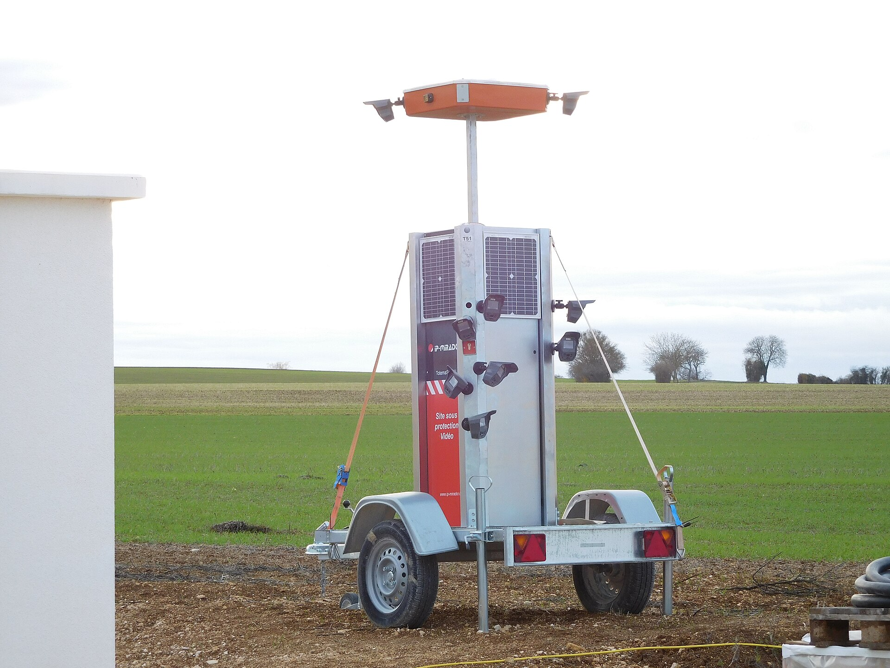

Some places in Nepal have no mains power or no internet: a farm, a building site, a road bend, a hillside store, a water tank. A solar camera uses a panel and a battery in place of a cable, and often a 4G SIM in place of broadband. This guide covers how to size one using Nepali sunshine data, what makers say about charging, and what the options cost on Daraz Nepal.

For cameras that connect by SIM, read [4G SIM CCTV cameras in Nepal](/blog/4g-sim-cctv-camera-nepal) as well. For the choice between WiFi and cable, see [WiFi vs wired cameras](/blog/wifi-vs-wired-cctv-camera).

## How much sun does Nepal get

Wikipedia's page on solar power in Nepal gives the average global solar radiation as 3.6 to 6.2 kWh per square metre a day, about 300 sunny days a year, and an average of 6.8 sunshine hours a day, with an average insolation of about 4.7 kWh per square metre a day ([source](https://en.wikipedia.org/wiki/Solar_power_in_Nepal)). One kWh per square metre a day equals one peak sun hour, the unit solar sizing uses. So 3.6 to 6.2 kWh a day is 3.6 to 6.2 peak sun hours.

Measured data from the Kathmandu valley adds season and a warning:

| Finding | Source |
|---|---|
| Pre-monsoon and post-monsoon sunshine about 8 hours a day, summer about 5, winter about 7 | [Journal of Hydrology and Meteorology](https://nepjol.info/index.php/JHM/article/view/15576) |
| Solar radiation about 190 W per square metre pre-monsoon, 170 in the monsoon and 135 in winter, the least | same |
| Kathmandu and Nepalgunj Jan to June 2019: "very good sunshine of 5 hours/day in winter and excellent sunshine of 8 hours/day in summer" | [Journal of Advanced College of Engineering and Management](https://www.nepjol.info/index.php/JACEM/article/view/93954) |

The two Kathmandu sources use different definitions of summer and different years, so they do not agree on summer hours. They agree on one thing for sizing: winter receives the least radiation in the first study, and the monsoon is lower than the pre-monsoon. Plan on the worst month, not the average, and use the low end of the national range, 3.6 peak sun hours, when you do not know your site. Measured data for your valley or hill may be different, since the second paper says continuous long-term solar data are not available in Nepal.

## The parts of a solar camera

| Part | Job |
|---|---|
| Solar panel | Charges the battery while the sun shines |
| Charge controller | Regulates the flow from the panel to the battery. Wasserstein's guide says to match its voltage and current to the panel and battery |
| Battery | Stores power for night and cloudy days |
| Camera | Records and sends video, often with a pan and tilt head |
| 4G SIM or WiFi | Carries video to your phone |
| Memory card | Keeps a local copy |

Many cameras are sold with the panel and battery built in or attached. For a larger DIY system, a 10 A, 12 V/24 V solar charge controller with two USB ports listed at Rs 838 on Daraz from Shrestha Trade Link on 19 October 2026 ([Daraz](https://www.daraz.com.np/products/10a-solar-charge-controller-12v24v-solar-panel-battery-intelligent-regulator-with-dual-usb-port-color-may-vary-i128409201.html)).

## How makers size panels

Reolink's guide says manufacturers build outdoor solar cameras to run on 2 to 4 hours of direct sunlight a day, and that this counts peak sun hours only, when sunlight hits the panel straight-on at full strength. Four things change the figure ([source](https://reolink.com/blog/how-much-sunlight-does-an-outdoor-solar-security-camera-need/)).

- Battery size. A larger battery buys a buffer on low-sun days. Reolink's example is its Altas with a 20,000 mAh battery, which it says runs up to 540 days in motion detection mode and needs as little as 10 minutes of direct sun a day to stay charged in that mode.
- Panel wattage. A bigger panel collects more per hour of direct sun.
- How often the camera records. Reolink says this affects power draw more than any other setting.
- Climate and season. Panels face the equator and tilt about to the latitude to balance the seasons, and a panel under a roof overhang "may charge at less than half the efficiency" of one in direct sun.

Reolink also says many solar cameras ship the panel on a separate cable so you can put it where the sun lands, and that the most common installation mistake is mounting the panel next to the camera without checking the spot gets direct sun.

## A sizing method you can use

Two installer guides give the same method ([Wasserstein](https://wasserstein-home.com/blogs/smart-home/how-to-power-a-security-camera-using-solar-panel-a-step-by-step-guide), [a UK solar CCTV guide](https://home-security-guide.readthedocs.io/en/latest/cctv/11-solar-powered-cctv-camera-guide-uk/)).

1. Daily energy in watt hours = the camera's average watts x hours a day.
2. Panel watts = daily watt hours divided by peak sun hours, plus a margin of 20 to 30 percent for cloud cover and system losses.
3. Battery: choose at least 2 to 3 days of autonomy in case of cloudy days. Use only about 50 percent of a lead-acid battery's capacity to preserve its life. Wasserstein says lithium lasts up to 3 times more cycles than lead acid.
4. Divide watt hours by 12 for the amp hours of a 12 V battery.

The camera's average draw must come from its datasheet or a meter. The table below uses three example draws to show how the numbers scale. They are inputs, not product specifications.

| Average draw | Daily energy | Panel at 3.6 sun hours | With 30% margin | Panel at 4.7 sun hours | With 30% margin |
|---|---|---|---|---|---|
| 2 W | 48 Wh | 13.3 W | 17.3 W | 10.2 W | 13.3 W |
| 5 W | 120 Wh | 33.3 W | 43.3 W | 25.5 W | 33.2 W |
| 9 W | 216 Wh | 60.0 W | 78.0 W | 46.0 W | 59.8 W |

| Average draw | 3 days of battery | Lead-acid capacity needed (50% usable) | Amp hours at 12 V |
|---|---|---|---|
| 2 W | 144 Wh | 288 Wh | 24 Ah |
| 5 W | 360 Wh | 720 Wh | 60 Ah |
| 9 W | 648 Wh | 1,296 Wh | 108 Ah |

Read these as planning figures. The UK guide adds that winter performance sets the size and that panels should be cleaned monthly, and that a north-facing panel in the UK produces only 20 to 30 percent of rated output. In Nepal the equivalent is a panel that faces away from the sun or sits in shade.

### What the built-in panels give

One Daraz listing helps show the scale. The Kapan Tech camera lists a built-in 10,000 mAh lithium battery and an 8 W solar panel, a WiFi connection, SD cards up to 256 GB, and a low-battery standby with PIR and app wake. An 8 W panel at 3.6 peak sun hours gives about 29 Wh a day before losses. That fits a camera that mostly sleeps and wakes on motion, not one that streams all day, which matches Reolink's remark that recording frequency drives draw.

## What solar and 4G cameras cost in Nepal

Daraz Nepal listings I opened on 19 October 2026. The solar rows are battery or panel cameras. The 4G rows have a SIM slot and need mains power or your own solar kit.

| Item | Key spec | Seller | Price (Rs) | Source | Checked |
|---|---|---|---|---|---|
| WiFi Solar Camera Dual Lens 2+2MP Dual Screen Battery CCTV Motion Detection Home Protection... | 2+2 MP dual lens solar, WiFi or 4G version | Sasto Gadgets And Accessories | 5,999 | [Daraz](https://www.daraz.com.np/products/wifi-solar-camera-dual-lens-22mp-dual-screen-battery-cctv-motion-detection-home-protection-security-i179720120.html) | 19 Oct 2026 |
| 2mp+2mp Dual Screen Solar Camera Outdoor Wireless /WiFi PTZ Dual Lens Security Protection... | 2+2 MP dual lens solar, WiFi or 4G version | Dream Market And Accessories | 6,500 | [Daraz](https://www.daraz.com.np/products/2mp2mp-dual-screen-solar-camera-outdoor-wireless-wifi-ptz-dual-lens-security-protection-auto-tracking-cctv-cameras-i180423208.html) | 19 Oct 2026 |
| 3MP Solar-powered battery backup 10000mAh Full-Color Wi-Fi Pan/Tilt Camera with 64 GB SD card | 3 MP solar, 10,000 mAh battery, 8 W panel, WiFi, 64 GB card | Kapan Tech | 14,400 | [Daraz](https://www.daraz.com.np/products/3mp-solar-powered-battery-backup-10000mah-full-color-wi-fi-pantilt-camera-with-64-gb-sd-card-i1512890474.html) | 19 Oct 2026 |
| 4MP IR Fixed-focal Bullet 4G Solar Power Network Camera | 4 MP 4G solar bullet | FonePortal | 34,200 | [Daraz](https://www.daraz.com.np/products/4mp-ir-fixed-focal-bullet-4g-solar-power-network-camera-i509254924.html) | 19 Oct 2026 |
| 8 MP (4+4) MP Dual Lens 4G IP Night Vision Camera Surveillance 1080P Full HD Automatic... | 8 MP (4+4) dual lens 4G | Lagankhel Gadgets | 3,799 | [Daraz](https://www.daraz.com.np/products/8-mp-44-mp-dual-lens-4g-ip-night-vision-camera-surveillance-1080p-full-hd-automatic-outdoor-smarthome-cctv-camera-v380-pro-two-way-audio-i172022686.html) | 19 Oct 2026 |
| 4G Sim Card Support Dual Lens WIFI IP Camera Outdoor IP66 Waterproof | 4G SIM dual lens, IP66 | T&T Traders | 4,399 | [Daraz](https://www.daraz.com.np/products/4g-sim-card-support-dual-lens-wifi-ip-camera-outdoor-ip66-waterproof-i295977844.html) | 19 Oct 2026 |
| EZVIZ H8C 4G 3MP Smart Home Camera | 3 MP 4G | NEPAL CCTV SALES | 11,500 | [Daraz](https://www.daraz.com.np/products/ezviz-h8c-4g-3mp-smart-home-camera-i130039364.html) | 19 Oct 2026 |
| EZVIZ H9C 3K(5MP+5MP) Dual-Lens Pan & Tilt 4G,Wi-Fi/Wired CCTV Camera(SD Card Not Included) | 5+5 MP dual lens, 4G and WiFi, SD card not included | Laliguras Digital Art and Multi Services | 11,663 | [Daraz](https://www.daraz.com.np/products/ezviz-h9c-3k5mp5mp-dual-lens-pan-tilt-4gwi-fiwired-cctv-camerasd-card-not-included-i168669916.html) | 19 Oct 2026 |
| DS-2DE2C400MWG-4G | 4 MP pan and tilt, 4G, IP66 | नेपाल वाङ चेङ ट्रेड | 18,000 | [Daraz](https://www.daraz.com.np/products/hikvision-fixed-outdoor-smart-pt-pan-tilt-ds-2de2c400mwg-4g-i1546504817.html) | 19 Oct 2026 |
| 4G Network Camera 4MP IR Fixed-focal Bullet WizSense DHI-IPC-HFW3441DG-AS-4G-EAU-B | 4 MP bullet, 4G, H.265, 8 GB onboard | Enroz Store | 24,500 | [Daraz](https://www.daraz.com.np/products/4g-network-camera-4mp-ir-fixed-focal-bullet-wizsense-dhi-ipc-hfw3441dg-as-4g-eau-b-i142572779.html) | 19 Oct 2026 |

Notes on the table:

- The two cheapest solar listings state two versions. The WiFi version connects to your 2.4 GHz WiFi and has no 4G SIM slot. The 4G version uses a SIM and does not support WiFi. For a site with no internet you need the 4G version, so confirm which one the seller will send.
- The Dahua 4G camera at Rs 24,500 lists a built-in 4G module, 8 GB of onboard memory, up to 256 GB on a card, H.265 and IP67. It is not solar, so a panel and battery are extra.
- The only 4G solar bullet camera found, at Rs 34,200, describes itself as solar powered with a 4G SIM, with no panel wattage or battery capacity in the listing text I read.
- The spread between a Rs 3,799 4G camera and a Rs 24,500 4G camera is large, so check the app, the bands the camera supports and the warranty. See the [4G guide](/blog/4g-sim-cctv-camera-nepal).

Nepal prices for separate panels and batteries were not collected for this guide. Ask a solar supplier for a quote on a panel and battery sized with the tables above.

## Where to mount it

1. Put the panel where it gets direct sun, facing the equator, and on a separate cable if the camera has to sit in shade. Reolink says a panel in shade can charge at less than half the rate.
2. Mount the camera high enough to be out of reach, on a pole or wall.
3. Check the 4G signal at the exact spot with a phone before you drill.
4. Clean the panel regularly. The UK guide advises monthly.
5. Fix the panel and battery firmly. Panels and batteries are easy to steal.

## What goes wrong

| Problem | Likely cause | What to do |
|---|---|---|
| Camera dies in a spell of cloud | Battery or panel too small for the worst month | Re-run the sizing with 3.6 peak sun hours and 3 days of autonomy |
| Camera fades over weeks | Dust on the panel or shade | Clean it, and check shade at different times of day |
| WiFi solar camera has no signal at a remote site | The WiFi version has no SIM slot | Buy the 4G version, or place a router nearby |
| 4G solar camera will not join a router | The 4G version does not support WiFi | Use the SIM, or buy the WiFi version |
| Video drops | Weak 4G signal | Test the signal first, try the other operator |

## Recording and keeping footage

Many solar cameras record to a memory card. The Kapan Tech listing gives a maximum of 256 GB, and the Dahua 4G camera lists up to 256 GB plus 8 GB of onboard memory. If the camera is stolen the card goes with it, so where the camera supports it, send alerts and short clips to your phone. See the [storage tables](/blog/cctv-hard-disk-recording-days) for how long a card lasts.

## Seeing a solar camera in your app

Solar cameras usually come with their own app that sends video through the maker's cloud. If the camera offers ONVIF or RTSP, it can join the same app as your other cameras. The [LunaCam Box](/products/lunacam-box) connects recorders and ONVIF or RTSP cameras to one app. Check the listing for a standard stream before you buy, because many entry models do not offer one.

## Checklist

1. Which version: WiFi or 4G? Confirm with the seller.
2. Does the listing state panel watts and battery capacity?
3. What is the camera's average draw in watts?
4. Panel: draw x 24 divided by 3.6, plus 20 to 30 percent.
5. Battery: 2 to 3 days, half usable if lead-acid.
6. Is there a 4G signal at the spot?
7. Is the panel in direct sun all year, including the worst month?
8. Memory card size, and is there a way to get alerts off site?
9. Warranty, and who repairs it.

## Sources

- [Wikipedia: Solar power in Nepal](https://en.wikipedia.org/wiki/Solar_power_in_Nepal)
- [Journal of Hydrology and Meteorology: Solar energy potential in the Kathmandu valley](https://nepjol.info/index.php/JHM/article/view/15576)
- [JACEM: Comparative analysis of irradiance at two locations in Nepal](https://www.nepjol.info/index.php/JACEM/article/view/93954)
- [Reolink: how much sunlight a solar camera needs](https://reolink.com/blog/how-much-sunlight-does-an-outdoor-solar-security-camera-need/)
- [Wasserstein: how to power a security camera using solar](https://wasserstein-home.com/blogs/smart-home/how-to-power-a-security-camera-using-solar-panel-a-step-by-step-guide)
- [UK solar CCTV camera guide](https://home-security-guide.readthedocs.io/en/latest/cctv/11-solar-powered-cctv-camera-guide-uk/)
- Daraz Nepal listings, linked in the table above.
