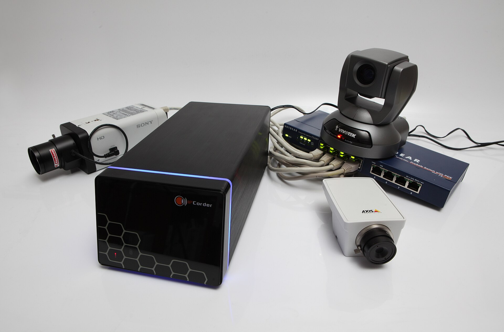
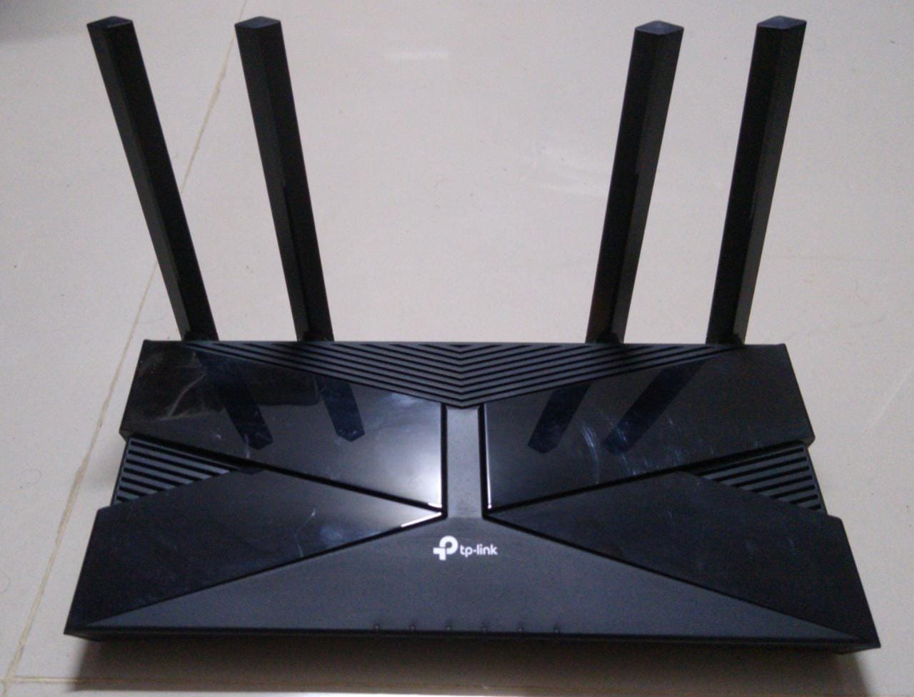
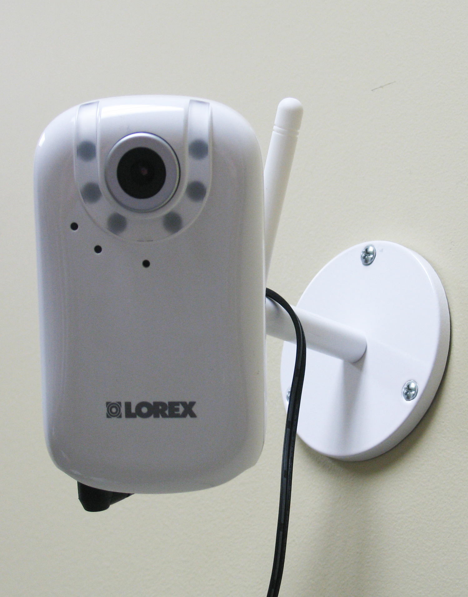

Almost every DVR sold in Nepal can be watched from a phone. The three common ways differ in effort, risk and where your video goes.

## 1. The vendor's app

You scan a QR code on the DVR screen, add it to the maker's app and you are done. It needs no router changes.

The cost is that video and your recorder password pass through the vendor's cloud, abroad. If that matters to you, read [Hik-Connect alternatives in Nepal](/blog/hik-connect-alternative-nepal).

## 2. Port forwarding

You log in to your router, forward a port to the DVR's address and connect to your public IP.

It gives you a direct path, but it exposes the DVR to the whole internet, it needs a static or dynamic address, and it fails entirely when your provider shares one address among many customers. That sharing is called CGNAT, explained in [why remote viewing fails behind CGNAT](/blog/cctv-remote-viewing-cgnat-nepal).

## 3. A box that connects out

A small box or agent on your network connects outward to a relay. The app connects to the same relay. Nothing on the router changes, and it works behind CGNAT.

This is how the [LunaCam Box](/products/lunacam-box) works, with relays in Nepal.

## Setting it up with LunaCam

1. Plug in the box, or install the agent on a PC that is always on.
2. Open the app and scan the code shown on the box.
3. The box finds your recorder and cameras on the network. Choose the ones to show.
4. If any still use the default password, change them when the app suggests it.
5. Open live view. Save a grid you use often.

## What the internet costs

Remote viewing needs an upload connection that stays on. WorldLink listed a residential 200 Mbps plan at [Rs 14,894 for 12 months](https://worldlink.com.np/internet-plans/residential-broadband/) and 600 Mbps at Rs 20,000 for 12 months, with VAT extra (checked October 2026). A few cameras at low-data settings need far less than either plan, so choose by how many people share the line, not by the cameras.

## A few habits that help

- Give each camera a clear name: Front gate, Counter, Stockroom.
- Share cameras with family or staff from the app instead of giving out the DVR password.
- Look at the last-seen time now and then. A camera that stopped last month is a camera you will not have footage from.
