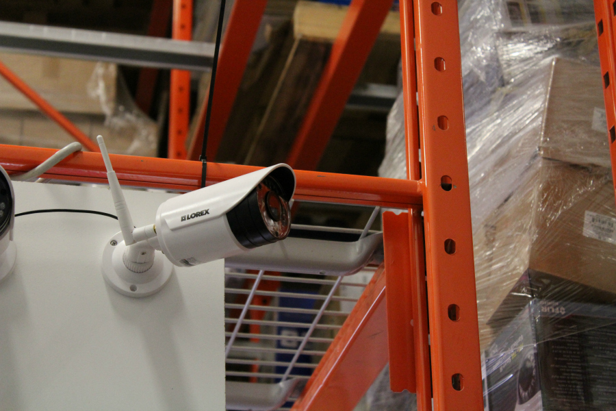

The choice is between cameras that send video over radio and cameras that send it over a cable. The right pick depends on how many cameras you need, how much the footage matters and where the cameras sit. This guide uses spec sheets and camera makers' own guides for the technical points, and live Daraz Nepal listings for prices.

Resolution, lens and night vision are covered in [choosing CCTV cameras](/blog/choosing-cctv-cameras-nepal). Full system costs are in [CCTV camera price in Nepal](/blog/cctv-camera-price-nepal).

## What each one means

A wired camera connects to a recorder or router by a cable. Reolink describes two types: PoE IP cameras using one Cat5 or Cat6 Ethernet cable for power and data, and older analog cameras using a coaxial cable plus a separate power cable ([Reolink](https://reolink.com/blog/wired-vs-wireless-security-cameras/)). The [PoE](/glossary/poe) and [analog HD camera](/glossary/analog-hd-camera) entries explain both.

A wireless camera sends video over WiFi. Reolink says "wireless" covers two setups: plug-in cameras that still need a constant outlet for power, and wire-free battery or solar cameras that need no cables or outlet.

So "wireless" describes the video link, not the power. Whatever you buy, something has to power it.

## What a WiFi camera spec sheet says

The TP-Link Tapo C200 is one of the best known WiFi cameras, and TP-Link publishes its specifications. These are from the official Tapo spec page ([source](https://www.tapo.com/us/product/tapo-c200-security-camera/specs/)).

| Item | Tapo C200 |
|---|---|
| Wireless | IEEE 802.11b/g/n, 2.4 GHz WiFi |
| Ethernet port | none listed |
| Power | 9 V DC adapter, input 100 to 240 V, output 9 V 0.6 A |
| Video | 1080P (1920 x 1080), 15 fps, H.264 |
| Night vision | 850 nm IR LED, 30 ft (9 m) |
| Local storage | microSD slot, up to 512 GB |
| Cloud storage | Tapo Care, subscription required |
| Operating temperature | 0 to 40 C |
| Weather resistance | none listed |
| Standards | ONVIF: yes, RTSP: yes |
| Mounting | tabletop or ceiling |

Four points follow for a buyer in Nepal.

1. The C200 is an indoor camera. Its spec sheet lists no weather resistance and an operating range of 0 to 40 C, so do not put it outside.
2. It needs a mains outlet for the adapter.
3. It has no Ethernet port, so its video link is 2.4 GHz WiFi.
4. It supports ONVIF and RTSP, so it can be read by standard recorders and apps. See the [ONVIF and RTSP guide](/blog/onvif-rtsp-one-app-many-brands).

Other models differ, so read the sheet for the one you buy.

## Where WiFi cameras fall short

### Range and walls

Reolink says all wireless security cameras must be located within WiFi range, and that significant building or metal between the camera and the router can cause connection issues, which repeaters can help. Another maker, Swann, notes that wired systems are not exposed to interference from wireless signals because the camera, recorder and router are physically connected ([Swann](https://blog.swann.com/wired-vs-wireless-vs-wire-free-security/)).

Most Nepali buildings use concrete, so test the signal where the camera will sit. Open a video on your phone on the same network. If it buffers there, the camera will buffer too.

### Power

A plug-in WiFi camera needs a socket. A battery or solar camera needs charging or sun. Swann points out that a wired system loses power in an outage too, and suggests a generator for remote sites. For sites with no power, see [solar CCTV cameras in Nepal](/blog/solar-cctv-camera-nepal).

### Storage

Many WiFi cameras record to a microSD card in the camera. The Tapo C200 accepts up to 512 GB, and its cloud option is a subscription. A recorder with a surveillance disk keeps all cameras in one place, while cards sit in each camera. The [storage tables](/blog/cctv-hard-disk-recording-days) show how many days a disk or card holds.

### Security

A WiFi camera is a device on your network. Change the default password and keep the firmware current. See [default passwords](/blog/default-passwords-cctv-cameras). The Tapo C200 sheet lists 128-bit AES encryption with SSL/TLS and WPA/WPA2-PSK, which is the kind of detail to look for in any camera.

## Where wired cameras fall short

Reolink and Swann both name the same drawback: installation. Swann says running multiple cables can be daunting and that wired systems are less flexible to mount. Reolink says wired is the better fit if you want maximum reliability and 24/7 recording and do not mind running cable, while wireless suits a fast DIY setup and repositioning later.

Cable choice matters for PoE. IP Security Depot says copper-clad aluminium (CCA) has roughly 58 percent higher resistance than copper, which spends the PoE voltage budget before it reaches the device, and that it is not TIA compliant ([IP Security Depot](https://www.ipsecuritydepot.com/blog/why-cca-ethernet-cable-fails-poe-installs/)). If you choose wired IP cameras, ask for pure copper network cable.

A recorder with built-in PoE ports puts its cameras on a private network. Hikvision explains that if cameras are plugged into the PoE switch on the back of the recorder, they sit in their own private network, so SADP cannot see them from your router unless you plug a computer into one of the PoE ports or cable the recorder to the router ([Hikvision](https://supportusa.hikvision.com/support/solutions/articles/17000128664-why-can-t-i-see-my-cameras-on-sadp-but-i-can-see-my-nvr-)).

## Prices in Nepal

All rows are Daraz Nepal listings I opened on 19 October 2026.

### WiFi cameras

| Item | Key spec | Seller | Price (Rs) | Source | Checked |
|---|---|---|---|---|---|
| Ezviz H1C 1080P Smart Home 2MP Wi-Fi CCTV Camera With Magnetic Base | 2 MP, indoor, magnetic base | Tech in town Store | 3,170 | [Daraz](https://www.daraz.com.np/products/ezviz-h1c-1080p-smart-home-2mp-wi-fi-cctv-camera-with-magnetic-base-i129760735.html) | 19 Oct 2026 |
| Ezviz H1C 1080P Indoor Smart Home 2MP Wi-Fi CCTV Camera With Magnetic Base(SD Card Not... | 2 MP, indoor, magnetic base, no card | Laliguras Digital Art and Multi Services | 3,618 | [Daraz](https://www.daraz.com.np/products/ezviz-h1c-1080p-indoor-smart-home-2mp-wi-fi-cctv-camera-with-magnetic-basesd-card-not-included-i104484076.html) | 19 Oct 2026 |
| Ezviz H1C 1080P Smart Home 2mp WiFi Camera And Magnetic Base With Hixa 64 GB SD Card | 2 MP with 64 GB card | Tech in town Store | 5,770 | [Daraz](https://www.daraz.com.np/products/ezviz-h1c-1080p-smart-home-2mp-wifi-camera-and-magnetic-base-with-hixa-64-gb-sd-card-i155562142.html) | 19 Oct 2026 |
| Hikvision Ezviz 3MP 2K H6C G1 Pro internet PT CCTV Camera with Sd Card Supported | 3 MP, pan and tilt, SD card supported | Tech in town Store | 3,838 | [Daraz](https://www.daraz.com.np/products/hikvision-ezviz-3mp-2k-h6c-g1-pro-internet-pt-cctv-camera-with-sd-card-supported-i134545266.html) | 19 Oct 2026 |
| Ezviz H6C G1 2K 3MP Indoor Pan & Tilt Wired/Wireless CCTV Camera, Smart Night Vision With... | 3 MP, indoor pan and tilt | Laliguras Digital Art and Multi Services | 4,100 | [Daraz](https://www.daraz.com.np/products/ezviz-h6c-g1-2k-3mp-indoor-pan-tilt-wiredwireless-cctv-camera-smart-night-vision-with-sd-card-supported-sd-card-not-included-i104960478.html) | 19 Oct 2026 |
| EZVIZ H6c G1 2K (3MP) | 3 MP, pan and tilt | Next Trade Link | 4,170 | [Daraz](https://www.daraz.com.np/products/ezviz-h6c-g1-2k-3mp-i164492467.html) | 19 Oct 2026 |
| Imou Ranger 2 Pro 3MP 3MP Wi-Fi PT Camera IPC-S2EP-3R1S | 3 MP, pan and tilt | Ps-Technology | 3,998 | [Daraz](https://www.daraz.com.np/products/imou-ranger-2-pro-3mp-3mp-wi-fi-pt-camera-ipcep-3r1s-i188158218.html) | 19 Oct 2026 |
| IMOU Ranger 2 Pro 3MP Full-Color Night Vision Security Camera with Human, Pet & Abnormal... | 3 MP, full colour night | BHILASH IT Traders | 4,090 | [Daraz](https://www.daraz.com.np/products/imou-ranger-2-pro-3mp-full-color-night-vision-security-camera-with-human-pet-abnormal-detection-dual-band-wi-fi-6-one-touch-call-2-years-warranty-i108940135.html) | 19 Oct 2026 |
| Wireless CCTV Camera IMOU Ranger 2 Pro 3MP (IPC-S2EP-3R1S) Human, Pet & Abnormal Sound... | 3 MP, pan and tilt | ROYAL COMPUTER INSTITUTE | 4,400 | [Daraz](https://www.daraz.com.np/products/wireless-cctv-camera-imou-ranger-2-pro-3mp-ipcep-3r1s-human-pet-abnormal-sound-detection-one-touch-call-with-louder-sound-smart-full-color-night-vision-dual-band-wi-fi-6-supported-5ghz-2-year-warranty-i511152164.html) | 19 Oct 2026 |
| TP-Link Tapo C211 2K 3MP Pan/Tilt Indoor Wireless Security Camera for Baby Monitor, Pet... | 3 MP, indoor, pan and tilt | TP-Link | 4,190 | [Daraz](https://www.daraz.com.np/products/tp-link-tapo-c211-2k-3mp-pantilt-indoor-wireless-security-camera-for-baby-monitor-pet-camera-motion-detection-tracking2-way-audio-cloud-sd-card-storage-works-walexa-google-home-black-i1544443803.html) | 19 Oct 2026 |
| CP-E25A (2MP Wi-Fi PT Camera - 10 Mtr.) | 2 MP, pan and tilt, 10 m | CP PLUS NEPAL | 4,970 | [Daraz](https://www.daraz.com.np/products/cp-e25a-2mp-wi-fi-pt-camera-10-mtr-i143902913.html) | 19 Oct 2026 |
| CP Plus 2MP Wi-Fi PT Camera -10 Mtr. - CP-E25A | 2 MP, pan and tilt, 10 m | Click ON | 5,130 | [Daraz](https://www.daraz.com.np/products/cp-plus-2mp-wi-fi-pt-camera-10-mtr-cp-e25a-i131517630.html) | 19 Oct 2026 |
| CP21 (2MP WI-Fi Pan & Tilt Camera - 10 Mtr) | 2 MP, pan and tilt, 10 m | CP PLUS NEPAL | 5,700 | [Daraz](https://www.daraz.com.np/products/cp21-2mp-wi-fi-pan-tilt-camera-10-mtr-i143899869.html) | 19 Oct 2026 |
| CP PLUS cp21 2Mp WI-FI PAN & Tilt Camera | 2 MP, pan and tilt | SKKY TECHNO SUPPORT | 5,325 | [Daraz](https://www.daraz.com.np/products/cp-plus-cp21-2mp-wi-fi-pan-tilt-camera-i419868879.html) | 19 Oct 2026 |
| Ezviz Outdoor 2MP H3C ColorVu Audio Wired/Wireless Fixed Bullet CCTV Camera With SD Card... | 2 MP outdoor, ColorVu, wired or wireless | Laliguras Digital Art and Multi Services | 5,715 | [Daraz](https://www.daraz.com.np/products/ezviz-outdoor-2mp-h3c-colorvu-audio-wiredwireless-fixed-bullet-cctv-camera-with-sd-card-supportedsd-card-not-included-i506638462.html) | 19 Oct 2026 |
| EZVIZ H3C 3MP 2K WiFi Outdoor Security Camera (4mm) / Color Night Vision / AI Human... | 3 MP outdoor, AI human detection | neo store | 8,596 | [Daraz](https://www.daraz.com.np/products/ezviz-h3c-3mp-2k-wifi-outdoor-security-camera-4mm-color-night-vision-ai-human-detection-two-way-talk-active-defense-siren-strobe-ip67-weatherproof-h265-cs-h3c-r100-1k3wkfl4mm-i1543410674.html) | 19 Oct 2026 |
| EZviz H8C Pro 2K 3 Mp | 2K, 3 MP, outdoor pan and tilt | Next Trade Link | 6,800 | [Daraz](https://www.daraz.com.np/products/ezviz-h8c-pro-2k-3-mp-i164948645.html) | 19 Oct 2026 |
| TP-Link Tapo C246D Indoor/Outdoor 2K 3MP Dual Lens Pan/Tilt Security Camera Free AI... | 2K, 3 MP dual lens, indoor or outdoor | TP-Link | 10,490 | [Daraz](https://www.daraz.com.np/products/tp-link-tapo-c246d-indooroutdoor-2k-3mp-dual-lens-pantilt-security-camera-free-ai-detection-full-color-smart-night-vision-2-way-audio-works-with-alexa-google-assistant-samsung-smartthings-i511566920.html) | 19 Oct 2026 |
| EZVIZ H6C 4MP Smart Home Wireless Camera with 128 GB Memory Card | 4 MP, with 128 GB card | NEPAL CCTV SALES | 9,500 | [Daraz](https://www.daraz.com.np/products/ezviz-h6c-4mp-smart-home-wireless-camera-with-128-gb-memory-card-i130029361.html) | 19 Oct 2026 |

Points from the table:

- The same Ezviz H1C 2 MP camera lists at Rs 3,170 (Tech in town Store), Rs 3,618 (Laliguras) and Rs 3,749 (another seller). The H1C with a 64 GB card from Tech in town Store lists at Rs 5,770, so the same seller's card adds Rs 2,600.
- The CP Plus CP21 2 MP pan and tilt lists at Rs 5,700 from CP PLUS NEPAL and Rs 5,325 from SKKY Techno Support.
- Three Imou Ranger 2 Pro 3 MP listings run from Rs 3,998 to Rs 4,400 across three sellers.
- Outdoor WiFi models cost more. The Ezviz H3C outdoor lists at Rs 8,596 from one seller, though a 2 MP ColorVu variant from another lists at Rs 5,715.

### Wired cameras and kits

| Item | Key spec | Seller | Price (Rs) | Source | Checked |
|---|---|---|---|---|---|
| Dahua Wired 2MP 20 Mtrs HD Dome Camera DH-HAC-T1A21P | 2 MP analog HD dome, needs a recorder | Lighting & Security | 2,500 | [Daraz](https://www.daraz.com.np/products/dahua-wired-2mp-20-mtrs-hd-dome-camera-dh-hac-t1a21p-i296077393.html) | 19 Oct 2026 |
| HIKVISION HD TVI CAMERA 2MP IR Dome Turbo HD Camera ECO DS-2CE56DOT-IP\ECO | 2 MP analog HD dome, needs a recorder | A.R.S | 2,999 | [Daraz](https://www.daraz.com.np/products/hikvision-hd-tvi-camera-2mp-ir-dome-turbo-hd-camera-eco-ds-2ce56dot-ipeco-i128391823.html) | 19 Oct 2026 |
| Hikvision 4 Channel AHD Hybrid Llight CCTV Package with 500 GB HDD | 4 channel DVR, 4 cameras, 45 m cable, 500 GB disk | Laliguras Digital Art and Multi Services | 22,470 | [Daraz](https://www.daraz.com.np/products/hikvision-4-channel-ahd-hybrid-llight-cctv-package-with-500-gb-hdd-i104894010.html) | 19 Oct 2026 |
| Hikvision 4 Channel IP CCTV Package with NVR & 500 GB Hard Disk | 4 channel NVR, 4 IP cameras, PoE switch, 50 m CAT6, 500 GB disk | Laliguras Digital Art and Multi Services | 39,769 | [Daraz](https://www.daraz.com.np/products/hikvision-4-channel-ip-cctv-package-with-nvr-500-gb-hard-disk-i105518180.html) | 19 Oct 2026 |

### Four cameras compared

| | Four WiFi cameras | Hikvision 4 channel analog kit | Hikvision 4 channel IP kit |
|---|---|---|---|
| Equipment price | Rs 16,400 to Rs 20,000 (four at Rs 4,100 to Rs 5,000) | Rs 22,470 | Rs 39,769 |
| Recorder | none | DVR | NVR and PoE switch |
| Storage | one card per camera, extra cost | 500 GB disk | 500 GB disk |
| Cable | none | 45 m coax | 50 m CAT6 |
| Power | an adapter and outlet per camera | one 5 A supply | PoE from the switch |

The WiFi price excludes cards. At the Rs 2,600 the H1C bundle shows for a 64 GB card, four cards would add about Rs 10,400. The kit rows use the Daraz listings above; the kit listings do not include labour. Prices here are for equipment only.

## Which should you buy

| Situation | Pick |
|---|---|
| One or two cameras in a rented room | WiFi, indoor |
| A shop, school or office where footage matters | Wired, with a recorder |
| A gate more than a short distance from the router | Wired, or a solar 4G camera |
| A site with no power or no internet | Solar with 4G. See [4G SIM cameras](/blog/4g-sim-cctv-camera-nepal) |
| An existing wired system that needs one more camera | A camera your recorder supports over ONVIF |

Reolink's own summary matches this. Wired is the better fit for maximum reliability and 24/7 recording. Wireless is the better fit for a fast DIY setup and the flexibility to reposition cameras.

## A test before you commit to WiFi

1. Stand where the camera will go and play a video on your phone, on the same WiFi network.
2. Check the camera's spec sheet for the band it uses. The Tapo C200 is 2.4 GHz only.
3. Look for obstacles between camera and router, such as concrete walls and metal.
4. Test at the busiest time of the evening.
5. If it fails, move the router, add a repeater, or run a cable.

## A mixed system

You can mix WiFi and wired cameras if they support ONVIF or RTSP. The [LunaCam Box](/products/lunacam-box) connects recorders and ONVIF or RTSP cameras, whatever the brand, to one app. LunaCam's adapters cover Hikvision, Dahua, Uniview, Axis, CP Plus, VIGI, Hanwha, ONVIF and RTSP devices. See [pricing](/pricing).

## Sources

- [TP-Link Tapo C200 specifications](https://www.tapo.com/us/product/tapo-c200-security-camera/specs/)
- [Reolink: wired vs wireless security cameras](https://reolink.com/blog/wired-vs-wireless-security-cameras/)
- [Swann: wired vs wireless vs wire-free](https://blog.swann.com/wired-vs-wireless-vs-wire-free-security/)
- [IP Security Depot: why CCA fails PoE installs](https://www.ipsecuritydepot.com/blog/why-cca-ethernet-cable-fails-poe-installs/)
- [Hikvision support: cameras not visible in SADP](https://supportusa.hikvision.com/support/solutions/articles/17000128664-why-can-t-i-see-my-cameras-on-sadp-but-i-can-see-my-nvr-)
- Daraz Nepal listings, linked in the tables above.
